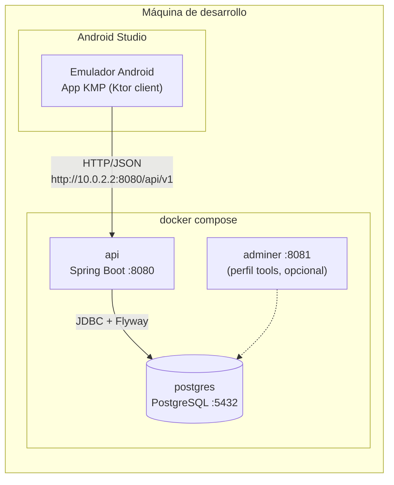
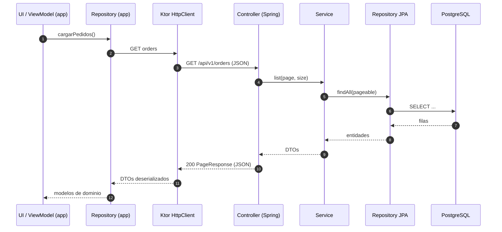
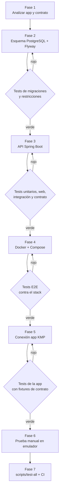
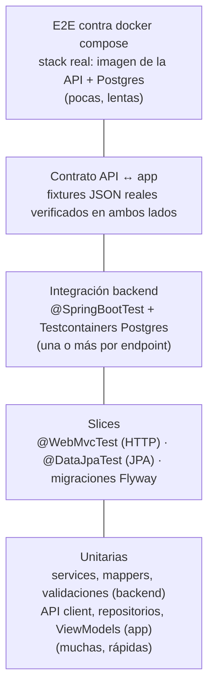
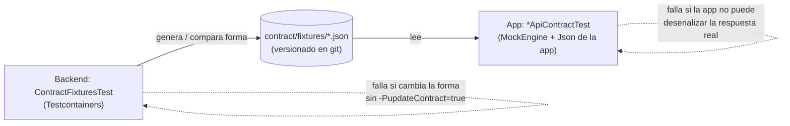
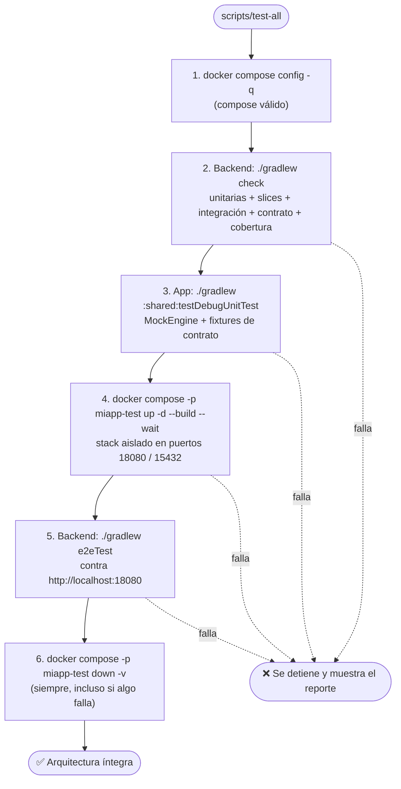

# Guía para opencode: API REST + PostgreSQL en Docker + conexión desde la app KMP, con pruebas automáticas

> **Para el agente (opencode):** este documento es tu plan de trabajo. Síguelo fase por fase, en orden.
> Si están instaladas, carga las skills de `.opencode/skills/` que se indican en cada fase (empieza por `kmp-backend-orchestrator`). Si alguna no existe, sigue igualmente esta guía: es suficiente por sí sola.
> **Regla central:** ninguna fase se da por terminada sin sus pruebas automáticas escritas y en verde.

---

## 0. Objetivo y arquitectura

A partir de la app Kotlin Multiplatform que ya existe en este repositorio, construir:

1. **Una base de datos PostgreSQL** que corre en Docker.
2. **Una API REST en Spring Boot** que corre en Docker.
3. **La conexión de la app KMP a la API** (capa de red con Ktor). La app **no** se mete en Docker: se ejecuta desde Android Studio en el emulador.
4. **Una suite de pruebas automáticas** que cubre todas las capas: base de datos, API, contrato entre API y app, app y el stack completo en Docker. Es el equivalente a `pytest` en Django, pero con JUnit 5 en Spring Boot y `kotlin.test` en KMP.

Todo el backend se levanta con `docker compose up -d --build` y toda la arquitectura se prueba con un solo script: `scripts/test-all`.



`10.0.2.2` es la IP con la que el emulador de Android llega al `localhost` de la máquina anfitriona.

### Flujo de una petición



### Estructura final del repositorio

```
/
├── composeApp/ , shared/ , iosApp/ ...   # app KMP existente (se modifica la capa de datos/red y se añaden tests)
├── backend/                              # NUEVO: proyecto Spring Boot (build de Gradle independiente)
│   ├── Dockerfile
│   ├── build.gradle.kts / settings.gradle.kts / gradlew(.bat)
│   └── src/
│       ├── main/resources/db/migration/  # migraciones Flyway
│       └── test/kotlin/...               # suite de pruebas del backend
├── contract/fixtures/                    # NUEVO: respuestas JSON reales de la API, compartidas por backend y app
├── scripts/test-all.sh / test-all.ps1    # NUEVO: ejecuta TODAS las pruebas de la arquitectura
├── docker-compose.yml                    # NUEVO: postgres + api (+ adminer)
├── .env.example / .env                   # NUEVO (.env en .gitignore)
├── .github/workflows/ci.yml              # NUEVO (opcional): CI que corre scripts/test-all.sh
└── docs/backend/                         # contrato, modelo de datos, progreso, dudas, informes
```

> **Importante:** el backend es un **build de Gradle independiente** (`backend/settings.gradle.kts` propio). **No** lo incluyas en el `settings.gradle.kts` raíz de la app: mezclar el plugin de Android/KMP con Spring Boot en un mismo build da conflictos y vuelve lenta la sincronización de Android Studio.

### Fases y puertas de calidad



---

## Reglas de trabajo

- **El contrato lo define la app.** El backend se adapta a los nombres de campos, tipos y rutas que la app ya usa. Si la app todavía no consume ninguna API, el contrato se diseña a partir de sus modelos (ver Fase 1, caso B).
- **Pruebas junto al código.** Cada endpoint, migración, mapper y repositorio nuevo se entrega con sus pruebas en el mismo paso, no al final.
- **No se desactivan ni se borran pruebas para que el build pase.** Si una prueba falla, se corrige el código; si la prueba está mal, se corrige la prueba y se explica en `PROGRESS.md`.
- **Cambios en la app permitidos solo en:** capa de red, repositorios, inyección de dependencias, `AndroidManifest.xml`, configuración de red, dependencias de Gradle y pruebas. **No** rediseñes pantallas ni cambies la lógica de UI salvo lo mínimo para mostrar carga y error.
- **No inventes versiones** de librerías: usa start.spring.io y la gestión de dependencias de Spring Boot para el backend, y para la app las versiones de `gradle/libs.versions.toml` o la última estable publicada en Maven Central.
- Después de cada fase: compila, ejecuta las pruebas y actualiza `docs/backend/PROGRESS.md` (fase, estado, pruebas añadidas, pendientes).
- Anota las dudas en `docs/backend/OPEN-QUESTIONS.md` en vez de suponer en silencio. Si una duda bloquea el trabajo, pregunta al usuario.
- **Windows:** usa `gradlew.bat` en vez de `./gradlew`, PowerShell para los scripts y `curl.exe` en vez de `curl`. Docker Desktop debe estar corriendo.

### Requisitos en la máquina

- Docker Desktop (con Docker Compose v2: `docker compose version`).
- JDK 21 (para compilar y probar el backend en el anfitrión; Testcontainers usa Docker).
- Android Studio con un emulador creado (API 26 o superior recomendado).

---

## Estrategia de pruebas automáticas

### Equivalencias para quien viene de pytest y Django

| pytest / Django | Spring Boot (backend) | KMP (app) |
|---|---|---|
| `pytest` | JUnit 5 (`./gradlew test`) | `kotlin.test` (`./gradlew :shared:testDebugUnitTest`) |
| `conftest.py` y fixtures | paquete `support/`, `@BeforeEach`, beans de `@TestConfiguration` | funciones *helper* y *fakes* en `commonTest` |
| BD de pruebas creada por Django | Postgres efímero con **Testcontainers** + Flyway | — (no aplica: la app usa `MockEngine`) |
| `@pytest.mark.django_db` + rollback | `@DataJpaTest` (rollback) o `DbCleaner` (truncate antes de cada test) | — |
| Cliente de pruebas de Django / `APIClient` de DRF | `MockMvc` (o el cliente de pruebas REST de tu versión de Boot) | Ktor `MockEngine` |
| `factory_boy` | *builders* / *Object Mother* en `support/fixtures` | *builders* de DTOs en `commonTest` |
| `@pytest.mark.parametrize` | `@ParameterizedTest` + `@CsvSource` / `@MethodSource` | bucles sobre casos, o `@ParameterizedTest` en `androidUnitTest` |
| `mock` / `pytest-mock` | MockK (Kotlin) o Mockito (Java) | *fakes* escritos a mano (preferido) |
| Marcadores (`-m e2e`) | `@Tag("e2e")` + tarea `e2eTest` | — |
| `pytest -k nombre` | `./gradlew test --tests '*OrderApi*'` | `./gradlew :shared:testDebugUnitTest --tests '*Order*'` |
| `pytest-cov` | **JaCoCo** (`jacocoTestCoverageVerification`) | **Kover** (opcional) |
| `assertNumQueries` | Estadísticas de Hibernate para detectar N+1 | — |

### Pirámide de pruebas de la arquitectura



| Capa | Qué protege | Dónde vive | Cuándo corre |
|---|---|---|---|
| Migraciones y BD | Esquema, restricciones (`unique`, `check`, FK), tipos de PG | `backend/src/test/.../db/` | `./gradlew test` |
| Unitarias backend | Lógica de negocio y mappers | `backend/src/test/.../<feature>/` | `./gradlew test` |
| Web slice | Validación, códigos HTTP, formato de error | `backend/src/test/.../<feature>/` | `./gradlew test` |
| Integración API | HTTP → servicio → JPA → Postgres real | `backend/src/test/.../<feature>/` | `./gradlew test` |
| Contrato | Que la app pueda deserializar las respuestas reales | `backend/.../contract/` + `shared/src/androidUnitTest/` | Ambos `test` |
| App | Cliente Ktor, mapeo de errores, repositorios, ViewModels | `shared/src/commonTest/` | `./gradlew :shared:testDebugUnitTest` |
| E2E | Imagen Docker, compose, healthchecks, red, persistencia | `backend/src/test/.../e2e/` (`@Tag("e2e")`) | `./gradlew e2eTest` con el stack levantado |

### Contrato compartido mediante fixtures

Las pruebas de integración del backend llaman a los endpoints reales y guardan las respuestas en `contract/fixtures/*.json`. La app usa **esos mismos archivos** en sus pruebas. Si el backend cambia la forma de una respuesta, falla la prueba de contrato del backend; si la app deja de poder leerla, falla la prueba de la app.



---

## Fase 1 — Analizar la app y definir el contrato de la API

Skill: `kmp-api-contract`

1. Ejecuta el escáner:
   - Linux/macOS: `bash .opencode/skills/kmp-api-contract/scripts/scan-kmp.sh .`
   - Windows: `powershell -NoProfile -ExecutionPolicy Bypass -File .opencode\skills\kmp-api-contract\scripts\scan-kmp.ps1 .`
2. Identifica: los módulos (`composeApp`, `shared`...), los targets (¿solo Android o también iOS?), el paquete base, el sistema de inyección de dependencias (Koin, manual...), si ya existen Ktor, kotlinx.serialization, SQLDelight o Room, y **qué pruebas existen ya** (`commonTest`, `androidUnitTest`, `androidInstrumentedTest`).
3. **Determina en cuál de estos dos casos está la app:**

   **Caso A — La app ya hace llamadas HTTP** (Ktor o Ktorfit):
   - Extrae cada endpoint (método, ruta, parámetros, body, respuesta), los DTOs `@Serializable`, la configuración de `Json {}` y la autenticación.
   - El backend debe cumplir ese contrato exactamente.

   **Caso B — La app usa datos locales o falsos** (listas en memoria, repositorios *fake*, SQLDelight o Room sin servidor):
   - Lista los modelos de dominio (`data class`) y las operaciones que hacen los repositorios y ViewModels (listar, obtener, crear, editar, borrar, buscar, filtrar).
   - Diseña un CRUD REST bajo `/api/v1/<recurso-en-plural>` que cubra exactamente esas operaciones, ni más ni menos.
   - JSON en camelCase, fechas ISO-8601 en UTC e identificadores UUID, salvo que los modelos ya usen otra convención.
   - Si hay datos semilla en la app (listas *mock*), conviértelos en datos de ejemplo para el perfil `dev` del backend.

4. **Entregables:**
   - `docs/backend/api-contract.md` y `docs/backend/openapi.yaml`.
   - `docs/backend/test-plan.md`: por cada endpoint, los casos que se probarán (feliz, validación, 404, 409, autorización, paginación). Esta lista es la que se verifica al final.
5. **Autenticación:** si la app tiene login o pantallas de usuario, aplica la Fase 3b. Si no, no añadas seguridad (deja la API abierta en desarrollo y anótalo en `OPEN-QUESTIONS.md`).

✅ **Listo cuando:** cada operación de datos de la app tiene su endpoint en el contrato y su fila en `test-plan.md`.

---

## Fase 2 — Base de datos PostgreSQL

Skill: `postgres-schema-design`

1. Diseña el esquema a partir del contrato. Documenta el diagrama entidad-relación (`erDiagram` de Mermaid) y el mapeo entre DTOs y tablas en `docs/backend/data-model.md`. Ejemplo de formato:

   ```mermaid
   erDiagram
       CUSTOMERS ||--o{ ORDERS : "realiza"
       ORDERS ||--|{ ORDER_ITEMS : "contiene"
       CUSTOMERS {
           uuid id PK
           varchar email UK
           text full_name
           timestamptz created_at
       }
       ORDERS {
           uuid id PK
           uuid customer_id FK
           varchar status
           timestamptz created_at
       }
       ORDER_ITEMS {
           uuid id PK
           uuid order_id FK
           int quantity
           numeric unit_price
       }
   ```

2. Escribe las migraciones Flyway en `backend/src/main/resources/db/migration/` (`V1__init_schema.sql`, `V2__...`).
3. Convenciones: tablas en plural y snake_case; `uuid` con `gen_random_uuid()`; `timestamptz`; `numeric(19,4)` para dinero; enums como `varchar` con `check`; un índice en cada clave foránea; restricciones con nombre (`uk_`, `fk_`, `ck_`).
4. Los datos de ejemplo van en `backend/src/main/resources/db/dev-data/` (por ejemplo `V1000__seed.sql`) y solo se cargan con el perfil `dev`:
   ```yaml
   # application-dev.yml
   spring.flyway.locations: classpath:db/migration,classpath:db/dev-data
   ```
   El perfil `test` **no** carga datos semilla: cada prueba crea los suyos.
5. **Nunca** uses `spring.jpa.hibernate.ddl-auto: update/create`. El esquema lo manda Flyway; Hibernate solo valida (`validate`).

### 🧪 Pruebas de esta fase (se escriben en la Fase 3, cuando exista el proyecto)

- `db/MigrationsTest`: todas las migraciones se aplican sobre un Postgres limpio y no quedan pendientes.
- `db/SchemaTest`: las tablas y columnas esperadas existen con su tipo (consultando `information_schema`).
- `db/ConstraintsTest`: cada `unique`, `check`, `not null` y FK rechaza los datos inválidos (se espera `DataIntegrityViolationException`).
- Arrancar el contexto con `ddl-auto: validate` ya prueba que las entidades JPA coinciden con el esquema.

✅ **Listo cuando:** el esquema está documentado y las pruebas de BD están en verde (se verifican en la Fase 3).

---

## Fase 3 — API REST con Spring Boot

Skills: `springboot-project-setup`, `springboot-jpa-postgres`, `springboot-rest-api`, `springboot-testing`

### 3.1 Generar el proyecto

```bash
curl -fsSL https://start.spring.io/starter.zip \
  -d type=gradle-project-kotlin -d language=kotlin -d javaVersion=21 \
  -d groupId=<grupo> -d artifactId=api -d name=api -d packageName=<paquete>.api \
  -d dependencies=web,validation,data-jpa,postgresql,flyway,actuator,testcontainers \
  -o backend.zip && unzip -q backend.zip -d backend && rm backend.zip
```

- Deriva `<grupo>` y `<paquete>` del `applicationId` o el namespace de la app (por ejemplo `com.miempresa.miapp` → paquete `com.miempresa.miapp.api`).
- Agrega `security,oauth2-resource-server` solo si aplica la Fase 3b.
- Agrega springdoc (`org.springdoc:springdoc-openapi-starter-webmvc-ui`) en la versión compatible con la versión de Spring Boot generada.
- Dependencias de prueba adicionales (sin versión; las gestiona Spring Boot): `io.rest-assured:rest-assured` (para E2E) y, en Kotlin, `com.ninja-squad:springmockk` o `io.mockk:mockk` (verifica la versión en Maven Central).
- En Windows: `curl.exe ... -o backend.zip`, luego `mkdir backend` y `tar -xf backend.zip -C backend`.

### 3.2 Configuración

`backend/src/main/resources/application.yml`:

```yaml
spring:
  application.name: api
  datasource:
    url: ${DB_URL:jdbc:postgresql://localhost:5432/app}
    username: ${DB_USER:app}
    password: ${DB_PASSWORD:app}
  jpa:
    open-in-view: false
    hibernate.ddl-auto: validate
    properties.hibernate.jdbc.time_zone: UTC
  jackson:
    serialization.write-dates-as-timestamps: false
  mvc.problemdetails.enabled: true
server:
  port: 8080
  error.include-stacktrace: never
management:
  endpoints.web.exposure.include: health,info
  endpoint.health.probes.enabled: true
```

`backend/src/test/resources/application-test.yml`:

```yaml
spring:
  flyway.locations: classpath:db/migration   # sin datos semilla
  jpa.properties.hibernate.generate_statistics: true
logging.level.org.hibernate.SQL: warn
```

### 3.3 Implementación

- Organiza el código por funcionalidad: `<feature>/{Controller, Service, Repository, Entity, dto/, Mapper}`, más `common/error` y `config/`.
- Las entidades JPA nunca se exponen en la API: siempre se convierten a DTOs.
- Los DTOs de respuesta deben coincidir campo por campo con lo que la app deserializa (nombres, nulabilidad, enums, formato de fechas).
- Errores con `ProblemDetail` (RFC 9457) desde un `@RestControllerAdvice`: 400 validación, 404 no encontrado, 409 conflicto y 500 genérico sin detalles internos.
- Paginación con un `PageResponse<T>` propio, sin exponer el `Page<T>` de Spring.
- Swagger UI en `/swagger-ui.html`.

### 3.4 Suite de pruebas del backend

#### Estructura

```
backend/src/test/kotlin/<paquete>/api/
├── support/
│   ├── TestcontainersConfiguration.kt   # Postgres efímero con @ServiceConnection
│   ├── IntegrationTest.kt               # anotación compuesta (como un "marker" de pytest)
│   ├── IntegrationTestBase.kt           # MockMvc + limpieza de BD antes de cada test
│   ├── DbCleaner.kt                     # TRUNCATE de todas las tablas (salvo flyway_schema_history)
│   ├── ContractSnapshot.kt              # genera y compara contract/fixtures/*.json
│   └── fixtures/                        # builders de datos (estilo factory_boy)
├── db/            MigrationsTest, SchemaTest, ConstraintsTest
├── <feature>/     <X>ServiceTest (unit), <X>ControllerTest (@WebMvcTest),
│                  <X>RepositoryTest (@DataJpaTest), <X>ApiIT (integración)
├── contract/      ContractFixturesTest, OpenApiContractTest
└── e2e/           StackE2ETest (@Tag("e2e"))
```

> Los nombres de paquetes de algunas anotaciones de prueba cambian entre Spring Boot 3.x y 4.x, y los de Testcontainers entre 1.x y 2.x. Usa los *imports* que correspondan a las versiones generadas por Initializr (la clase `TestcontainersConfiguration` que genera Initializr es la referencia).

#### Configuración de Gradle (`backend/build.gradle.kts`)

```kotlin
plugins {
    // ...plugins generados por Initializr...
    jacoco
}

val contractDir = file("../contract/fixtures").absolutePath
val updateContract = (findProperty("updateContract") ?: "false").toString()

tasks.test {
    useJUnitPlatform { excludeTags("e2e") }
    systemProperty("contract.fixtures.dir", contractDir)
    systemProperty("contract.update", updateContract)
    finalizedBy(tasks.jacocoTestReport)
}

val e2eTest by tasks.registering(Test::class) {
    description = "Pruebas E2E contra el stack levantado con docker compose"
    group = "verification"
    testClassesDirs = sourceSets.test.get().output.classesDirs
    classpath = sourceSets.test.get().runtimeClasspath
    useJUnitPlatform { includeTags("e2e") }
    systemProperty("e2e.baseUrl", System.getenv("E2E_BASE_URL") ?: "http://localhost:8080")
    outputs.upToDateWhen { false }
}

tasks.jacocoTestReport {
    reports { xml.required = true; html.required = true }
}

tasks.jacocoTestCoverageVerification {
    dependsOn(tasks.test)
    classDirectories.setFrom(
        sourceSets.main.get().output.asFileTree.matching {
            exclude("**/config/**", "**/*Application*", "**/dto/**")
        }
    )
    violationRules { rule { limit { counter = "LINE"; minimum = "0.80".toBigDecimal() } } }
}

tasks.check { dependsOn(tasks.jacocoTestCoverageVerification) }
```

#### Soporte (equivalente a `conftest.py`)

```kotlin
@Target(AnnotationTarget.CLASS)
@Retention(AnnotationRetention.RUNTIME)
@SpringBootTest(webEnvironment = SpringBootTest.WebEnvironment.RANDOM_PORT)
@AutoConfigureMockMvc
@Import(TestcontainersConfiguration::class)
@ActiveProfiles("test")
annotation class IntegrationTest

@IntegrationTest
abstract class IntegrationTestBase {
    @Autowired lateinit var mockMvc: MockMvc
    @Autowired lateinit var dbCleaner: DbCleaner

    @BeforeEach
    fun cleanDatabase() = dbCleaner.clean()   // como la BD limpia de pytest-django en cada test
}

@TestComponent
class DbCleaner(private val jdbc: JdbcTemplate) {
    fun clean() {
        val tables = jdbc.queryForList(
            "select tablename from pg_tables where schemaname = 'public' and tablename <> 'flyway_schema_history'",
            String::class.java,
        )
        if (tables.isNotEmpty()) {
            jdbc.execute("truncate table ${tables.joinToString { "\"$it\"" }} restart identity cascade")
        }
    }
}
```

`DbCleaner` debe registrarse en el contexto de prueba (por ejemplo, con `@Import(DbCleaner::class)` en la anotación `IntegrationTest`). El contenedor de Postgres se reutiliza entre clases gracias a la caché de contextos de Spring: no levantes un contenedor por cada prueba.

#### Ejemplos

Migraciones:

```kotlin
class MigrationsTest : IntegrationTestBase() {
    @Autowired lateinit var flyway: Flyway

    @Test
    fun `todas las migraciones se aplican y no queda ninguna pendiente`() {
        val info = flyway.info()
        assertThat(info.applied()).isNotEmpty
        assertThat(info.pending()).isEmpty()
    }
}
```

Integración de un endpoint, con casos parametrizados (como `@pytest.mark.parametrize`):

```kotlin
class OrderApiIT : IntegrationTestBase() {
    @Autowired lateinit var data: TestDataFactory   // builders en support/fixtures

    @Test
    fun `GET por id devuelve 200 con la forma del contrato`() {
        val order = data.order()
        mockMvc.get("/api/v1/orders/${order.id}").andExpect {
            status { isOk() }
            jsonPath("$.id") { value(order.id.toString()) }
            jsonPath("$.status") { value("PENDING") }
            jsonPath("$.createdAt") { isString() }
        }
    }

    @Test
    fun `GET de un id inexistente devuelve 404 en formato ProblemDetail`() {
        mockMvc.get("/api/v1/orders/${UUID.randomUUID()}").andExpect {
            status { isNotFound() }
            jsonPath("$.status") { value(404) }
        }
    }

    @ParameterizedTest(name = "body inválido: {0}")
    @MethodSource("bodiesInvalidos")
    fun `POST con body inválido devuelve 400`(descripcion: String, body: String) {
        mockMvc.post("/api/v1/orders") {
            contentType = MediaType.APPLICATION_JSON
            content = body
        }.andExpect { status { isBadRequest() } }
    }

    companion object {
        @JvmStatic
        fun bodiesInvalidos() = listOf(
            Arguments.of("sin items", """{"customerId":"${UUID.randomUUID()}","items":[]}"""),
            Arguments.of("customerId vacío", """{"customerId":"","items":[{"sku":"A","quantity":1}]}"""),
            Arguments.of("JSON mal formado", """{"customerId":"""),
        )
    }
}
```

Contrato (comparación de la **forma** del JSON: claves y tipos, no valores):

```kotlin
object ContractSnapshot {
    private val mapper = jacksonObjectMapper()
    private val dir = File(System.getProperty("contract.fixtures.dir"))
    private val update = System.getProperty("contract.update") == "true"

    fun assertMatches(name: String, actualJson: String) {
        val file = dir.resolve("$name.json")
        val actual = mapper.readTree(actualJson)
        if (update || !file.exists()) {
            dir.mkdirs()
            mapper.writerWithDefaultPrettyPrinter().writeValue(file, actual)
            return
        }
        assertEquals(
            shape(mapper.readTree(file)), shape(actual),
            "El contrato '$name' cambió. Si es intencional: ./gradlew test -PupdateContract=true y adapta la app.",
        )
    }

    private fun shape(n: JsonNode): Any = when {
        n.isObject -> n.fields().asSequence().associate { it.key to shape(it.value) }.toSortedMap()
        n.isArray -> if (n.isEmpty) "array" else listOf(shape(n[0]))
        n.isNull -> "null"
        n.isNumber -> "number"
        n.isBoolean -> "boolean"
        else -> "string"
    }
}

class ContractFixturesTest : IntegrationTestBase() {
    @Autowired lateinit var data: TestDataFactory

    @Test
    fun `GET orders por id`() {
        val order = data.order(withAllOptionalFields = true)   // datos deterministas, todos los campos llenos
        val body = mockMvc.get("/api/v1/orders/${order.id}").andReturn().response.contentAsString
        ContractSnapshot.assertMatches("get-order", body)
    }
    // ...un test por cada respuesta del contrato (listados, detalle, creación, errores)
}
```

> Con Spring Boot 4 (Jackson 3) los *imports* son `tools.jackson.*` y `fields()` pasa a ser `properties()`.

`OpenApiContractTest`: obtiene `/v3/api-docs` y verifica que cada ruta y método de `docs/backend/openapi.yaml` existe en la API real.

E2E contra el stack de Docker (sin contexto de Spring; usa la imagen y el compose reales):

```kotlin
@Tag("e2e")
class StackE2ETest {
    private val base = System.getProperty("e2e.baseUrl", "http://localhost:8080")

    @Test
    fun `la API está UP`() {
        given().baseUri(base).get("/actuator/health")
            .then().statusCode(200).body("status", equalTo("UP"))
    }

    @Test
    fun `CRUD completo persiste en Postgres`() {
        val id = given().baseUri(base).contentType(ContentType.JSON).body(nuevoPedidoJson())
            .post("/api/v1/orders").then().statusCode(201).extract().path<String>("id")
        given().baseUri(base).get("/api/v1/orders/$id").then().statusCode(200)
        given().baseUri(base).delete("/api/v1/orders/$id").then().statusCode(204)
        given().baseUri(base).get("/api/v1/orders/$id").then().statusCode(404)
    }
}
```

#### Casos mínimos por endpoint

Cada fila de `docs/backend/test-plan.md` debe quedar cubierta:

- [ ] Caso feliz: código de estado y forma del JSON.
- [ ] Validación: body inválido → 400 con `ProblemDetail`.
- [ ] Recurso inexistente → 404.
- [ ] Conflicto (`unique` u *optimistic locking*) → 409.
- [ ] Paginación: `page`, `size`, límite máximo y orden (en listados).
- [ ] Autorización: sin token → 401, recurso ajeno → 403 o 404 (si hay Fase 3b).
- [ ] Sin N+1: los listados ejecutan un número acotado de consultas (con las estadísticas de Hibernate).
- [ ] Fixture de contrato generado para cada respuesta.

### 3b — Autenticación (solo si la app tiene login)

Skill: `springboot-security-jwt`. Tokens de acceso JWT de vida corta y tokens de renovación opacos con rotación. Responde 401 con `WWW-Authenticate: Bearer` para que el plugin `Auth { bearer { } }` de Ktor renueve el token automáticamente. El secreto se lee de la variable `JWT_SECRET`.

Pruebas obligatorias: login correcto y fallido, petición sin token (401 + `WWW-Authenticate`), token expirado (401), renovación con rotación, token de renovación revocado (401) y rol insuficiente (403).

✅ **Listo cuando:** `cd backend && ./gradlew check` pasa (pruebas + cobertura ≥ 80 %) y existen los fixtures en `contract/fixtures/`.

---

## Fase 4 — Docker y Docker Compose

Skill: `backend-docker-compose`

### 4.1 `backend/Dockerfile`

```dockerfile
FROM eclipse-temurin:21-jdk AS build
WORKDIR /src
COPY gradlew settings.gradle.kts build.gradle.kts ./
COPY gradle gradle
RUN chmod +x gradlew && ./gradlew --no-daemon dependencies > /dev/null || true
COPY src src
RUN ./gradlew --no-daemon bootJar -x test

FROM eclipse-temurin:21-jre
WORKDIR /app
RUN apt-get update && apt-get install -y --no-install-recommends curl \
    && rm -rf /var/lib/apt/lists/* && useradd -r -u 1001 spring
COPY --from=build /src/build/libs/*.jar app.jar
USER spring
EXPOSE 8080
ENTRYPOINT ["java", "-XX:MaxRAMPercentage=75", "-jar", "/app/app.jar"]
```

- Excluye del contexto de build lo que no hace falta con `backend/.dockerignore`: `build/`, `.gradle/`, `.idea/`, `*.iml`, `.env`.
- Las pruebas no se corren dentro del build de Docker (necesitan Docker por Testcontainers); se corren en el anfitrión y en el script `test-all`.
- **Windows:** si `gradlew` tiene finales de línea CRLF, el build falla con `/bin/sh^M`. Crea `.gitattributes` con `gradlew text eol=lf` y `*.sh text eol=lf`, y convierte esos archivos a LF.

### 4.2 `docker-compose.yml` (en la raíz)

Los puertos del anfitrión son configurables para que el script de pruebas levante un stack aislado sin chocar con el de desarrollo.

```yaml
name: miapp   # usa el nombre del proyecto

services:
  postgres:
    image: postgres:17-alpine
    restart: unless-stopped
    environment:
      POSTGRES_DB: ${DB_NAME:-app}
      POSTGRES_USER: ${DB_USER:-app}
      POSTGRES_PASSWORD: ${DB_PASSWORD:-app}
    ports:
      - "${DB_PORT:-5432}:5432"     # para inspeccionar con DBeaver o DataGrip desde el anfitrión
    volumes:
      - pgdata:/var/lib/postgresql/data
    healthcheck:
      test: ["CMD-SHELL", "pg_isready -U ${DB_USER:-app} -d ${DB_NAME:-app}"]
      interval: 5s
      timeout: 3s
      retries: 20

  api:
    build: ./backend
    restart: unless-stopped
    depends_on:
      postgres:
        condition: service_healthy
    environment:
      DB_URL: jdbc:postgresql://postgres:5432/${DB_NAME:-app}
      DB_USER: ${DB_USER:-app}
      DB_PASSWORD: ${DB_PASSWORD:-app}
      SPRING_PROFILES_ACTIVE: ${SPRING_PROFILES_ACTIVE:-dev}
      # JWT_SECRET: ${JWT_SECRET:?Define JWT_SECRET en .env}   # descomentar solo si hay autenticación
    ports:
      - "${API_PORT:-8080}:8080"
    healthcheck:
      test: ["CMD", "curl", "-fsS", "http://localhost:8080/actuator/health"]
      interval: 10s
      timeout: 3s
      start_period: 40s
      retries: 10

  adminer:                    # visor web de la BD: docker compose --profile tools up -d
    image: adminer
    profiles: ["tools"]
    depends_on: [postgres]
    ports:
      - "${ADMINER_PORT:-8081}:8080"

volumes:
  pgdata:
```

### 4.3 Variables

- `.env.example` (sí se sube al repositorio): `DB_NAME=app`, `DB_USER=app`, `DB_PASSWORD=app`, `SPRING_PROFILES_ACTIVE=dev` (y `JWT_SECRET=cambia-esto-por-32+-caracteres` si hay autenticación).
- Copia `.env.example` a `.env` y añade `.env` al `.gitignore`.

### 4.4 Levantar y comprobar

```bash
docker compose up -d --build --wait               # espera a que todo esté "healthy"
curl -fsS http://localhost:8080/actuator/health   # {"status":"UP"}
# Swagger: http://localhost:8080/swagger-ui.html
```

### 🧪 Pruebas de esta fase

- `docker compose config -q` valida la sintaxis del compose (está incluido en `test-all`).
- `./gradlew e2eTest` (en `backend/`) con el stack levantado: salud, CRUD completo, formato de error y, si aplica, el flujo de login.
- Opcional, persistencia: `docker compose restart api` y comprobar que un registro creado antes del reinicio sigue existiendo.

✅ **Listo cuando:** `docker compose up -d --build --wait` termina sin errores y `./gradlew e2eTest` está en verde.

---

## Fase 5 — Conexión de la app KMP con la API

Skill: `kmp-client-sync`

### 5.1 Dependencias (si no existen)

En `gradle/libs.versions.toml` y en el módulo compartido (`shared` o `composeApp`):

- `commonMain`: `ktor-client-core`, `ktor-client-content-negotiation`, `ktor-serialization-kotlinx-json`, `ktor-client-logging`, `kotlinx-serialization-json` (y `kotlinx-datetime` si hay fechas).
- `androidMain`: `ktor-client-okhttp`.
- `iosMain` (si hay target iOS): `ktor-client-darwin`.
- `commonTest`: `kotlin-test`, `ktor-client-mock`, `kotlinx-coroutines-test` (y `app.cash.turbine:turbine` si hay `Flow`).
- Plugin `org.jetbrains.kotlin.plugin.serialization` en el módulo.

Si la app ya usa Ktor, reutiliza su versión y su configuración; no dupliques el cliente.

### 5.2 Base URL por plataforma

`commonMain`:
```kotlin
expect val apiBaseUrl: String
```

`androidMain`:
```kotlin
// Emulador → 10.0.2.2. Dispositivo físico por USB → usar `adb reverse tcp:8080 tcp:8080` y "http://localhost:8080"
actual val apiBaseUrl: String = "http://10.0.2.2:8080/api/v1/"
```

`iosMain`:
```kotlin
actual val apiBaseUrl: String = "http://localhost:8080/api/v1/"
```

Si el proyecto ya usa BuildKonfig o `BuildConfig` con *flavors*, define ahí la URL en lugar de `expect/actual`.

### 5.3 Cliente HTTP (`commonMain`), preparado para pruebas

El motor (*engine*) es inyectable para poder usar `MockEngine` en las pruebas.

```kotlin
val appJson = Json {
    ignoreUnknownKeys = true
    explicitNulls = false
}

fun createHttpClient(engine: HttpClientEngine? = null, baseUrl: String = apiBaseUrl): HttpClient {
    val config: HttpClientConfig<*>.() -> Unit = {
        expectSuccess = true
        install(ContentNegotiation) { json(appJson) }
        install(HttpTimeout) {
            requestTimeoutMillis = 15_000
            connectTimeoutMillis = 10_000
        }
        install(Logging) { level = LogLevel.INFO }
        defaultRequest {
            url(baseUrl)
            contentType(ContentType.Application.Json)
        }
    }
    return if (engine != null) HttpClient(engine, config) else HttpClient(config)
}
```

- Las rutas de las peticiones van **sin `/` inicial** (`client.get("orders")`) para que se sumen a la base `.../api/v1/`.
- Si hay autenticación, añade `install(Auth) { bearer { loadTokens { ... }; refreshTokens { ... } } }` y guarda los tokens de forma segura (DataStore o EncryptedSharedPreferences en Android, Keychain en iOS).

### 5.4 Capa de datos

- `data/remote/dto/`: DTOs `@Serializable` idénticos al contrato.
- `data/remote/<Recurso>Api.kt`: funciones `suspend` (`getAll`, `getById`, `create`, `update`, `delete`) que reciben el `HttpClient` por constructor.
- Mappers entre DTOs y modelos de dominio. La UI sigue usando los modelos de dominio.
- **Caso B (la app tenía repositorios *fake* o locales):** conserva la **interfaz** del repositorio y crea una implementación remota (`<Recurso>RepositoryImpl`) que use la API. Cámbiala en la inyección de dependencias. No borres la implementación *fake*: sirve para previews y pruebas de ViewModels.
- Si la app usa SQLDelight o Room, puedes mantenerlo como caché local (red primero, con respaldo local), pero solo si ya existe. No lo introduzcas como parte de esta tarea.
- Errores: convierte las excepciones de red (`ClientRequestException`, `ServerResponseException`, `IOException`, timeout) en un resultado propio (`Result` o una `sealed class` de errores) y muestra estado de carga y de error en los ViewModels existentes.

### 5.5 Configuración de Android para HTTP local

- `AndroidManifest.xml`: `<uses-permission android:name="android.permission.INTERNET" />`.
- Permitir HTTP sin cifrar **solo hacia los hosts de desarrollo**. Crea `res/xml/network_security_config.xml`:
  ```xml
  <network-security-config>
      <domain-config cleartextTrafficPermitted="true">
          <domain includeSubdomains="false">10.0.2.2</domain>
          <domain includeSubdomains="false">localhost</domain>
      </domain-config>
  </network-security-config>
  ```
  y refiérelo en `<application android:networkSecurityConfig="@xml/network_security_config" ...>`. Lo ideal es ponerlo solo en el *source set* de debug para que no llegue a producción.
- iOS (si aplica): excepción de ATS (`NSAllowsLocalNetworking = true`) en `Info.plist`.

### 5.6 🧪 Suite de pruebas de la app

```
shared/src/
├── commonTest/kotlin/.../
│   ├── support/        TestHttpClient.kt (MockEngine), builders de DTOs, FakeRepositories
│   ├── data/remote/    <Recurso>ApiTest           # método, ruta, query, body y parseo
│   ├── data/           <Recurso>RepositoryImplTest # mapeo DTO→dominio y mapeo de errores
│   └── ui/             <Pantalla>ViewModelTest     # estados de carga, éxito y error
└── androidUnitTest/kotlin/.../
    └── contract/       <Recurso>ApiContractTest    # parsea contract/fixtures/*.json reales
```

Para que las pruebas encuentren los fixtures, en el `build.gradle.kts` del módulo:

```kotlin
tasks.withType<Test>().configureEach {
    systemProperty("contract.fixtures.dir", rootProject.file("contract/fixtures").absolutePath)
}
```

Prueba del cliente con `MockEngine` (verifica la petición y la respuesta):

```kotlin
class OrderApiTest {
    @Test
    fun getById_hace_GET_a_la_ruta_correcta_y_parsea_la_respuesta() = runTest {
        val engine = MockEngine { request ->
            assertEquals(HttpMethod.Get, request.method)
            assertEquals("/api/v1/orders/123", request.url.encodedPath)
            respond(
                content = """{"id":"123","status":"PENDING","createdAt":"2026-01-01T10:00:00Z"}""",
                status = HttpStatusCode.OK,
                headers = headersOf(HttpHeaders.ContentType, "application/json"),
            )
        }
        val api = OrderApi(createHttpClient(engine, baseUrl = "http://test/api/v1/"))

        val dto = api.getById("123")

        assertEquals("PENDING", dto.status)
    }

    @Test
    fun un_404_se_convierte_en_error_NotFound() = runTest {
        val engine = MockEngine { respondError(HttpStatusCode.NotFound) }
        val repo = OrderRepositoryImpl(OrderApi(createHttpClient(engine, baseUrl = "http://test/api/v1/")))

        val result = repo.getOrder("x")

        assertTrue(result.isFailure)
        // assertIs<DataError.NotFound>(result.exceptionOrNull())
    }
}
```

Prueba de contrato con las respuestas reales del backend:

```kotlin
class OrderApiContractTest {
    private val fixtures = File(System.getProperty("contract.fixtures.dir"))

    private fun clientRespondiendo(fixture: String) = createHttpClient(
        MockEngine {
            respond(
                fixtures.resolve("$fixture.json").readText(),
                HttpStatusCode.OK,
                headersOf(HttpHeaders.ContentType, "application/json"),
            )
        },
        baseUrl = "http://test/api/v1/",
    )

    @Test
    fun la_app_deserializa_la_respuesta_real_de_get_order() = runTest {
        val dto = OrderApi(clientRespondiendo("get-order")).getById("cualquiera")
        assertTrue(dto.id.isNotBlank())
    }
}
```

> Para que la prueba sea estricta con los campos sobrantes, puedes crear en el test un `Json` igual al de la app pero con `ignoreUnknownKeys = false` y usarlo para deserializar el fixture directamente. Así detectas campos que el backend envía y la app desconoce.

Pruebas de ViewModel: usa el repositorio *fake*, `Dispatchers.setMain(StandardTestDispatcher())` en `@BeforeTest` y `Dispatchers.resetMain()` en `@AfterTest`. Verifica la secuencia de estados: carga → éxito, y carga → error.

Opcional: pruebas instrumentadas (`androidInstrumentedTest`, Compose UI Test) contra el stack real con el emulador abierto (`./gradlew :composeApp:connectedDebugAndroidTest`). Son lentas; no forman parte de `test-all` por defecto.

### 5.7 Informe de compatibilidad

Genera `docs/backend/compat-report.md` comparando los DTOs de la app con `http://localhost:8080/v3/api-docs` (rutas, campos, nulabilidad, enums, fechas, códigos de estado). Corrige todas las filas marcadas con ❌, preferentemente en el backend.

✅ **Listo cuando:** la app compila, `./gradlew :shared:testDebugUnitTest` está en verde (incluidas las pruebas de contrato) y el informe no tiene incompatibilidades.

---

## Fase 6 — Prueba manual de punta a punta

1. `docker compose up -d --build --wait` → todo en `healthy`.
2. En Android Studio: *Sync Gradle* → ejecutar la app en el emulador.
3. Recorre cada flujo: listar, ver detalle, crear, editar, borrar (y login si existe).
4. Mientras tanto, mira los logs con `docker compose logs -f api`: no debe haber 4xx o 5xx inesperados.
5. Confirma en la base de datos que los cambios se guardaron, con Adminer (`docker compose --profile tools up -d` → http://localhost:8081, servidor `postgres`, usuario y contraseña de `.env`) o con `docker compose exec postgres psql -U app -d app`.
6. Si encuentras un fallo, **primero escribe una prueba que lo reproduzca**, luego corrígelo.

---

## Fase 7 — Un solo comando para probar toda la arquitectura



El stack de pruebas usa otro nombre de proyecto (`-p miapp-test`), otros puertos y su propio volumen. No toca los datos del stack de desarrollo y se destruye al terminar.

### `scripts/test-all.sh` (Linux, macOS, Git Bash, CI)

```bash
#!/usr/bin/env bash
set -euo pipefail
ROOT="$(cd "$(dirname "$0")/.." && pwd)"
cd "$ROOT"

APP_MODULE="${APP_MODULE:-shared}"      # módulo KMP con la capa de datos
PROJECT="${PROJECT:-miapp-test}"
export API_PORT=18080 DB_PORT=15432 ADMINER_PORT=18081
DC=(docker compose -p "$PROJECT")

cleanup() { "${DC[@]}" down -v --remove-orphans >/dev/null 2>&1 || true; }
trap cleanup EXIT

echo "▶ 1/5 Validando docker-compose.yml";   "${DC[@]}" config -q
echo "▶ 2/5 Backend: pruebas + contrato + cobertura"; (cd backend && ./gradlew --no-daemon check)
echo "▶ 3/5 App KMP: pruebas";                ./gradlew --no-daemon ":${APP_MODULE}:testDebugUnitTest"
echo "▶ 4/5 Levantando stack aislado";        "${DC[@]}" up -d --build --wait
echo "▶ 5/5 Pruebas E2E";                     (cd backend && E2E_BASE_URL="http://localhost:${API_PORT}" ./gradlew --no-daemon e2eTest)
echo "✅ Toda la arquitectura pasó las pruebas"
```

### `scripts/test-all.ps1` (Windows)

```powershell
$ErrorActionPreference = 'Stop'
$root = Split-Path -Parent $PSScriptRoot
Set-Location $root

$appModule = if ($env:APP_MODULE) { $env:APP_MODULE } else { 'shared' }
$project   = if ($env:PROJECT)    { $env:PROJECT }    else { 'miapp-test' }
$env:API_PORT = '18080'; $env:DB_PORT = '15432'; $env:ADMINER_PORT = '18081'

function Invoke-Step([string]$title, [scriptblock]$action) {
    Write-Host "`n▶ $title" -ForegroundColor Cyan
    & $action
    if ($LASTEXITCODE -ne 0) { throw "Falló: $title (código $LASTEXITCODE)" }
}

try {
    Invoke-Step '1/5 Validando docker-compose.yml' { docker compose -p $project config -q }
    Invoke-Step '2/5 Backend: pruebas + contrato + cobertura' {
        Push-Location backend; try { .\gradlew.bat --no-daemon check } finally { Pop-Location }
    }
    Invoke-Step '3/5 App KMP: pruebas' { .\gradlew.bat --no-daemon ":${appModule}:testDebugUnitTest" }
    Invoke-Step '4/5 Levantando stack aislado' { docker compose -p $project up -d --build --wait }
    Invoke-Step '5/5 Pruebas E2E' {
        $env:E2E_BASE_URL = "http://localhost:$($env:API_PORT)"
        Push-Location backend; try { .\gradlew.bat --no-daemon e2eTest } finally { Pop-Location }
    }
    Write-Host "`n✅ Toda la arquitectura pasó las pruebas" -ForegroundColor Green
}
finally {
    docker compose -p $project down -v --remove-orphans | Out-Null
}
```

Ejecución en Windows desde cmd: `powershell -NoProfile -ExecutionPolicy Bypass -File scripts\test-all.ps1`

### CI opcional: `.github/workflows/ci.yml`

```yaml
name: ci
on: [push, pull_request]

jobs:
  architecture-tests:
    runs-on: ubuntu-latest          # trae Docker y Android SDK
    steps:
      - uses: actions/checkout@v5   # verifica la versión mayor vigente de cada action
      - uses: actions/setup-java@v5
        with:
          distribution: temurin
          java-version: '21'
      - name: Preparar
        run: |
          chmod +x gradlew backend/gradlew scripts/test-all.sh
          cp .env.example .env
      - name: Pruebas de toda la arquitectura
        run: scripts/test-all.sh
      - name: Reportes
        if: always()
        uses: actions/upload-artifact@v4
        with:
          name: test-reports
          path: |
            backend/build/reports/
            */build/reports/
```

✅ **Listo cuando:** `scripts/test-all` termina con ✅ en limpio (sin contenedores previos).

---

## Comandos de referencia

| Acción | Comando |
|---|---|
| Levantar todo | `docker compose up -d --build --wait` |
| Ver estado | `docker compose ps` |
| Logs de la API | `docker compose logs -f api` |
| Reconstruir solo la API | `docker compose up -d --build api` |
| Parar / parar **y borrar datos** | `docker compose down` / `docker compose down -v` |
| Consola SQL | `docker compose exec postgres psql -U app -d app` |
| Visor web de la BD | `docker compose --profile tools up -d` → http://localhost:8081 |
| **Todas las pruebas** | `scripts/test-all.sh` · Windows: `powershell -ExecutionPolicy Bypass -File scripts\test-all.ps1` |
| Pruebas del backend | `cd backend && ./gradlew test` |
| Backend + cobertura | `cd backend && ./gradlew check` → `build/reports/jacoco/test/html/index.html` |
| Una clase o prueba (como `pytest -k`) | `./gradlew test --tests '*OrderApiIT*'` |
| Actualizar fixtures de contrato | `cd backend && ./gradlew test -PupdateContract=true` (y adaptar la app) |
| E2E contra el stack de desarrollo | `cd backend && ./gradlew e2eTest` |
| Pruebas de la app | `./gradlew :shared:testDebugUnitTest` |
| API fuera de Docker (depurar en el IDE) | `docker compose up -d postgres` y luego `cd backend && ./gradlew bootRun` |
| Dispositivo físico por USB | `adb reverse tcp:8080 tcp:8080` y base URL `http://localhost:8080/api/v1/` |

## Solución de problemas

| Síntoma | Causa probable / solución |
|---|---|
| La app: `CLEARTEXT communication not permitted` | Falta `network_security_config` o no está referenciado en el manifiesto |
| La app: `Failed to connect to /10.0.2.2:8080` | La API no está levantada (`docker compose ps`), el puerto 8080 está ocupado o el firewall de Windows bloquea Docker |
| La app: `SerializationException: Field 'x' is required` | La API no envía un campo que es no nulo en el DTO de la app → corregir el backend y su fixture de contrato |
| La API no arranca: `Schema-validation: missing column` | Las entidades JPA no coinciden con las migraciones de Flyway |
| `FlywayValidateException: checksum mismatch` | Se editó una migración ya aplicada → crear una nueva; en desarrollo: `docker compose down -v` |
| Testcontainers: `Could not find a valid Docker environment` | Docker Desktop no está corriendo |
| Las pruebas pasan solas pero fallan juntas | Datos compartidos entre pruebas → revisar que `DbCleaner` corra en `@BeforeEach` y que cada prueba cree sus datos |
| `El contrato 'x' cambió` | El backend cambió la forma de una respuesta: si es intencional, `-PupdateContract=true` y adaptar la app; si no, corregir el backend |
| Cobertura por debajo del 80 % | Faltan pruebas de servicios o controladores; ver el reporte de JaCoCo |
| El build de Docker falla con `/bin/sh^M` | `gradlew` con CRLF → convertir a LF y añadir `.gitattributes` |
| `port is already allocated` | Otro servicio usa el puerto → cambia `API_PORT` / `DB_PORT` en `.env` |

---

## Criterio final de terminado

- [ ] `docker compose up -d --build --wait` deja `postgres` y `api` en estado `healthy`.
- [ ] Swagger UI muestra todos los endpoints de `docs/backend/api-contract.md`.
- [ ] Cada fila de `docs/backend/test-plan.md` tiene sus pruebas y están en verde.
- [ ] `cd backend && ./gradlew check` en verde, con cobertura de líneas ≥ 80 %.
- [ ] `contract/fixtures/` existe, está versionado en git y la app lo usa en sus pruebas de contrato.
- [ ] `./gradlew :shared:testDebugUnitTest` de la app en verde.
- [ ] `scripts/test-all` termina con ✅ desde cero.
- [ ] La app en el emulador lee y escribe datos reales a través de la API.
- [ ] `docs/backend/compat-report.md` no tiene incompatibilidades abiertas.
- [ ] `.env` no está en el repositorio; `.env.example` sí.
