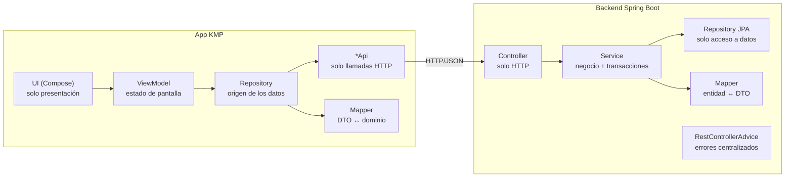

# Guía de refactorización conservadora

> **Para el agente (opencode):** este documento es tu plan de trabajo para refactorizar el proyecto. Síguelo sección por sección, en orden, sin saltarte pasos.
> Registra todo el avance **en este mismo archivo**: casillas, tablas de hallazgos, estados e incidencias. Si la sesión se corta, este documento es lo que permite retomar.

---

## 0. Objetivo

Que **cada parte del proyecto haga solo lo que le corresponde, de la forma más simple y legible posible**. El alcance es todo el proyecto: app KMP, backend Spring Boot, migraciones, Docker y scripts.

1. **Eliminar código muerto**: lo que no se usa en ningún lado.
2. **Quitar lo innecesario**: lo duplicado, lo sobrediseñado o lo que complica sin aportar.
3. **Reescribir lo que pueda ser más claro**, sin cambiar lo que hace.
4. **Poner cada cosa en su capa**, sin cambiar lo que hace.

**No es una reescritura.** Son cambios pequeños, localizados, verificados con pruebas y fáciles de revisar y revertir uno por uno.

### Datos de la tarea (los llena el usuario)

| Dato | Valor |
|---|---|
| Sistema operativo | `<Windows>` |
| Módulo KMP con la capa de datos | `shared` (cambiar si es otro, p. ej. `composeApp`) |
| Rama de trabajo | `refactor/limpieza` |
| Punto de retorno | etiqueta `v0.1.0` |
| ¿Abrir Pull Request a `main` al terminar? | `sí` |

---

## 1. Reglas que no se pueden romper

### El comportamiento no cambia
La app, la API y la base de datos deben hacer **exactamente lo mismo** antes y después:
- mismos endpoints, rutas, métodos y parámetros;
- mismo JSON (nombres de campos, tipos, nulabilidad, enums, formato de fechas);
- mismos códigos HTTP y formato de error;
- mismo esquema de base de datos;
- mismas pantallas y mismos flujos en la app.

Si una mejora exige cambiar el comportamiento, **no se hace**: se anota en la sección 8.2 (Propuestas que cambian comportamiento).

### Prohibido
- Modificar o regenerar `contract/fixtures/` (no usar `-PupdateContract=true`).
- Editar, renombrar o borrar migraciones Flyway existentes.
- Desactivar, borrar o debilitar pruebas (`@Disabled`, aserciones eliminadas, etc.), o bajar el umbral de cobertura.
- Cambiar versiones de dependencias.
- Agregar librerías, frameworks o patrones nuevos.
- Cambiar la arquitectura, la estructura de módulos o la de paquetes (salvo mover una clase que está claramente en el paquete equivocado).
- Reescribir archivos o módulos completos.
- Tocar el diseño visual de las pantallas.
- Renombrar algo que forme parte del contrato: campos JSON, rutas, nombres de tablas o columnas, claves de `@SerialName` o `@JsonProperty`.
- `git push --force` o reescribir el historial remoto.

### No es código muerto aunque lo parezca
Antes de declarar algo como "sin uso", comprobar que no se usa de forma indirecta por:
- anotaciones y reflexión: `@Bean`, `@Component`, `@Service`, `@Configuration`, `@RestControllerAdvice`, `@Entity`, `@Serializable`, `@JsonProperty`, `@SerialName`, `@EventListener`, `@Scheduled`;
- inyección de dependencias (módulos de Koin u otro sistema);
- `expect` / `actual`;
- previews de Compose (`@Preview`);
- pruebas (`src/test`, `commonTest`, `androidUnitTest`, `androidInstrumentedTest`);
- `AndroidManifest.xml`, `Info.plist`, `network_security_config.xml`;
- archivos de configuración (`application*.yml`, `docker-compose.yml`, `.env.example`, workflows de CI);
- datos semilla (`db/dev-data/`) y scripts (`scripts/`).

Los **repositorios de la app con implementación remota y fake** se conservan los dos: la fake se usa en previews y pruebas.

> **Ante la duda, no se borra.** Se anota en la sección 8.1 como "posible código muerto, por confirmar".

---

## 2. Flujo de trabajo


---

## 3. Preparación

- [ ] **3.1** Confirmar que estás en la rama `refactor/limpieza` (`git branch --show-current`). Si no existe, crearla desde la etiqueta: `git switch -c refactor/limpieza v0.1.0`.
- [ ] **3.2** `git status` limpio. Si hay cambios sin commitear, **detenerse y preguntar**.
- [ ] **3.3** Limpiar el entorno:
  ```bash
  docker compose down -v
  docker compose -p miapp-test down -v
  ```
- [ ] **3.4** Ejecutar la **línea base**: `scripts/test-all.sh` (o en Windows: `powershell -NoProfile -ExecutionPolicy Bypass -File scripts\test-all.ps1`). Si no termina en ✅, **detenerse y avisar**: no se refactoriza sobre algo roto.
- [ ] **3.5** Registrar la línea base en la tabla de abajo. Cuenta las pruebas en los reportes XML de `build/test-results/`; la cobertura sale del reporte de JaCoCo (`backend/build/reports/jacoco/test/`).
- [ ] **3.6** Medir las líneas de código por módulo (con `cloc` si está instalado; si no, contando líneas de los `.kt`, `.java`, `.sql` y `.kts`, sin `build/`).
- [ ] **3.7** Guardar la lista de endpoints actual para compararla al final:
  ```bash
  docker compose up -d --build --wait
  curl -fsS http://localhost:8080/v3/api-docs > /tmp/openapi-antes.json   # Windows: curl.exe ... -o $env:TEMP\openapi-antes.json
  docker compose down
  ```

### Línea base

| Métrica | Antes | Después |
|---|---|---|
| Pruebas backend (unitarias + integración + contrato) | | |
| Pruebas E2E | | |
| Pruebas app | | |
| Cobertura de líneas del backend (JaCoCo) | | |
| Líneas de código: backend `src/main` | | |
| Líneas de código: app (sin pruebas) | | |
| Dependencias declaradas en Gradle (backend / app) | | |
| Advertencias del compilador (backend / app) | | |

---

## 4. Análisis

Recorrer **todo** el proyecto y llenar las tablas de esta sección **antes de cambiar nada**.

### Niveles de riesgo
| Riesgo | Ejemplos | ¿Necesita aprobación? |
|---|---|---|
| 🟢 Bajo | Imports sin uso, código comentado, variables locales sin uso, renombrar algo `private`, extraer constantes, *early returns* | No: se aplica directamente |
| 🟡 Medio | Borrar clases o funciones sin uso, unificar duplicados, dividir funciones largas, quitar dependencias de Gradle, simplificar configuración | Sí |
| 🔴 Alto | Mover lógica entre capas, eliminar interfaces o capas, cambiar firmas públicas o `internal` usadas en varios módulos | Sí, una por una |

### Qué buscar

**4.1 Código muerto**
- Clases, funciones, propiedades, parámetros, DTOs, constantes y recursos de Android (strings, drawables, layouts, colores) sin uso.
- Imports sin uso, código comentado, TODOs ya resueltos, ramas imposibles en `if` o `when`.
- Dependencias y plugins de Gradle sin uso, en `libs.versions.toml` y en cada `build.gradle.kts`.
- Propiedades de `application*.yml`, variables de `.env.example` y servicios o variables de `docker-compose.yml` que nadie lee.
- Apoyo: las advertencias del compilador de Kotlin (`./gradlew build --warning-mode all`) y buscar cada símbolo en todo el repositorio antes de borrarlo.

**4.2 Innecesario o sobrediseñado**
- Código duplicado de verdad (misma lógica, mismo motivo de cambio). Que dos fragmentos se parezcan por casualidad no basta para unificarlos.
- Interfaces con una sola implementación que no aportan nada (con la excepción de la sección 1).
- *Wrappers* o capas que solo pasan datos de un lado a otro.
- Configuración manual de algo que Spring Boot o Ktor ya hacen por defecto con el mismo resultado.
- Abstracciones genéricas usadas en un solo lugar.
- Try/catch repetidos en controllers que ya resuelve el `@RestControllerAdvice`.

**4.3 Legibilidad**
- Funciones largas (más de ~30 líneas o con varios niveles de anidación): dividir en funciones pequeñas con nombres claros.
- Nombres poco claros en elementos privados o internos.
- Condicionales anidados: usar *early returns*, guard clauses y `when`.
- Números y textos mágicos: convertirlos en constantes con nombre.
- Kotlin idiomático solo cuando aclare el código: `require` / `check`, `?.let`, funciones de extensión, `sealed class` para estados y errores, `buildList`, `takeIf`.
- Comentarios desactualizados o que repiten el código.

**4.4 Responsabilidades: cada cosa en su lugar**



| Capa | Le corresponde | No le corresponde |
|---|---|---|
| Controller | Mapear HTTP, `@Valid`, códigos de estado | Lógica de negocio, acceso a repositorios, try/catch de errores |
| Service | Reglas de negocio, `@Transactional`, orquestación | Detalles HTTP (`ResponseEntity`, códigos de estado) |
| Repository JPA | Consultas | Lógica de negocio |
| Mapper | Conversión entre entidades y DTOs | Consultas o reglas |
| UI (Compose) | Mostrar estado y emitir eventos | Lógica de negocio, llamadas a repositorios |
| ViewModel | Estado de la pantalla, coordinar casos de uso | Construir peticiones HTTP, parsear JSON |
| Repository (app) | Decidir el origen de los datos, mapear errores | Detalles de la UI |
| `*Api` | Peticiones HTTP | Mapeo a dominio, reglas de negocio |

### Tablas de hallazgos

Estados: ⏳ pendiente · 👍 aprobado · ✅ aplicado · 🚀 subido · ↩️ revertido · ⏭️ descartado (indicar por qué).

#### 4.1 Código muerto
| ID | Archivo / símbolo | Hallazgo | Propuesta | Riesgo | Estado |
|---|---|---|---|---|---|
| M-01 | | | | | ⏳ |

#### 4.2 Innecesario o sobrediseñado
| ID | Archivo / símbolo | Hallazgo | Propuesta | Riesgo | Estado |
|---|---|---|---|---|---|
| N-01 | | | | | ⏳ |

#### 4.3 Legibilidad
| ID | Archivo / símbolo | Hallazgo | Propuesta | Riesgo | Estado |
|---|---|---|---|---|---|
| L-01 | | | | | ⏳ |

#### 4.4 Responsabilidades
| ID | Archivo / símbolo | Hallazgo | Propuesta | Riesgo | Estado |
|---|---|---|---|---|---|
| R-01 | | | | | ⏳ |

- [ ] **4.5** Tablas llenas. **Mostrar el análisis al usuario** y esperar su aprobación de los hallazgos 🟡 y 🔴 (marcar 👍 los aprobados y ⏭️ los rechazados).

---

## 5. Aplicación de los cambios

### Orden
1. 🟢 Código muerto e imports (4.1).
2. 🟡 Dependencias de Gradle sin uso (4.1).
3. Duplicación y sobrediseño (4.2).
4. Legibilidad (4.3).
5. Responsabilidades (4.4).

Dentro de cada grupo: primero el backend y después la app.

### Por cada hallazgo
1. Aplicar **un solo cambio** (o un grupo muy pequeño del mismo tipo en el mismo archivo).
2. Verificar según el módulo:

   | Módulo tocado | Comando |
   |---|---|
   | Backend | `cd backend && ./gradlew check` (Windows: `gradlew.bat check`) |
   | App | `./gradlew :<módulo>:testDebugUnitTest :<módulo>:assembleDebug`, y `:composeApp:assembleDebug` si existe |
   | Gradle (dependencias) | Compilar **todos** los módulos que usaban esa dependencia |
   | Docker / compose | `docker compose config -q` y `docker compose up -d --build --wait` |

3. **Si falla:** revertir ese cambio (`git restore` / `git checkout -- <archivo>`), marcar ↩️ y anotar el motivo en la sección 9. **No "arreglar" la prueba.**
4. **Si pasa:** commit con un mensaje que cite el ID:
   ```
   refactor(backend): elimina OrderUtils sin uso [M-03]
   refactor(app): divide OrderViewModel.load en funciones pequeñas [L-02]
   build(backend): quita dependencia sin uso commons-lang3 [M-07]
   ```
5. Si el cambio deja obsoleto algún comentario, KDoc, documento de `docs/` o diagrama Mermaid, **actualizarlo en el mismo commit**.
6. Marcar ✅ en la tabla del hallazgo.
7. `git push` cada 3 a 5 commits y marcar 🚀.

### Comprobación intermedia
- [ ] Después de terminar cada grupo del orden de arriba, ejecutar `scripts/test-all` completo. Si falla, buscar el commit responsable (puedes usar `git bisect`), revertirlo con `git revert` y anotarlo.

---

## 6. Verificación final

- [ ] **6.1** Entorno limpio: `docker compose down -v` y `docker compose -p miapp-test down -v`.
- [ ] **6.2** `scripts/test-all` termina en ✅.
- [ ] **6.3** Llenar la columna "Después" de la línea base (sección 3). Se tiene que cumplir:
  - número de pruebas **igual o mayor** en todas las capas;
  - cobertura **igual o mayor**;
  - advertencias del compilador **iguales o menos**.
- [ ] **6.4** Ni los fixtures de contrato ni las migraciones cambiaron. Este comando no debe mostrar nada:
  ```bash
  git diff --stat v0.1.0 -- contract/fixtures backend/src/main/resources/db/migration
  ```
- [ ] **6.5** La API expone lo mismo que antes:
  ```bash
  docker compose up -d --build --wait
  curl -fsS http://localhost:8080/v3/api-docs > /tmp/openapi-despues.json
  ```
  Comparar los `paths` (rutas y métodos) y los `components.schemas` de los dos archivos. Solo pueden diferir las descripciones. Cualquier otra diferencia es un cambio de comportamiento: revertirlo.
- [ ] **6.6** La app compila y abre en el emulador conectada al backend. Recorrer los flujos principales y revisar `docker compose logs api` en busca de 4xx o 5xx inesperados (o pedir al usuario que lo confirme si no puedes ejecutar el emulador).
- [ ] **6.7** No queda ningún hallazgo en ⏳ o 👍: todos están en 🚀, ↩️ o ⏭️.
- [ ] **6.8** Último `git push`. `git status` limpio y `git rev-parse HEAD` igual a `git ls-remote origin refactor/limpieza`.

---

## 7. Cierre

- [ ] **7.1** Si en la sección 0 dice "sí" al Pull Request y `gh` está autenticado:
  ```bash
  gh pr create --base main --head refactor/limpieza \
    --title "refactor: limpieza y simplificación del código" \
    --body-file docs/REFACTOR-RESUMEN.md
  ```
  Antes, crear `docs/REFACTOR-RESUMEN.md` con el contenido del reporte (sección 10), y commitearlo y subirlo. **No hacer merge**: lo revisa el usuario.
- [ ] **7.2** Commit final de este documento con todos los estados: `docs: cierra la guía de refactorización`, y push.

---

## 8. Pendientes que no se aplicaron

### 8.1 Posible código muerto, por confirmar
| Archivo / símbolo | Por qué parece sin uso | Por qué no se borró |
|---|---|---|
| _(ninguno)_ | | |

### 8.2 Propuestas que cambian comportamiento
| Propuesta | Beneficio | Qué cambiaría (API, BD, app) | Riesgo |
|---|---|---|---|
| _(ninguna)_ | | | |

---

## 9. Incidencias

| Fecha | Hallazgo / paso | Problema | Acción |
|---|---|---|---|
| _(ninguna)_ | | | |

---

## 10. Reporte final para el usuario

Entregar:
- Un resumen por categoría (código muerto, innecesario, legibilidad, responsabilidades): qué se cambió y cuántos archivos.
- La tabla de la línea base completa (antes y después).
- Las dependencias de Gradle que se quitaron.
- El resultado de `scripts/test-all` y de las verificaciones 6.4 y 6.5.
- Los hallazgos revertidos (↩️) o descartados (⏭️) y por qué.
- Los pendientes de la sección 8.
- El enlace del Pull Request (si se creó).
