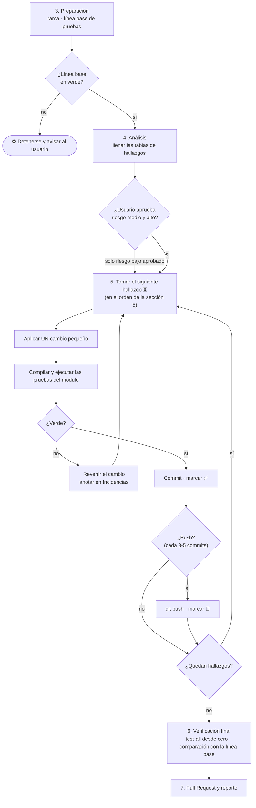
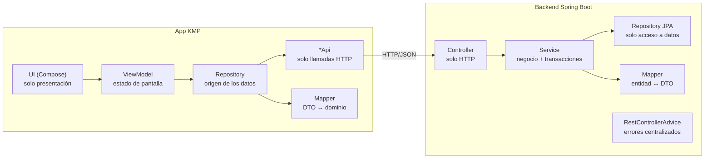

# Guía de refactorización conservadora

> **Para el agente (opencode):** este documento es tu plan de trabajo para refactorizar el proyecto. Síguelo sección por sección, en orden, sin saltarte pasos.
> Registra todo el avance **en este mismo archivo**: casillas, tablas de hallazgos, estados e incidencias. Si la sesión se corta, este documento es lo que permite retomar.

---

## 0. Objetivo

Que **cada parte del proyecto haga solo lo que le corresponde, de la forma más simple y legible posible**. El alcance es todo el proyecto: app KMP, backend Spring Boot, migraciones, Docker y scripts.

1. **Eliminar código muerto**: lo que no se usa en ningún lado.
2. **Quitar lo innecesario**: lo duplicado, lo sobrediseñado o lo que complica sin aportar.
3. **Reescribir lo que pueda ser más claro**, sin cambiar lo que hace.
4. **Poner cada cosa en su capa**, sin cambiar lo que hace.

**No es una reescritura.** Son cambios pequeños, localizados, verificados con pruebas y fáciles de revisar y revertir uno por uno.

### Datos de la tarea (los llena el usuario)

| Dato | Valor |
|---|---|
| Sistema operativo | `<Windows>` |
| Módulo KMP con la capa de datos | `shared` (cambiar si es otro, p. ej. `composeApp`) |
| Rama de trabajo | `refactor/limpieza` |
| Punto de retorno | etiqueta `v0.1.0` |
| ¿Abrir Pull Request a `main` al terminar? | `sí` |

---

## 1. Reglas que no se pueden romper

### El comportamiento no cambia
La app, la API y la base de datos deben hacer **exactamente lo mismo** antes y después:
- mismos endpoints, rutas, métodos y parámetros;
- mismo JSON (nombres de campos, tipos, nulabilidad, enums, formato de fechas);
- mismos códigos HTTP y formato de error;
- mismo esquema de base de datos;
- mismas pantallas y mismos flujos en la app.

Si una mejora exige cambiar el comportamiento, **no se hace**: se anota en la sección 8.2 (Propuestas que cambian comportamiento).

### Prohibido
- Modificar o regenerar `contract/fixtures/` (no usar `-PupdateContract=true`).
- Editar, renombrar o borrar migraciones Flyway existentes.
- Desactivar, borrar o debilitar pruebas (`@Disabled`, aserciones eliminadas, etc.), o bajar el umbral de cobertura.
- Cambiar versiones de dependencias.
- Agregar librerías, frameworks o patrones nuevos.
- Cambiar la arquitectura, la estructura de módulos o la de paquetes (salvo mover una clase que está claramente en el paquete equivocado).
- Reescribir archivos o módulos completos.
- Tocar el diseño visual de las pantallas.
- Renombrar algo que forme parte del contrato: campos JSON, rutas, nombres de tablas o columnas, claves de `@SerialName` o `@JsonProperty`.
- `git push --force` o reescribir el historial remoto.

### No es código muerto aunque lo parezca
Antes de declarar algo como "sin uso", comprobar que no se usa de forma indirecta por:
- anotaciones y reflexión: `@Bean`, `@Component`, `@Service`, `@Configuration`, `@RestControllerAdvice`, `@Entity`, `@Serializable`, `@JsonProperty`, `@SerialName`, `@EventListener`, `@Scheduled`;
- inyección de dependencias (módulos de Koin u otro sistema);
- `expect` / `actual`;
- previews de Compose (`@Preview`);
- pruebas (`src/test`, `commonTest`, `androidUnitTest`, `androidInstrumentedTest`);
- `AndroidManifest.xml`, `Info.plist`, `network_security_config.xml`;
- archivos de configuración (`application*.yml`, `docker-compose.yml`, `.env.example`, workflows de CI);
- datos semilla (`db/dev-data/`) y scripts (`scripts/`).

Los **repositorios de la app con implementación remota y fake** se conservan los dos: la fake se usa en previews y pruebas.

> **Ante la duda, no se borra.** Se anota en la sección 8.1 como "posible código muerto, por confirmar".

---

## 2. Flujo de trabajo



---

## 3. Preparación

- [x] **3.1** `git branch --show-current` devuelve `refactor/limpieza`; la etiqueta de retorno `v0.1.0` existe. No hizo falta crear la rama.
- [x] **3.2** `git status` mostró un único archivo sin tracking: la propia guía. Se detuvo y se preguntó al usuario, que eligió **commitearla ahora** (`f621c74 docs: añade guía de refactorización conservadora`); el árbol quedó limpio para empezar.
- [x] **3.3** Entorno limpio: `docker compose down -v` y `docker compose -p miapp-test down -v` terminaron con código 0 (el proyecto `miapp-test` no tenía recursos que eliminar).
- [x] **3.4** Línea base ejecutada en Windows con `powershell -NoProfile -ExecutionPolicy Bypass -File scripts\test-all.ps1`: **✅ 5/5 en verde** (compose, backend `check`, app KMP, stack aislado y E2E). No hubo que detenerse.
- [x] **3.5** Línea base registrada desde los XML de `build/test-results/` (38 backend, 4 E2E, 19 app; 0 fallos/errores/saltadas) y del contador `LINE` de `backend/build/reports/jacoco/test/jacocoTestReport.xml` (1025/1079 = 95 %).
- [x] **3.6** `cloc` no está instalado: se contaron líneas de `.kt`, `.java`, `.sql` y `.kts` sin `build/` ni fuentes de prueba (4630 en backend `src/main`, 11248 en la app). Dependencias: 27 backend / 30 app.
- [x] **3.7** OpenAPI "antes" guardado en `$env:TEMP\openapi-antes.json` (49 957 bytes, **26 paths, 35 schemas**). El `curl` a `localhost:8080` devolvió 404 porque en este Windows ese puerto lo sirve un Apache ajeno (`Server: Apache`); se repitió con el stack aislado `-p miapp-before` en `API_PORT=18080` → HTTP 200. Anotado en la sección 9.

### Línea base

| Métrica | Antes | Después |
|---|---|---|
| Pruebas backend (unitarias + integración + contrato) | 38 | 38 |
| Pruebas E2E | 4 | 4 |
| Pruebas app | 19 | 19 |
| Cobertura de líneas del backend (JaCoCo) | 95 % (1025/1079) | 95,3 % (1028/1079) |
| Líneas de código: backend `src/main` | 4630 (22 archivos) | 4647 (25 archivos) |
| Líneas de código: app (sin pruebas) | 11248 (91 archivos) | 11240 (91 archivos) |
| Dependencias declaradas en Gradle (backend / app) | 27 / 30 | 26 / 29 |
| Advertencias del compilador (backend / app) | 15 / 8 (recount real sobre `v0.1.0`; la celda inicial «0/0» era inexacta, ver §9) | 12 / 8 (mismos comandos; ningún aviso nuevo) |

---

## 4. Análisis

Recorrer **todo** el proyecto y llenar las tablas de esta sección **antes de cambiar nada**.

### Niveles de riesgo
| Riesgo | Ejemplos | ¿Necesita aprobación? |
|---|---|---|
| 🟢 Bajo | Imports sin uso, código comentado, variables locales sin uso, renombrar algo `private`, extraer constantes, *early returns* | No: se aplica directamente |
| 🟡 Medio | Borrar clases o funciones sin uso, unificar duplicados, dividir funciones largas, quitar dependencias de Gradle, simplificar configuración | Sí |
| 🔴 Alto | Mover lógica entre capas, eliminar interfaces o capas, cambiar firmas públicas o `internal` usadas en varios módulos | Sí, una por una |

### Qué buscar

**4.1 Código muerto**
- Clases, funciones, propiedades, parámetros, DTOs, constantes y recursos de Android (strings, drawables, layouts, colores) sin uso.
- Imports sin uso, código comentado, TODOs ya resueltos, ramas imposibles en `if` o `when`.
- Dependencias y plugins de Gradle sin uso, en `libs.versions.toml` y en cada `build.gradle.kts`.
- Propiedades de `application*.yml`, variables de `.env.example` y servicios o variables de `docker-compose.yml` que nadie lee.
- Apoyo: las advertencias del compilador de Kotlin (`./gradlew build --warning-mode all`) y buscar cada símbolo en todo el repositorio antes de borrarlo.

**4.2 Innecesario o sobrediseñado**
- Código duplicado de verdad (misma lógica, mismo motivo de cambio). Que dos fragmentos se parezcan por casualidad no basta para unificarlos.
- Interfaces con una sola implementación que no aportan nada (con la excepción de la sección 1).
- *Wrappers* o capas que solo pasan datos de un lado a otro.
- Configuración manual de algo que Spring Boot o Ktor ya hacen por defecto con el mismo resultado.
- Abstracciones genéricas usadas en un solo lugar.
- Try/catch repetidos en controllers que ya resuelve el `@RestControllerAdvice`.

**4.3 Legibilidad**
- Funciones largas (más de ~30 líneas o con varios niveles de anidación): dividir en funciones pequeñas con nombres claros.
- Nombres poco claros en elementos privados o internos.
- Condicionales anidados: usar *early returns*, guard clauses y `when`.
- Números y textos mágicos: convertirlos en constantes con nombre.
- Kotlin idiomático solo cuando aclare el código: `require` / `check`, `?.let`, funciones de extensión, `sealed class` para estados y errores, `buildList`, `takeIf`.
- Comentarios desactualizados o que repiten el código.

**4.4 Responsabilidades: cada cosa en su lugar**



| Capa | Le corresponde | No le corresponde |
|---|---|---|
| Controller | Mapear HTTP, `@Valid`, códigos de estado | Lógica de negocio, acceso a repositorios, try/catch de errores |
| Service | Reglas de negocio, `@Transactional`, orquestación | Detalles HTTP (`ResponseEntity`, códigos de estado) |
| Repository JPA | Consultas | Lógica de negocio |
| Mapper | Conversión entre entidades y DTOs | Consultas o reglas |
| UI (Compose) | Mostrar estado y emitir eventos | Lógica de negocio, llamadas a repositorios |
| ViewModel | Estado de la pantalla, coordinar casos de uso | Construir peticiones HTTP, parsear JSON |
| Repository (app) | Decidir el origen de los datos, mapear errores | Detalles de la UI |
| `*Api` | Peticiones HTTP | Mapeo a dominio, reglas de negocio |

### Tablas de hallazgos

Estados: ⏳ pendiente · 👍 aprobado · ✅ aplicado · 🚀 subido · ↩️ revertido · ⏭️ descartado (indicar por qué).

#### 4.1 Código muerto
| ID | Archivo / símbolo | Hallazgo | Propuesta | Riesgo | Estado |
|---|---|---|---|---|---|
| M-01 | `backend/.../web/dto/Dtos.kt:12` · `import NotEmpty` | Única aparición del símbolo en `backend/src` es el propio import. | Borrar la línea de import. | 🟢 | 🚀 (`5dc38ff`) |
| M-02 | `backend/src/test/.../AuthIntegrationTest.kt:9` · `import HttpHeaders` | Única aparición en el archivo; el test usa `authHeaders(token)` de `IntegrationTestBase`. | Borrar la línea de import (no se toca ninguna aserción). | 🟢 | 🚀 (`9ed234f`) |
| M-03 | `.../ui/auth/WelcomeScreen.kt:28` · `import clipRect` | Única aparición en `ui/`; el `Canvas` no lo invoca. | Borrar la línea de import. | 🟢 | 🚀 (`7c5fa87`) |
| M-04 | `.../ui/meetings/MeetingsScreen.kt:30-31` · `mutableStateOf`, `remember` | El archivo solo usa `collectAsState` y `rememberScrollState` (import propio en :15). | Borrar las dos líneas de import. | 🟢 | 🚀 (`579b8b1`) |
| M-05 | `.../data/SchoolSampleData.kt:37-38` · grupo commented-out | `//SchoolGroup(4L, ...)` y su cabecera `// 👇 GRUPO DE PEDRO...` son código comentado; el grupo 3 ya está activo en la semilla. | Borrar solo esas dos líneas comentadas. | 🟢 | 🚀 (`6135623`) |
| M-06 | `model/SchoolTask.kt:33`, `navigation/UserChip.kt:49-51`, `ui/tasks/TaskDetailScreen.kt:45` | Comentarios de andamiaje ("ESTA ES LA PROPIEDAD QUE FALTA", "NUEVO PARÁMETRO") ya resueltos: las propiedades/parámetros están implementados. `ui/theme/EduviaTheme.kt:39` NO se incluye: las fuentes Poppins aún no están, así que su instrucción sigue vigente. | Limpiar solo esos 4 comentarios; no tocar código. | 🟢 | 🚀 (`528a0dc`, `9156ec0`, `58975ec`) |
| M-07 | `.../ui/auth/GroupsReadyScreen.kt:140,146` · `/* TODO copiar */`, `/* TODO compartir */` | Affordance visual intencional; implementar acciones cambiaría comportamiento. | Sustituir por un comentario explícito que remita a Q10/H8, sin implementar nada. | 🟢 | 🚀 (`d6bf718`) |
| M-08 | `backend/.../api/repository/Repositories.kt:40,60,239` · `findByPhone`, `findAllByUserIdAndRevokedAtIsNullAndExpiresAtAfter`, `findAllByGroupIdAndTypeOrderByDateAsc` | Búsqueda global: solo declaración y KDoc; los servicios usan `existsByPhone`, `findByTokenHash` y `events.findAll().sortedBy`. | Borrar los 3 métodos y ajustar el KDoc que los cita. | 🟡 | 🚀 (`bf34f6c`) |
| M-09 | `backend/.../api/web/dto/Mappers.kt:152` · `attendanceSummary` | Sin llamadas; `CalendarService` construye `AttendanceSummaryDto` directamente. El KDoc de :131 lo cita. | Borrar la función y corregir ese comentario; `docs/INVENTARIO.md` también lo citaba y se ajustó. | 🟡 | 🚀 (`e5341c8`) |
| M-10 | `backend/build.gradle.kts:57` · `testImplementation("io.mockk:mockk:1.14.12")` | 0 imports `io.mockk` en `backend/src`; solo menciones documentales. | Quitar la dependencia (sin cambiar versiones de las demás). | 🟡 | 🚀 (`35465f5`, con `docs/backend/PROGRESS.md` y `docs/adr/0002-build-gradle-separado.md`) |
| M-11 | `Librerias_eduvia/gradle/libs.versions.toml:21-26` · 6 aliases y sus `version.ref` huérfanos | Ningún `*.gradle.kts` referencia `libs.kotlin.testJunit`, `libs.junit`, `libs.androidx.core.ktx`, `libs.androidx.testExt.junit`, `libs.androidx.espresso.core` ni `libs.androidx.appcompat`. | Retirar solo esos aliases y sus versiones sin uso. | 🟡 | 🚀 (`f066fc2`) |

#### 4.2 Innecesario o sobrediseñado
| ID | Archivo / símbolo | Hallazgo | Propuesta | Riesgo | Estado |
|---|---|---|---|---|---|
| N-01 | `web/CalendarController.kt:65`, `GroupController.kt:65,171,201`, `TaskController.kt:68`, `MeetingController.kt:63,229` · `100` | 7 usos del mismo literal `size.coerceAtMost(100)`; es el límite acordado con la app. | Extraer `internal const val MAX_PAGE_SIZE = 100` en `web/Pagination.kt` (archivo nuevo, compartido por los controllers); mismo valor y misma paginación. | 🟢 | 🚀 (`235c371`) |
| N-02 | `.../ui/auth/GroupsReadyScreen.kt:34`, `.../ui/auth/RegisterScreen.kt:46` · `HeaderGradient` | Dos `private val` con el mismo degradado horizontal; mismo motivo de cambio (identidad visual). | Definirlo una sola vez en `ui/theme/EduviaTheme.kt` y referenciarlo desde ambas pantallas, sin tocar colores ni `padding`. | 🟡 | 🚀 (`a569b80`) |
| N-03 | `service/AuthService.kt:343-355`, `service/GroupService.kt:153-161` · generador de códigos | Mismo alfabeto, formato `AA-AAAA`, 20 reintentos y comprobación `existsByCodeIgnoreCase`; cambiar uno y no el otro rompería la unicidad. | Un único helper compartido en `service/GroupCodes.kt`, conservando el mensaje de error de cada llamador. | 🟡 | 🚀 (`c44bc28`) |
| N-04 | `service/MeetingService.kt:313-317`, `service/TaskService.kt:232-236` · `parseDate` | Cuerpo idéntico: `ISO_LOCAL_DATE` y el mismo `FieldErrorDto("dateText", ...)`. | Helper compartido en `service/DateParsing.kt` con el mismo mensaje y excepción. | 🟡 | 🚀 (`2fbfbac`) |
| N-05 | `web/CalendarController.kt:65`, `GroupController.kt:65,171,201`, `TaskController.kt:68`, `MeetingController.kt:63,229` · `PageRequest.of(...)` | Siete construcciones con el mismo límite; tres añaden además `Sort.by("id")`, uno `Sort.by("date","id")`, otro `Sort.by("dueDate","id")` y dos no llevan `Sort`. | Helper `pageRequest(page, size, sort?)` en `web/Pagination.kt`, preservando exactamente el orden actual de cada endpoint. | 🟡 | 🚀 (`3a9508e`) |
| N-06 | `Librerias_eduvia/shared/build.gradle.kts:54` frente a `:62` | `implementation(libs.compose.foundation)` y `api("org.jetbrains.compose.foundation:foundation:1.12.1")` son el mismo módulo y la misma versión (`composeMultiplatform = 1.12.1`); la declaración `implementation` es redundante. | Borrar solo la línea 54; se conserva `api(...)`, así que la visibilidad para otros módulos no cambia. | 🟡 | 🚀 (`9808858`) |

#### 4.3 Legibilidad
| ID | Archivo / símbolo | Hallazgo | Propuesta | Riesgo | Estado |
|---|---|---|---|---|---|
| L-01 | `service/AuthService.kt:300,324,327` · nombres fully-qualified | `JwsHeader`, `UserDto` y `SchoolGroupDto` se escriben con su ruta completa en mitad del código. | Añadir los 3 imports y dejar los nombres simples. | 🟢 | 🚀 (`73d9314`) |
| L-02 | `docs/HALLAZGOS.md:91` · «los 21 bloques del repositorio» | Cifra desactualizada: ahora hay 31 apariciones de ```` ```mermaid ```` (29 sin contar esta guía). `PLAN-SUBIDA-GITHUB.md:145` sí es un registro histórico del commit 23 y no se toca. | Reescribir la frase como «los 21 bloques originales, validados entonces…» para no falsar el histórico. | 🟢 | 🚀 (`cf9db7e`) |
| L-03 | `AuthService.kt:80-131,298-334`; `MeetingService.kt:99-143,165-206`; `TaskService.kt:100-135` | Cinco funciones de 35-45 líneas con validaciones, normalización y escrituras mezcladas; las dos de `MeetingService` repiten las mismas 4 validaciones. | Extraer helpers `private` con nombres claros (`validateRegistration`, `createGroups`, `linkChildren`, `accessToken`, `issueRefreshToken`, `validateMeetingFields`, `ensureNoConflict`, `saveTaskEvent`), sin reordenar validaciones ni escrituras; `register` conserva su comprobación actual (ver 8.2). | 🟡 | 🚀 (`3692c32`) |

#### 4.4 Responsabilidades
| ID | Archivo / símbolo | Hallazgo | Propuesta | Riesgo | Estado |
|---|---|---|---|---|---|
| R-01 | _(sin hallazgos)_ | Los controllers solo validan y delegan; los services no devuelven `ResponseEntity`; los repositorios solo consultan; los mappers solo convierten; la UI no llama a repositorios. | No mover nada: cualquier cambio aquí sería 🔴 y no aporta. | — | ⏭️ sin hallazgos |

- [x] **4.5** Tablas llenas y análisis mostrado al usuario. No hay hallazgos 🔴; el usuario aprobó **todos los 🟡** (M-08…M-11, N-02…N-06, L-03), marcados 👍. R-01 quedó ⏭️ por no existir hallazgos de responsabilidades. 8.1 y 8.2 registrados antes de tocar código.

---

## 5. Aplicación de los cambios

### Orden
1. 🟢 Código muerto e imports (4.1).
2. 🟡 Dependencias de Gradle sin uso (4.1).
3. Duplicación y sobrediseño (4.2).
4. Legibilidad (4.3).
5. Responsabilidades (4.4).

Dentro de cada grupo: primero el backend y después la app.

### Por cada hallazgo
1. Aplicar **un solo cambio** (o un grupo muy pequeño del mismo tipo en el mismo archivo).
2. Verificar según el módulo:

   | Módulo tocado | Comando |
   |---|---|
   | Backend | `cd backend && ./gradlew check` (Windows: `gradlew.bat check`) |
   | App | `./gradlew :<módulo>:testDebugUnitTest :<módulo>:assembleDebug`, y `:composeApp:assembleDebug` si existe |
   | Gradle (dependencias) | Compilar **todos** los módulos que usaban esa dependencia |
   | Docker / compose | `docker compose config -q` y `docker compose up -d --build --wait` |

3. **Si falla:** revertir ese cambio (`git restore` / `git checkout -- <archivo>`), marcar ↩️ y anotar el motivo en la sección 9. **No "arreglar" la prueba.**
4. **Si pasa:** commit con un mensaje que cite el ID:
   ```
   refactor(backend): elimina OrderUtils sin uso [M-03]
   refactor(app): divide OrderViewModel.load en funciones pequeñas [L-02]
   build(backend): quita dependencia sin uso commons-lang3 [M-07]
   ```
5. Si el cambio deja obsoleto algún comentario, KDoc, documento de `docs/` o diagrama Mermaid, **actualizarlo en el mismo commit**.
6. Marcar ✅ en la tabla del hallazgo.
7. `git push` cada 3 a 5 commits y marcar 🚀.

### Comprobación intermedia
- [x] **Grupo 1 (🟢 4.1) verificado:** `scripts/test-all.ps1` → ✅ 5/5 tras M-01…M-07. Sin revertidos.
- [x] **Grupo 2 (🟡 Gradle 4.1) verificado:** `scripts/test-all.ps1` → ✅ 5/5 tras M-10 y M-11. Sin revertidos.
- [x] **Grupo 3 (4.2 duplicación/sobrediseño) verificado:** `scripts/test-all.ps1` → ✅ 5/5 tras M-08, M-09, N-01…N-06. Sin revertidos.
- [x] **Grupo 4 (4.3 legibilidad) verificado:** `scripts/test-all.ps1` → ✅ 5/5 tras L-01, L-02 y L-03. Sin revertidos.

---

## 6. Verificación final

- [x] **6.1** Entorno limpio: `docker compose down -v`, `docker compose -p miapp-test down -v` y `docker compose -p miapp-before down -v` (código 0; los contenedores ajenos listados por `docker ps -a` no se tocaron).
- [x] **6.2** `scripts/test-all.ps1` → ✅ 5/5 tras la limpieza.
- [x] **6.3** Columna "Después" llenada: pruebas 38/4/19 (iguales), cobertura 95,3 % (mayor), avisos 12/8 frente a 15/8 (iguales o menos; recuento real en un worktree de `v0.1.0` con `--warning-mode all --rerun-tasks`, ver §9).
  - número de pruebas **igual o mayor** en todas las capas ✅;
  - cobertura **igual o mayor** ✅;
  - advertencias del compilador **iguales o menos** ✅.
- [x] **6.4** Ni los fixtures de contrato ni las migraciones cambiaron: `git diff --stat v0.1.0 -- contract/fixtures backend/src/main/resources/db/migration` no mostró nada (salida vacía).
- [x] **6.5** La API expone lo mismo que antes: stack aislado `-p miapp-before` con `API_PORT=18080`/`DB_PORT=15432` (ver §9), `curl -fsS http://localhost:18080/v3/api-docs -o $env:TEMP\openapi-despues.json` → HTTP 200. Comparación: **26 paths y 35 schemas idénticos**; rutas, métodos, parámetros, `operationId`, códigos de respuesta y esquemas sin diferencias sustantivas. Los dos archivos son incluso byte-idénticos (SHA-256 `A2243A846A1EF392D387CF1A0C97B8A6D11C3D10BEC4B3A31DB7C10C257C70E0`, 49 957 bytes). El primer volcado con `Invoke-WebRequest` introdujo doble codificación UTF-8 en `tags`; se repitió con `curl.exe -o` y desapareció (§9).
- [x] **6.6** Compilación y prueba real en emulador `emulator-5554` (AVD `Pixel_7`): APK debug instalado con `adb install -r`, login con `laura@eduvia.mx` / `Maestra123` → pantalla «Hola, Laura» con 6 tareas y 2 juntas del backend; recorridos Inicio, Tareas, Calendario y Juntas mostrando datos reales (grupo 3º B, código 3B-7K2P). `docker compose -p miapp-before logs api`: **0 respuestas 4xx/5xx inesperadas**; solo dos `WARN` de SpringDoc por tener api-docs/swagger habilitados. La redirección temporal `adb reverse` + `iptables` se eliminó, se hizo `adb unroot` y el stack se bajó con `-v` (§9).
- [x] **6.7** No queda ningún hallazgo en ⏳ o 👍: todos están en 🚀 o ⏭️ (R-01, sin hallazgos). Ninguno en ↩️.
- [x] **6.8** Último `git push` con este documento cerrado. `git status` limpio y `git rev-parse HEAD` igual a `git ls-remote origin refactor/limpieza` (verificado tras el commit final `docs: cierra la guía de refactorización`).

---

## 7. Cierre

- [x] **7.1** La sección 0 dice "sí", pero `gh` no está instalado, no hay `GH_TOKEN`/`GITHUB_TOKEN` y el navegador muestra «Sign in» en GitHub: **no se pudo crear el PR** (§9). Se creó, commiteó y subió igualmente `docs/REFACTOR-RESUMEN.md` con el reporte de la sección 10 y el comando exacto para que el usuario abra el PR sin merge:
  ```bash
  gh pr create --base main --head refactor/limpieza \
    --title "refactor: limpieza y simplificación del código" \
    --body-file docs/REFACTOR-RESUMEN.md
  ```
- [x] **7.2** Commit final de este documento con todos los estados: `docs: cierra la guía de refactorización`, y push.

---

## 8. Pendientes que no se aplicaron

### 8.1 Posible código muerto, por confirmar
| Archivo / símbolo | Por qué parece sin uso | Por qué no se borró |
|---|---|---|
| `.../ui/auth/RegisterTeacherViewModel.kt:16` · `RegisterTeacherViewModel` | Búsqueda global: solo la declaración y dos menciones en `docs/`; ninguna pantalla lo instancia. | Podría conectarse en una navegación futura; ante la duda se conserva. |
| `backend/.../domain/Entities.kt:437` · `Meeting.hasVirtualLink` | Parece derivable de `virtualLink != null`. | Es un campo del contrato, aparece en `contract/fixtures/` y en aserciones de `MeetingIntegrationTest`; no se toca (fixtures prohibidos). |
| `backend/build.gradle.kts:42-48` · starters `-test` de Spring Boot 4 | No hay imports directos de sus clases en `src/test`. | Los starters de slice pueden actuar por classpath/autoconfiguración; retirarlos podría debilitar pruebas. |
| `backend/src/main/resources/application.properties:2` · `spring.application.name` | Duplicado con `application.yml:2`. | `docs/HALLAZGOS.md` H11 indica conservarlo; no es duplicación inocua desde el punto de vista de esta tarea. |

### 8.2 Propuestas que cambian comportamiento
| Propuesta | Beneficio | Qué cambiaría (API, BD, app) | Riesgo |
|---|---|---|---|
| Implementar copiar/compartir en `GroupsReadyScreen.kt:140,146` | Los dos botones dejarían de ser decorativos (Q10/H8). | Cambiaría flujos de la app y requeriría permisos de plataforma; no se hace. | 🔴 |
| Quitar en `AuthService.kt:108` el `if (groups.existsByCodeIgnoreCase(generateGroupCode()))` | Evita un 409 basado en un código aleatorio distinto del que se guarda después. | Cambiaría los códigos de error del endpoint de registro; no se hace. | 🔴 |

---

## 9. Incidencias

| Fecha | Hallazgo / paso | Problema | Acción |
|---|---|---|---|
| 2026-11-25 | Paso 3.2 | `GUIA-REFACTORIZACION.md` aparecía como untracked y la guía exige `git status` limpio. | Se detuvo y se preguntó; el usuario eligió commitearla primero (`f621c74`). |
| 2026-11-25 | Paso 3.7 | `http://localhost:8080/v3/api-docs` devuelve 404: un Apache ajeno al proyecto ocupa ese puerto en este Windows (la respuesta dice `Server: Apache`). | No se detuvo ningún servicio ajeno. Se levantó el stack con `-p miapp-before` y `API_PORT=18080` (`DB_PORT=15432`); `/v3/api-docs` respondió 200 y se guardó la línea base. La comparación 6.5 usará el mismo puerto aislado. |
| 2026-11-25 | Verificación de app / Docker | Las tareas `:shared:testDebugUnitTest` y `:shared:assembleDebug` de la guía no existen en este proyecto; y el recuento inicial de «0 advertencias Kotlin» no incluía 3 avisos `deprecation` de `DemoTodayProvider.kt` y `ParentHomeScreen.kt` ni 1 aviso del Elvis en `GlobalExceptionHandler.kt:153`, todos preexistentes. | Se usa `:shared:testAndroid :shared:assembleAndroidMain :androidApp:assembleDebug` para verificar la app. En 6.3 se compara el recuento final con el de `v0.1.0` usando los mismos comandos; no se cambian esos archivos porque no están en el análisis aprobado. |
| 2026-11-25 | Paso 6.3 | El primer recuento de avisos podía verse reducido por la caché de Gradle (configuración y script Kotlin ya compilados). | Se repitieron backend y app con `--warning-mode all --rerun-tasks` (app además con `--no-configuration-cache`) en el árbol final y en un worktree temporal de `v0.1.0`, con el mismo `local.properties` copiado solo al worktree. Resultado: backend 15 → 12 (11 avisos Kotlin idénticos; no se repitieron 3 avisos del script `build.gradle.kts:84`), app 8 → 8. El worktree se eliminó sin `--force`. |
| 2026-11-26 | Pasos 6.5 y 6.6 | En `Invoke-WebRequest.Content` el JSON se decodificó como Latin-1 y al volver a escribirlo quedó double-encoded; y el emulador alcanza `10.0.2.2:8080`, donde responde el Apache ajeno, aunque `adb reverse tcp:8080 tcp:18080` esté activo. | OpenAPI se volvió a descargar con `curl.exe -fsS -o` (bytes crudos) y resultó idéntico al de la línea base. Para la prueba en emulador se añadió una regla `iptables` temporal dentro del emulador (`10.0.2.2:8080` → localhost:8080) con `adb root`; al terminar se borró la regla, se quitó el `adb reverse`, se ejecutó `adb unroot` y se bajó el stack. No se detuvo el Apache ni se cambió la base URL de la app. |
| 2026-11-26 | Paso 7.1 | El usuario marcó «sí» al PR, pero `gh` no existe en `PATH` ni en las rutas habituales, no hay tokens de GitHub y la sesión web está sin autenticar («Sign in» en la página de comparación). | No se creó el PR ni se hizo merge, para no suplantar la identidad del usuario. El reporte `docs/REFACTOR-RESUMEN.md` incluye el comando `gh pr create …` listo para ejecutar; la revisión sigue siendo del usuario. |

---

## 10. Reporte final para el usuario

Entregar:
- Un resumen por categoría (código muerto, innecesario, legibilidad, responsabilidades): qué se cambió y cuántos archivos.
- La tabla de la línea base completa (antes y después).
- Las dependencias de Gradle que se quitaron.
- El resultado de `scripts/test-all` y de las verificaciones 6.4 y 6.5.
- Los hallazgos revertidos (↩️) o descartados (⏭️) y por qué.
- Los pendientes de la sección 8.
- El enlace del Pull Request (si se creó).
