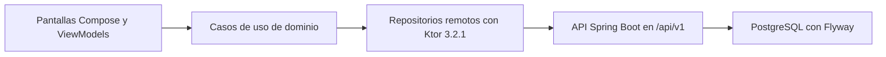

# EduvIA — app Kotlin Multiplatform 📱

Aplicación escolar compartida entre **Android** e **iOS**. Un docente publica tareas y juntas; un padre o tutor consulta las tareas de sus hijos y responde si asistirá a una junta. Toda la lógica, la interfaz Compose y el cliente HTTP viven en `shared/`; cada plataforma aporta solo su punto de entrada y su motor de red.

> Antes de leer: este README sustituye a la plantilla genérica de KMP, que mencionaba `jvmMain` y otras tareas que no existen aquí (hallazgo [H6](../docs/HALLAZGOS.md)). La guía completa está en [`docs/app-kmp.md`](../docs/app-kmp.md).

## Estructura real

| Ruta | Qué contiene |
|---|---|
| [`shared/src/commonMain/kotlin`](./shared/src/commonMain/kotlin) | Código compartido: modelos, casos de uso, repositorios, capa de red Ktor y pantallas Compose. |
| [`shared/src/androidMain/kotlin`](./shared/src/androidMain/kotlin) | Motor OkHttp y base URL `http://10.0.2.2:8080/api/v1/`. |
| [`shared/src/iosMain/kotlin`](./shared/src/iosMain/kotlin) | Motor Darwin y base URL `http://localhost:8080/api/v1/`. |
| [`shared/src/commonTest`](./shared/src/commonTest) · [`androidHostTest`](./shared/src/androidHostTest) · [`iosTest`](./shared/src/iosTest) | Pruebas compartidas, de contrato y de cada plataforma. |
| [`androidApp/src/main/kotlin`](./androidApp/src/main/kotlin) | `MainActivity`, punto de entrada Android. |
| [`iosApp/iosApp`](./iosApp/iosApp) | `iOSApp.swift`, `ContentView.swift` e `Info.plist`, punto de entrada iOS. |

No existe `jvmMain`: el proyecto tiene como objetivo Android e iOS. Los READMEs cortos de cada módulo están en [`shared/`](./shared/README.md), [`androidApp/`](./androidApp/README.md) e [`iosApp/`](./iosApp/README.md).

## Arquitectura en pocas líneas



La app no se mete en Docker: se ejecuta desde Android Studio o Xcode y apunta a la API local. La sesión se guarda en memoria (`SessionStore`), por lo que al cerrar la app hay que volver a iniciar sesión. Detalles en [`docs/arquitectura.md`](../docs/arquitectura.md).

## Ejecutar y verificar (Windows)

La API debe estar levantada en el puerto 8080; consulta [`docs/docker.md`](../docs/docker.md). Desde esta carpeta:

```powershell
.\gradlew.bat --no-daemon :shared:testAndroid
.\gradlew.bat --no-daemon :androidApp:assembleDebug
```

Para abrir la app en el emulador usa la configuración de ejecución de Android Studio. En iOS abre `iosApp/iosApp.xcodeproj` en Xcode; la ruta HTTP local se permite con ATS en `Info.plist`. La suite completa (backend + app + E2E) se ejecuta desde la raíz con `scripts/test-all.ps1`; ver [`docs/pruebas.md`](../docs/pruebas.md).

## Usuarios de ejemplo

- Docente: `laura@eduvia.mx` / `Maestra123`
- Padre: `maria@correo.com` / `Padre1234`

Los datos de ejemplo los siembra el backend solo con el perfil `dev`. Más información en [`docs/base-de-datos.md`](../docs/base-de-datos.md) y [`docs/operacion.md`](../docs/operacion.md).
