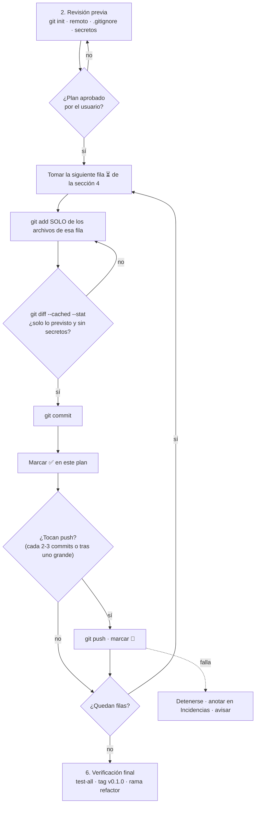

# Plan para subir el proyecto a GitHub de forma progresiva

> **Para el agente (opencode):** este documento es tu plan de trabajo. Síguelo paso por paso, en orden, sin saltarte ninguno.
> Cada vez que completes algo, actualiza su estado **en este mismo archivo**. El objetivo es subir todo el trabajo actual a GitHub con commits pequeños y ordenados, **antes de cualquier refactorización**.

---

## 0. Datos del repositorio (los llena el usuario)

| Dato | Valor |
|---|---|
| URL del repositorio | `https://github.com/Ludwig-Ivan/Eduvia.git` |
| Rama principal | `main` |
| Nombre para los commits | `Ludwig-Ivan` (tomado de `git config user.name`) |
| Correo para los commits | `ivansierras11@gmail.com` (tomado de `git config user.email`) |
| Sistema operativo | `Windows` |
| ¿Subir el workflow de CI (GitHub Actions)? | `sí` |

Ejemplos de URL: `https://github.com/usuario/mi-app.git` o `git@github.com:usuario/mi-app.git`.

> ⛔ Si la URL sigue diciendo `<PEGA_AQUÍ_LA_URL>`, **detente y pídesela al usuario**. No continúes sin ella.
> El repositorio de GitHub debe estar **vacío**: sin README, sin .gitignore y sin licencia.

---

## 1. Reglas que no se pueden romper

### Seguridad
- **Nunca** escribas tokens, contraseñas ni credenciales en la URL del remoto, en archivos ni en mensajes de commit. Para autenticarte usa lo que el usuario ya tiene configurado (SSH, `gh auth login` o el gestor de credenciales de git). Si el push pide credenciales y no las hay, detente y explica qué configurar.
- **Nunca** uses `git push --force` ni `git reset --hard` sobre trabajo ya subido, y no reescribas el historial remoto.
- **Nunca** uses `git add .` ni `git add -A` (salvo en el commit de renormalización). Siempre añade los archivos de la fila que estás ejecutando.

### Qué NO se sube
- Secretos y archivos locales: `.env`, `local.properties`, `*.jks`, `*.keystore`, `google-services.json` o `GoogleService-Info.plist` con claves reales, archivos de credenciales y dumps de base de datos.
- Artefactos de build: `build/`, `.gradle/`, `.kotlin/`, `out/`, `*.apk`, `*.aab`, `captures/`, `*.iml`, `.DS_Store`, `xcuserdata/`, `Pods/`.
- `.idea/`, salvo lo que el equipo quiera compartir (por ejemplo `.idea/codeStyles/`).

### Qué SÍ se sube aunque parezca raro
- `.env.example` (sin secretos reales).
- `gradle/wrapper/gradle-wrapper.jar`, tanto de la app como de `backend/`: sin él, `gradlew` no funciona en otra máquina ni en el CI.
- `contract/fixtures/`, `.opencode/skills/`, `GUIA-OPENCODE.md` y este plan.

### Alcance
- **No se modifica código** en este proceso. Solo se pueden crear o ajustar `.gitignore`, `.gitattributes` y este documento.
- Si algo falla (pruebas, build, push), **no lo arregles aquí**: anótalo en la sección 7 (Incidencias) y avisa al usuario.

---

## 2. Revisión previa

Marca cada casilla al completarla.

- [x] **2.1** `git status`: el proyecto no era un repositorio git; se ejecutó `git init -b main`.
- [x] **2.2** Identidad: confirmados `Ludwig-Ivan` y `ivansierras11@gmail.com` con `git config`; no hizo falta configurar nada (sin `--global`).
- [x] **2.3** Remoto: no existía `origin`; se añadió con la URL de la sección 0 y se verificó con `git remote -v`.
- [x] **2.4** `git ls-remote origin` devolvió vacío: el remoto no tiene commits ni referencias, así que no hay historial que sobrescribir.
- [x] **2.5** `.gitignore` revisado y ampliado en la raíz, `backend/` y `Librerias_eduvia/`: excluye secretos, builds e IDEs; `.env.example` y los `gradle-wrapper.jar` siguen incluidos (verificado con `git check-ignore`).
- [x] **2.6** `.gitattributes` en la raíz completado con `* text=auto`, finales de línea por tipo de script y `binary` para JAR/imágenes; se conservó el de `backend/`.
  ```gitattributes
  * text=auto
  gradlew text eol=lf
  *.sh text eol=lf
  *.bat text eol=crlf
  *.cmd text eol=crlf
  *.ps1 text eol=crlf
  *.jar binary
  *.png binary
  *.jpg binary
  *.webp binary
  ```
- [x] **2.7** **Escaneo de secretos** en los 260 archivos candidatos: sin claves privadas, tokens reales, claves de API ni credenciales de conexión reales. Únicos hallazgos: valores de demo/prueba y defaults de desarrollo (`app/app`, `cambia-esto-...`, `Password1!`, `Maestra123`). Se mostraron al usuario y **confirmó que se pueden subir**.
- [x] **2.8** **Archivos grandes:** 0 archivos de más de 10 MB entre los 260 candidatos; el mayor tiene 0,183 MB. No hizo falta preguntar.
- [x] **2.9** Confirmado: los dos `gradle-wrapper.jar` (`Librerias_eduvia/` y `backend/`) son candidatos y `git check-ignore` no los marca como ignorados.
- [x] **2.10** Sección 4 ajustada a 24 filas con rutas reales (259 candidatos asignados sin duplicados) y sección 5 completada con los casos ignorados/a propósito.
- [x] **2.11** Plan completo mostrado al usuario; aprobación explícita recibida antes del primer commit.

---

## 3. Flujo de trabajo



### Por cada fila de la sección 4
1. `git add <archivos o patrones de la fila>`
2. `git status` y `git diff --cached --stat` → entran exactamente los archivos previstos y ningún secreto.
3. `git commit -m "<mensaje>"`. Si el commit agrupa varias cosas, añade un cuerpo con viñetas que las describa.
4. Cambiar el estado de la fila a ✅ en este documento.
5. **Push progresivo:**
   - El primer push: `git push -u origin main`.
   - Después: `git push` cada 2 o 3 commits, o justo después de un commit grande. Marcar 🚀 las filas que se subieron.
6. Si el push falla: **no reintentar con `--force`**. Leer el error, anotarlo en Incidencias y avisar.

> Los commits intermedios no tienen que compilar por sí solos (son la subida de un trabajo que ya existe), pero **el último sí**: se verifica en la sección 6.

---

## 4. Plan de commits

Formato de los mensajes: [Conventional Commits](https://www.conventionalcommits.org/) (`feat`, `test`, `docs`, `build`, `ci`, `chore`).
Estados: ⏳ pendiente · ✅ commit hecho · 🚀 subido a GitHub · ⏭️ omitido (indicar por qué).

El agente debe **ajustar esta tabla al proyecto real** en el paso 2.10: completar las rutas, dividir filas grandes y omitir las que no apliquen.

| # | Mensaje del commit | Archivos o patrones | Verificación antes del commit | Estado |
|---|---|---|---|---|
| 1 | `chore: configuración inicial del repositorio` | `.gitignore` (raíz, `backend/`, `Librerias_eduvia/`), `.gitattributes` (raíz, `backend/`) — 5 archivos | `git check-ignore`: `.env` ignorado; `.env.example` y ambos `gradle-wrapper.jar` incluidos | 🚀 |
| 2 | `chore: normaliza finales de línea` | `git add --renormalize .` (solo si hay cambios; si no, ⏭️) | `git diff --cached --stat` vacío: no había tracked files que renormalizar | ⏭️ |
| 3 | `feat(app): base Gradle, Android y iOS` | `Librerias_eduvia/{build.gradle.kts,settings.gradle.kts,gradle.properties,gradlew,gradlew.bat,gradle/**,androidApp/**,iosApp/**}`, `shared/build.gradle.kts`, `shared/src/iosMain/.../MainViewController.kt` — 41 archivos | Sin `local.properties`, `build/`, `*.jks`, ni `xcuserdata/` | 🚀 |
| 4 | `feat(app): modelo y dominio compartidos` | `shared/src/commonMain/.../{model/**,domain/**}` y 6 archivos de datos demo (`CalendarSampleData`, `DemoTodayProvider`, `FakeEmailSender`, `MeetingSampleData`, `SchoolSampleData`, `TeacherCalendarSampleData`) — 32 archivos | Sin capa de red Ktor todavía | 🚀 |
| 5 | `feat(app): interfaz Compose y recursos` | `shared/src/commonMain/.../{ui/**,navigation/**}`, `App.kt`, `AppTheme.kt`, `shared/src/commonMain/composeResources/**` — 37 archivos | Solo UI y recursos; sin lógica de red | 🚀 |
| 6 | `chore: skills de opencode y guías del proyecto` | `.opencode/skills/**`, `GUIA-OPENCODE.md`, `install-opencode-skills.cmd`, `install-opencode-skills.sh` — 15 archivos | — | 🚀 |
| 7 | `docs(backend): contrato de API y plan de pruebas` | `docs/backend/{api-contract.md,openapi.yaml,test-plan.md,DECISIONS.md,OPEN-QUESTIONS.md,compat-report.md,PROGRESS.md}` — 7 archivos | — | 🚀 |
| 8 | `build(backend): proyecto Spring Boot base` | `backend/{build.gradle.kts,settings.gradle.kts,gradlew,gradlew.bat,gradle/**}`, `ApiApplication.kt`, `application.properties`, `application.yml`, `application-dev.yml` — 10 archivos | `gradle-wrapper.jar` incluido | 🚀 |
| 9 | `feat(db): esquema PostgreSQL y migraciones Flyway` | `backend/src/main/resources/db/**`, `docs/backend/data-model.md` — 4 archivos | V1 y V1000 intactos (checksum Flyway) | 🚀 |
| 10 | `feat(backend): infraestructura común` | `api/domain/**`, `api/repository/Repositories.kt`, `api/web/dto/**`, `api/web/GlobalExceptionHandler.kt` — 6 archivos | — | 🚀 |
| 11 | `feat(backend): autenticación JWT` | `api/config/**`, `api/service/AuthService.kt`, `api/web/AuthController.kt` — 4 archivos | Sin secretos reales | 🚀 |
| 12 | `feat(backend): grupos` | `api/service/GroupService.kt`, `api/web/GroupController.kt` — 2 archivos | — | 🚀 |
| 13 | `feat(backend): tareas` | `api/service/TaskService.kt`, `api/web/TaskController.kt` — 2 archivos | — | 🚀 |
| 14 | `feat(backend): juntas` | `api/service/MeetingService.kt`, `api/web/MeetingController.kt` — 2 archivos | — | 🚀 |
| 15 | `feat(backend): calendario` | `api/service/CalendarService.kt`, `api/web/CalendarController.kt` — 2 archivos | — | 🚀 |
| 16 | `test(backend): soporte y pruebas de base de datos` | `IntegrationTestBase`, `TestcontainersConfiguration`, `TestData`, `PasswordEncoderForTest`, `TestApiApplication`, `ApiApplicationTests`, `src/test/resources/application-test.yml` — 7 archivos | PostgreSQL real con Testcontainers, no H2 | 🚀 |
| 17 | `test(backend): pruebas por funcionalidad` | `AuthIntegrationTest`, `GroupIntegrationTest`, `TaskIntegrationTest`, `MeetingIntegrationTest`, `CalendarIntegrationTest` — 5 archivos | — | 🚀 |
| 18 | `test(backend): contrato y E2E` | `E2eIntegrationTest.kt`, `contract/fixtures/*.json` (11) — 12 archivos | Solo fixtures; sin secretos reales | 🚀 |
| 19 | `build(docker): Dockerfile y docker-compose` | `backend/{Dockerfile,.dockerignore,compose.yaml}`, `docker-compose.yml`, `.env.example` — 5 archivos | `.env` NO incluido | 🚀 |
| 20 | `feat(app): conexión a la API REST` | `shared/src/commonMain/.../{data/remote/**,data/repository/**,di/AppContainer.kt}`, `PlatformHttpClient.kt` (`androidMain` y `iosMain`), `AndroidManifest.xml`, `network_security_config.xml` — 20 archivos | Ktor 3.2.1; sin credenciales reales | 🚀 |
| 21 | `test(app): pruebas de la capa de datos y del contrato` | `shared/src/{commonTest,androidHostTest,iosTest}/**` — 8 archivos | Usa los 11 fixtures; `ignoreUnknownKeys=false` | 🚀 |
| 22 | `ci: scripts de pruebas` | `scripts/test-all.ps1` — 1 archivo | No existe `.github/workflows/`; decisión en la sección 5 | 🚀 |
| 23 | `docs: documentación del proyecto` | `README.md`, `docs/**` salvo filas 7 y 9, READMEs de módulos — 31 archivos | 21 bloques Mermaid válidos; 0 enlaces rotos | 🚀 |
| 24 | `docs: plan de subida a GitHub` | `PLAN-SUBIDA-GITHUB.md` — 1 archivo, con estados actualizados | Todas las filas previas en ✅/🚀/⏭️ | 🚀 |

> Los 259 archivos candidatos están asignados una sola vez; la fila 2 no asigna archivos. Los archivos ignorados a propósito se listan en la sección 5.

---

## 5. Archivos no asignados

Ejecutado `git status --porcelain --untracked-files=all`: 260 entradas iniciales; tras ignorar `backend.zip` quedan **259 candidatos**, todos asignados una sola vez a las filas 1, 3–24 de la sección 4 (verificación con script de mapeo). Casos dudosos y decisión:

| Archivo | Decisión (fila # / ignorado / preguntar) |
|---|---|
| `backend.zip` | **Ignorado** a propósito: copia local obsoleta (34 entradas, sin `build.gradle.kts`) que duplica `backend/`. Se añadió a `.gitignore` de la raíz. |
| `backend/HELP.md` | **Ignorado** por el `backend/.gitignore` existente: generado por Spring Initializr; la documentación real está en `docs/`. |
| `.github/workflows/` | No existe. **No se crea**: el paso 1.44 solo permite crear/ajustar `.gitignore`, `.gitattributes` y este plan. La fila 22 sube únicamente `scripts/test-all.ps1`; por tanto la comprobación 6.6 no aplica. |
| `local.properties`, `.env`, `*.jks`, `*.keystore`, `google-services.json`, `GoogleService-Info.plist` | **Ignorados** por diseño (secretos/configuración local). Ninguno está presente entre los candidatos. |
| `build/`, `.gradle/`, `.kotlin/`, `out/`, `*.apk`, `*.aab`, `captures/`, `xcuserdata/`, `Pods/`, `.idea/`, `*.iml` | **Ignorados** por los tres `.gitignore` (artefactos e IDE). |
| `Librerias_eduvia/gradle/gradle-daemon-jvm.properties` | **Fila 3**: generado por `updateDaemonJvm`, pero necesario para fijar el toolchain 21 en otra máquina/CI. |
| `Librerias_eduvia/iosApp/iosApp.xcodeproj/**` | **Fila 3**: se sube el proyecto Xcode compartido; los datos de usuario de Xcode siguen ignorados. |
| `.env.example` | **Fila 19**: se sube sin secretos reales (confirmado en el escaneo 2.7). |

---

## 6. Verificación final

- [x] **6.1** Antes del último push: ejecutado `powershell -NoProfile -ExecutionPolicy Bypass -File scripts\test-all.ps1` desde la raíz → **5/5 en verde** (compose config, backend `check` + contrato + JaCoCo, app KMP `testAndroid`, stack aislado `--wait` y E2E). La suite limpió contenedores y volúmenes al terminar.
- [x] **6.2** `git status` limpio tras el commit 24: solo quedan archivos ignorados por los `.gitignore`.
- [x] **6.3** `git log --oneline` coincide con la sección 4 (24 filas; la fila 2 quedó omitida a propósito).
- [x] **6.4** `git rev-parse HEAD` = hash de `git ls-remote origin main` tras el push final.
- [x] **6.5** No hay archivos prohibidos: `git ls-files | Select-String -Pattern '(^|/)(\.env$|local\.properties$|build/|\.gradle/)|\.(jks|keystore)$'` no devolvió nada.
- [x] **6.6** No aplica: no existe `.github/workflows/` y no se creó (decisión registrada en la sección 5), así que no hay `gh run list` que consultar. La sección 0 declaraba `sí`, pero el paso 1.44 solo permite crear/ajustar `.gitignore`, `.gitattributes` y este plan; la fila 22 sube únicamente `scripts/test-all.ps1`.
- [x] **6.7** Etiqueta de versión creada y subida como punto de retorno antes de la refactorización:
  ```bash
  git tag -a v0.1.0 -m "Primera versión: app KMP + API Spring Boot + PostgreSQL"
  git push origin v0.1.0
  ```
- [x] **6.8** Rama para la siguiente tarea, dejando al usuario en ella:
  ```bash
  git switch -c refactor/limpieza
  git push -u origin refactor/limpieza
  ```

---

## 7. Incidencias

| Fecha | Paso / fila | Problema | Estado |
|---|---|---|---|
| 2026-11-25 |Filas 4–6 (estado del plan) | El script auxiliar de PowerShell 5.1 escribió los estados de esas filas con codificación incorrecta (`✅`) y no los marcó como 🚀 tras el push. | **Resuelto** antes de continuar: corregido a 🚀; los commits y los push no se vieron afectados. |
| 2026-11-25 |Sección 0 / fila 22 | La sección 0 declara CI `sí`, pero no existe `.github/workflows/` y el paso 1.44 impide crearla. | **Resuelto** sin incidencia abierta: se documentó en la sección 5; 6.6 no aplica. |

---

## 8. Reporte final para el usuario

Al terminar, entregar:
- La URL del repositorio y la lista de commits subidos (hash corto y mensaje).
- Lo que quedó excluido por los `.gitignore`.
- El resultado de `scripts/test-all` y del CI (si aplica).
- Confirmación de que existen la etiqueta `v0.1.0` y la rama `refactor/limpieza`, y de que el usuario quedó en esa rama.
- Las incidencias abiertas (sección 7), si las hay.
