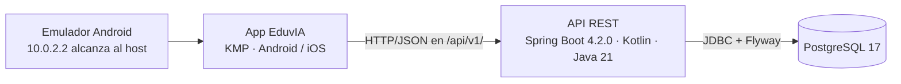

# EduvIA

EduvIA es una aplicación móvil para una escuela: el **docente** publica tareas y juntas, y el **padre o tutor** consulta las tareas de sus hijos, ve el calendario y responde si asistirá a una junta. La interfaz es Kotlin Multiplatform (Compose Multiplatform) y comparte código entre Android e iOS; los datos viven en una API REST Spring Boot con PostgreSQL.

El contrato de la API se derivó de los modelos y repositorios de la app: las reglas, formatos y decisiones están en [`docs/backend/`](docs/backend/). Resumen de estado verificado en [`docs/backend/PROGRESS.md`](docs/backend/PROGRESS.md): 38 pruebas de backend, 19 pruebas KMP, 4 E2E, JaCoCo 86,2 %, `/actuator/health` en `UP` y [`docs/backend/compat-report.md`](docs/backend/compat-report.md) sin incompatibilidades abiertas. Los bugs y confusiones detectados están inventariados en [`docs/HALLAZGOS.md`](docs/HALLAZGOS.md); no se han arreglado, salvo dos incidencias puramente documentales (H6 y H12) marcadas como resueltas en ese mismo archivo.



## Requisitos

- **JDK 21** para compilar y probar el backend en Windows.
- **Android Studio con SDK Android** (incluido `local.properties` apuntando al SDK local) y un emulador; `minSdk = 24`.
- **Docker Desktop** con Docker Compose v2 (`docker compose version`).
- **Gradle wrapper** incluido en cada build: `backend\gradlew.bat` y `Librerias_eduvia\gradlew.bat`. El backend es un build de Gradle independiente; no se mezcla con el de la app.
- **PowerShell** para los scripts. Desde `.env.example` se crea `.env`: Compose exige `JWT_SECRET` (falla en arranque si falta).

## Inicio rápido (Windows)

Todo se ejecuta desde la raíz del repositorio. Si aún no existe `.env`, cópialo primero con `copy .env.example .env` y revisa `JWT_SECRET`.

```powershell
powershell -NoProfile -ExecutionPolicy Bypass -File scripts\test-all.ps1
```

Ese script tiene 5 pasos (validar Compose, `check` del backend, pruebas de la app, levantar el stack aislado `miapp-test` en los puertos 18080/15432/18081 y pruebas E2E) y limpia el stack en `finally`. Ver [`scripts/test-all.ps1`](scripts/test-all.ps1) y [`docs/backend/PROGRESS.md`](docs/backend/PROGRESS.md).

Para el entorno de desarrollo:

```powershell
docker compose up -d --build --wait
```

El nombre del proyecto Compose es `miapp`; los servicios son `postgres`, `api` y `adminer` (este último solo con el perfil `tools`). Los puertos se configuran en `.env`. Comprueba la salud con `curl.exe http://localhost:8080/actuator/health`.

Para depurar la API fuera de Docker, con el stack de Compose detenido:

```powershell
cd backend && .\gradlew.bat bootRun
```

La app Android usa `http://10.0.2.2:8080/api/v1/` porque `10.0.2.2` es la dirección con la que el emulador alcanza el `localhost` del host; iOS usa `http://localhost:8080/api/v1/`. Detalles en [`docs/arquitectura.md`](docs/arquitectura.md).

### Credenciales de la demo

Disponibles con el perfil `dev`, que carga `backend/src/main/resources/db/dev-data/V1000__seed.sql`.

| Usuario | Contraseña | Rol |
|---|---|---|
| `laura@eduvia.mx` | `Maestra123` | docente (`TEACHER`) |
| `maria@correo.com` | `Padre1234` | padre (`PARENT`) |

## Índice de documentación

- [Índice completo de `docs/`](docs/README.md) — inicio, arquitectura, app, backend, API, base de datos, Docker, pruebas, desarrollo, operación, glosario, ADR y guías juveniles.
- [Arquitectura](docs/arquitectura.md) — capas, flujo de una petición, errores, paginación, JWT y reglas de oro.
- [Glosario](docs/glosario.md) — términos del dominio y técnicos.
- [Contrato de API](docs/backend/api-contract.md) y [OpenAPI](docs/backend/openapi.yaml) — 26 paths / 34 operaciones / 36 schemas.
- [Modelo de datos](docs/backend/data-model.md), [progreso](docs/backend/PROGRESS.md), [decisiones](docs/backend/DECISIONS.md), [dudas abiertas](docs/backend/OPEN-QUESTIONS.md) y [hallazgos](docs/HALLAZGOS.md).
- [Guías para estudiantes](docs/guias/README.md) y [inventario de documentación](docs/INVENTARIO.md).
- [Guía original de trabajo](GUIA-OPENCODE.md) — plan por fases y puertas de calidad.

> **Nota (H7):** [`GUIA-OPENCODE.md`](GUIA-OPENCODE.md) es el plan original y usa nombres de plantilla (`composeApp/`, `scripts/test-all.sh`, `:shared:testDebugUnitTest`). En este repositorio los nombres reales son `Librerias_eduvia/`, `scripts/test-all.ps1` y `:shared:testAndroid`. La guía no se ha reescrito; ver [H7 en `docs/HALLAZGOS.md`](docs/HALLAZGOS.md).
