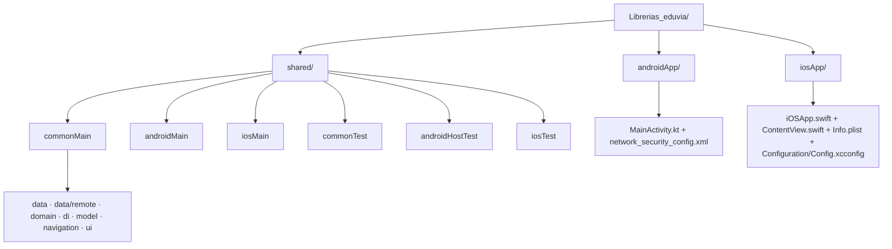
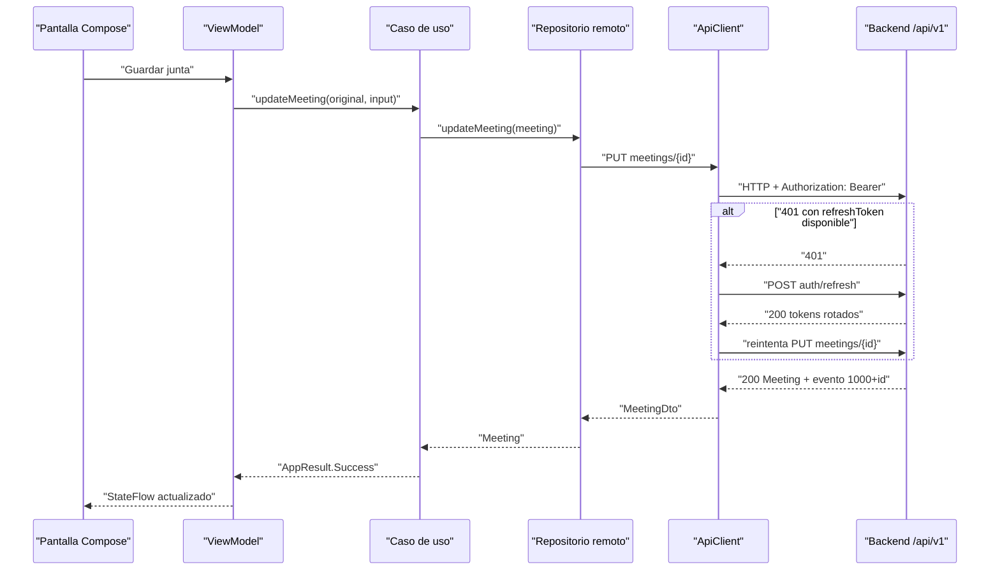

# App KMP — EduvIA

> **Resumen.** La app es un proyecto Kotlin Multiplatform con UI Compose compartida: `shared/` concentra las reglas, la red y las pantallas; `androidApp/` y `iosApp/` son solo los puntos de entrada nativos. La ruta activa de datos es la capa remota Ktor contra la API documentada en [`docs/api.md`](api.md). Los comandos verificados están en [`docs/backend/PROGRESS.md`](backend/PROGRESS.md) y los hallazgos sin corregir en [`docs/HALLAZGOS.md`](HALLAZGOS.md).

Enlaces de partida: visión general [`docs/arquitectura.md`](arquitectura.md), guía divulgativa [`docs/guias/app-kotlin.md`](guias/app-kotlin.md), mapa de documentación [`docs/guias/README.md`](guias/README.md), contrato [`docs/backend/api-contract.md`](backend/api-contract.md) e informe de compatibilidad [`docs/backend/compat-report.md`](backend/compat-report.md).

## 1. Módulos y source sets



| Source set | Contenido verificado |
|---|---|
| `shared/src/commonMain` | Código compartido: composables raíz, tema, modelos, casos de uso, repositorios e infraestructura de red común. |
| `shared/src/androidMain` | `data/remote/PlatformHttpClient.kt` con motor OkHttp y base URL Android. |
| `shared/src/iosMain` | `MainViewController.kt` y `data/remote/PlatformHttpClient.kt` con motor Darwin. |
| `shared/src/commonTest` | Pruebas de red y dominio con `MockEngine`; `TestSupport.kt` centraliza los dobles. |
| `shared/src/androidHostTest` | `ContractFixturesFileTest.kt`: deserializa los 11 JSON reales de `contract/fixtures/`. |
| `shared/src/iosTest` | Smoke test de la lógica compartida (`SharedLogicIOSTest.kt`). |

`settings.gradle.kts` incluye únicamente `:androidApp` y `:shared`. **No existe `jvmMain`**: es un error del README plantilla de KMP (hallazgo [H6](HALLAZGOS.md)).

## 2. Capas dentro de `commonMain`

Ruta común: `Librerias_eduvia/shared/src/commonMain/kotlin/com/example/librerias/`.

| Paquete | Responsabilidad |
|---|---|
| `data/` | Datos de demostración (`CalendarSampleData`, `MeetingSampleData`, `SchoolSampleData`, `TeacherCalendarSampleData`), `FakeEmailSender` y `DemoTodayProvider` (fija "hoy = 12 oct 2026", Q7). |
| `data/remote/` | `ApiClient`, 31 DTOs `@Serializable`, mappers, `SessionStore`, `RemoteListStore` y 5 repositorios remotos (`Auth`, `Group`, `Task`, `Meeting`, `Calendar`). |
| `data/repository/` | 5 implementaciones "fake" en memoria, conservadas como reserva; **no son la ruta activa** (H10 / Q12). |
| `di/` | `AppContainer.kt`: contenedor manual que decide qué implementación se inyecta. |
| `domain/repository/` | 5 interfaces de dominio; la UI depende de ellas, no de Ktor. |
| `domain/usecase/` | 24 casos de uso con validación y reglas de negocio. |
| `domain/util/` | Abstracciones `EmailSender` y `TodayProvider`. |
| `domain/validation/` | `Validators` (nombre, correo, teléfono, contraseña, hora y URL). |
| `model/` | Modelos (`User`, `SchoolTask`, `Meeting`, `CalendarEvent`, …), `AppResult`, fechas y sufijo `MEETING_ID_OFFSET`. |
| `navigation/` | `AppNavHost.kt` y `UserChip.kt`; decide pantalla según ruta y sesión. |
| `ui/` | `auth`, `calendar`, `home`, `meetings`, `tasks`, `components`, `theme` y la pantalla de gastos. |

## 3. Inyección en `AppContainer`

`di/AppContainer.kt` construye el grafo a mano, sin framework de DI:

1. `SessionStore` (tokens y usuario en memoria) → `ApiClient`.
2. `ApiClient` → `RemoteGroupRepository`, `RemoteCalendarRepository`, `RemoteTaskRepository`, `RemoteMeetingRepository` y `RemoteAuthRepository`.
3. Esos repositorios → casos de uso (`login`, `register`, `observeTasks`, `createMeeting`, `updateMeeting`, …).
4. Los casos de uso → ViewModels mediante el `container` que recibe cadaViewModel.

Las implementaciones de `data/repository/*Impl.kt` siguen en el código como ejemplo/reserva y no se inyectan; el propio KDoc de `AppContainer` lo aclara (H10 / Q12). `FakeEmailSender` tampoco envía correos: alimenta `demoInbox` con el código que devuelve el backend en el perfil `dev` (Q5).

## 4. Red por plataforma

`ApiClient.kt` declara `expect fun createPlatformHttpClient(...)` y `expect fun apiBaseUrl()`; cada plataforma aporta el `actual`:

| Plataforma | Motor | Base URL | Archivo |
|---|---|---|---|
| Android | OkHttp | `http://10.0.2.2:8080/api/v1/` | `shared/src/androidMain/kotlin/com/example/librerias/data/remote/PlatformHttpClient.kt` |
| iOS | Darwin (NSURLSession) | `http://localhost:8080/api/v1/` | `shared/src/iosMain/kotlin/com/example/librerias/data/remote/PlatformHttpClient.kt` |

Configuración común del cliente: `Json { ignoreUnknownKeys = true; explicitNulls = false; encodeDefaults = true }`, `expectSuccess = false` para convertir no-2xx en `ApiException` y leer el `ProblemDetail` (RFC 9457), timeouts de petición 15 s y conexión 10 s, `Logging` en nivel INFO, `Content-Type: application/json` y cabecera `Authorization: Bearer` cuando hay sesión.

El tráfico HTTP plano es solo de desarrollo: `androidApp/src/main/res/xml/network_security_config.xml` lo permite únicamente para `10.0.2.2`/`localhost`, e `iosApp/iosApp/Info.plist` activa `NSAllowsLocalNetworking` sin habilitar `NSAllowsArbitraryLoads`.

Si un `401` llega a una petición distinta de `auth/refresh` y existe refresh token, `ApiClient` ejecuta `POST auth/refresh`, guarda los tokens rotados y reintenta **una sola vez**; excluir `auth/refresh` evita el bucle. Si la renovación falla, limpia la sesión y propaga el error original.

## 5. Sesión y caché

- `SessionStore` mantiene `token`, `refreshToken` y `currentUser` en `MutableStateFlow`. **No hay persistencia segura**: al reiniciar el proceso hay que iniciar sesión de nuevo (documentado en [`compat-report.md`](backend/compat-report.md), decisión 9 de [`DECISIONS.md`](backend/DECISIONS.md)).
- `RemoteListStore<K,T>` es una caché en memoria protegida con `Mutex`: el primer suscriptor dispara el `loader`, `filterNotNull` evita emitir una lista vacía antes de la respuesta, y `refresh`/`replace`/`update`/`removeWhere` mantienen los flujos vivos sin esperar otra llamada. Los fallos de carga conservan el último valor conocido.
- `RegisterUseCase` valida primero, envía `children=[]` y `groups=[]` en `auth/register` y después crea grupos (`POST /groups`) o vincula hijos (`POST /students:link`) según el rol (decisión 10).
- `RemoteCalendarRepository.addEvent` solo hace `POST /calendar/events` para `EXAM`; para `TASK` y `MEETING` el backend ya creó el evento en la misma transacción, así que la app únicamente actualiza la caché local.
- `UpdateMeetingUseCase` conserva el id de la junta, **excluye la propia junta** del chequeo de duplicados y actualiza el evento `1000 + id` (`MEETING_ID_OFFSET`). La cobertura de esta regla está en `UpdateMeetingUseCaseTest.kt`; el contexto completo está en la decisión 12 y en `PROGRESS.md`, Fase 6.

## 6. Estados de la UI (ViewModels)

Los ViewModels exponen `StateFlow` y llaman a los casos de uso a través de `AppContainer`; las pantallas Compose solo observan y reaccionan.

| ViewModel | Estados / flujos expuestos | Observación |
|---|---|---|
| `LoginViewModel` | `isLoading`, `error`, `lockSeconds` | Bloqueo de 30 s tras 5 intentos fallidos. |
| `HomeViewModel` | `meetings`, `tasks` | Usa el grupo literal `1` para tareas (H9 / Q11). |
| `TasksViewModel` | `tasks`, `creationError` | Crear, editar, borrar y marcar entrega; `groupId` obligatorio (T1). |
| `MeetingsViewModel` | `meetings`, `creationError` | `createMeeting` vs. `updateMeeting` según `meetingToEdit`; asistencia y respuestas. |
| `CalendarViewModel` | eventos por rol (`PARENT`/`TEACHER`) | La vista del docente recibe `attendance`; la del padre, `null`. |
| `RegisterViewModel`, `RegisterTeacherViewModel`, `ForgotPasswordViewModel` | estados de formulario y error | Validación compartida en `domain/validation/Validators`. |

## 7. Flujo de una petición



## 8. Pruebas

| Ubicación | Qué cubre |
|---|---|
| `shared/src/commonTest/.../data/remote/TestSupport.kt` | `MockEngine`, builders de DTO y JSON de prueba reutilizables. |
| `shared/src/commonTest/.../data/remote/ApiClientTest.kt` | Ruta, token Bearer, query, paginación, `ProblemDetail`, refresco tras 401 y respuestas 204. |
| `shared/src/commonTest/.../data/remote/RemoteRepositoriesTest.kt` | Mapeo DTO→modelo y bodies/rutas exactos enviados a la API. |
| `shared/src/commonTest/.../domain/usecase/UpdateMeetingUseCaseTest.kt` | Edición de juntas: sin falso duplicado y evento `1000+id`. |
| `shared/src/androidHostTest/.../contract/ContractFixturesFileTest.kt` | Los 11 fixtures de `contract/fixtures/` con `ignoreUnknownKeys=false`: detecta campos nuevos o renombrados. |
| `shared/src/commonTest/.../SharedCommonTest.kt` y `shared/src/iosTest/.../SharedLogicIOSTest.kt` | Smoke tests de la lógica compartida. |

Comandos reales del wrapper (No se ejecutan aquí):

```powershell
cd Librerias_eduvia
.\gradlew.bat --no-daemon :shared:testAndroid
.\gradlew.bat :androidApp:assembleDebug
```

`:shared:testAndroid` es la tarea usada por `scripts/test-all.ps1` y registrada en verde con 19 pruebas, 0 fallos en la verificación final ([`PROGRESS.md`](backend/PROGRESS.md), Fase 7). La compilación `iosArm64` (main y test) también se verificó en Windows; la ejecución en simulador queda fuera de ese entorno ([`compat-report.md`](backend/compat-report.md)).

## 9. Limitaciones documentadas (no corregidas)

| Id | Limitación | Detalle |
|---|---|---|
| [H6](HALLAZGOS.md) | README plantilla | `Librerias_eduvia/README.md` menciona `jvmMain` (inexistente) y `:shared:testAndroidHostTest`; la tarea usada es `:shared:testAndroid`. |
| [H8](HALLAZGOS.md) / [Q10](backend/OPEN-QUESTIONS.md) | Botones sin acción | `ui/auth/GroupsReadyScreen.kt:136,142` ("copiar" y "compartir") son solo affordances visuales. |
| [H9](HALLAZGOS.md) / [Q11](backend/OPEN-QUESTIONS.md) | Grupo fijo | `ui/home/HomeViewModel.kt:18` observa `groupId = 1` en vez de tomarlo de la sesión. |
| [H10](HALLAZGOS.md) / [Q12](backend/OPEN-QUESTIONS.md) | Repositorios "fake" | 5 implementaciones en memoria conviven con las remotas; `AppContainer` inyecta estas últimas. |

Todas se enlazan, no se corrigen. Para el detalle de decisiones de producto, ver [`docs/backend/OPEN-QUESTIONS.md`](backend/OPEN-QUESTIONS.md) y [`docs/backend/DECISIONS.md`](backend/DECISIONS.md).

## 10. Enlaces relacionados

- Guía de la app: [`docs/guias/app-kotlin.md`](guias/app-kotlin.md)
- API y operaciones: [`docs/api.md`](api.md), [`docs/backend/api-contract.md`](backend/api-contract.md), [`docs/backend/openapi.yaml`](backend/openapi.yaml)
- Servidor: [`docs/backend.md`](backend.md)
- Compatibilidad y ejecución: [`docs/backend/compat-report.md`](backend/compat-report.md), [`docs/backend/PROGRESS.md`](backend/PROGRESS.md)
- Hallazgos y decisiones: [`docs/HALLAZGOS.md`](HALLAZGOS.md), [`docs/backend/OPEN-QUESTIONS.md`](backend/OPEN-QUESTIONS.md)
