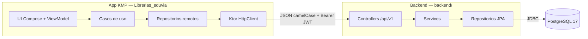
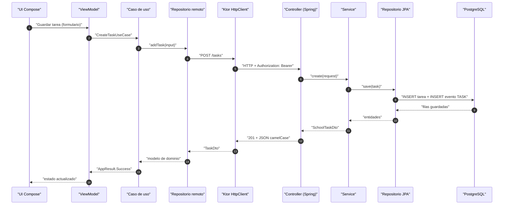
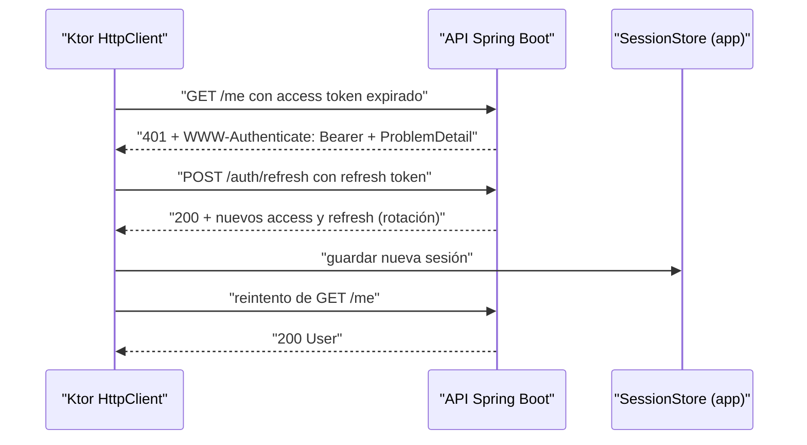

# Arquitectura — EduvIA

> Fuentes reutilizadas: [`backend/api-contract.md`](backend/api-contract.md), [`backend/data-model.md`](backend/data-model.md), [`backend/DECISIONS.md`](backend/DECISIONS.md), [`backend/compat-report.md`](backend/compat-report.md), [`INVENTARIO.md`](INVENTARIO.md) y [`GUIA-OPENCODE.md`](../GUIA-OPENCODE.md). Aquí se resume y se enlaza; los detalles están en esos documentos.

## Visión general

La app KMP posee la lógica de presentación y de dominio y llama a la API por HTTP/JSON; la API aplica reglas y transacciones, y Flyway/Hibernate se apoyan en PostgreSQL. El contrato lo define la app (`/api/v1`, camelCase, IDs `Long`, fechas `YYYY-MM-DD`).

## Capas de la app KMP

| Capa | Responsabilidad | Código existente |
|---|---|---|
| Presentación | Pantallas Compose, estado de carga/érror y navegación | `Librerias_eduvia/shared/src/commonMain/kotlin/com/example/librerias/ui/` y `navigation/AppNavHost.kt` |
| ViewModel | Convierte eventos de la UI en llamadas a casos de uso y expone estados | `ui/*/…ViewModel.kt` (por ejemplo `TasksViewModel`, `MeetingsViewModel`) |
| Dominio | Interfaces de repositorio, casos de uso y validaciones compartidas | `domain/repository/`, `domain/usecase/`, `domain/validation/`, `model/` |
| Datos | Repositorios remotos, DTOs `@Serializable`, mappers, sesión y caché local | `data/remote/` (`RemoteAuthRepository`, `RemoteGroupRepository`, `RemoteTaskRepository`, `RemoteMeetingRepository`, `RemoteCalendarRepository`, `ApiClient`, `ApiDtos`, `Mappers`, `SessionStore`, `RemoteListStore`) |
| Plataforma | Motor HTTP y base URL mediante `expect/actual` | `ApiClient.kt` (`commonMain`) y `PlatformHttpClient.kt` en `androidMain` / `iosMain` |
| Entradas nativas | Actividad Android y aplicación Swift | `Librerias_eduvia/androidApp/` y `Librerias_eduvia/iosApp/` |

`di/AppContainer.kt` inyecta únicamente los repositorios remotos de `data/remote/`: la app no tiene implementaciones en memoria ni datos de ejemplo, y la única fuente de datos es la API (que consulta PostgreSQL). `HomeViewModel` recibe el grupo real resuelto en `AppNavHost` desde los grupos de la sesión. Con esto quedan resueltos **H9/H10** y **Q11/Q12**, documentados en [`HALLAZGOS.md`](HALLAZGOS.md) y [`backend/OPEN-QUESTIONS.md`](backend/OPEN-QUESTIONS.md).

## Capas del backend

| Capa | Responsabilidad | Código existente |
|---|---|---|
| `web/` | Controllers de los 26 paths, `@Valid` y traducción de errores | `AuthController`, `GroupController`, `TaskController`, `MeetingController`, `CalendarController`, `GlobalExceptionHandler` |
| `web/dto/` | DTOs de request/response, `PageResponse<T>` y mappers entidad ↔ DTO | `Dtos.kt`, `Mappers.kt` |
| `service/` | Reglas de negocio, validaciones de dominio y transacciones | `AuthService`, `GroupService`, `TaskService`, `MeetingService`, `CalendarService` |
| `domain/` | Entidades JPA, enums e IDs compuestos | `Entities.kt`, `CompositeIds.kt` |
| `repository/` | Acceso a datos con Spring Data JPA | `Repositories.kt` (10 repositorios) |
| `config/` | Seguridad y JWT | `SecurityConfig.kt`, `JwtConfig.kt` |
| Recursos | Esquema, datos demo y configuración por perfil | `db/migration/`, `db/dev-data/`, `application*.yml` |

Paquete base: `com.example.librerias.api`. Spring Boot 4.2.0 / Kotlin / Java 21 con Gradle wrapper `backend\gradlew.bat`. Boot 4 usa Jackson 3, detalle recogido en [`backend/PROGRESS.md`](backend/PROGRESS.md).

## Flujo punta a punta de una petición

Ejemplo: crear una tarea desde el formulario (T3), que también genera su evento de calendario.

La ruta inversa de lectura es equivalente: el repositorio remoto convierte `PageDto<T>` en modelos de dominio y la UI solo consume `items`. La lista completa de operaciones está en [`backend/api-contract.md`](backend/api-contract.md); no se repite aquí.

### Renovación del token

El cliente Ktor detecta el 401, pide un refresh con rotación y reintenta la petición original.

## Manejo de errores

- El backend responde `ProblemDetail` (RFC 9457) desde `GlobalExceptionHandler.kt`: `type`, `title`, `status`, `detail`, `instance` y `properties.errors`; `Content-Type: application/problem+json`. Un 404 real verificado es `{"detail":"Grupo no encontrado","status":404,"title":"Not Found","errors":[]}`.
- Códigos habituales: 400 validación, 401 sin token o refresh inválido, 404 recurso inexistente, 409 conflicto (email/teléfono duplicado, junta repetida, código de clase inexistente). El cuerpo de 500 no expone detalles internos.
- En la app, `ApiClient.kt` parsea `ProblemDto` y convierte fallos de red, timeout y códigos HTTP en `ApiException` / `AppResult.Error(message)` para los ViewModels. El contrato de errores y su compatibilidad están en [`backend/api-contract.md`](backend/api-contract.md) y [`backend/compat-report.md`](backend/compat-report.md); la explicación para estudiantes, en [`guias/api-rest.md`](guias/api-rest.md).

## Paginación

Todos los listados devuelven `PageResponse<T>` con `items`, `page`, `size`, `totalElements` y `totalPages`. Defaults: `page = 0`, `size = 20`, `size <= 100`. Aplica a G1, G5, G6, T1, M1, M5 y C1. La app consume únicamente `items` y no ha cambiado sus pantallas; la decisión provisional Q2 está en [`backend/OPEN-QUESTIONS.md`](backend/OPEN-QUESTIONS.md). La forma exacta del objeto está en [`backend/api-contract.md`](backend/api-contract.md).

## Autenticación JWT

- Flujo público A1–A8 (`/auth/...`) y protegido A9 (`GET /me`) más el resto de recursos; cabecera `Authorization: Bearer <accessToken>`.
- Access token de **900 s**; refresh de **7 días** con rotación (revocar + insertar en `refresh_tokens`). Secreto leído de `JWT_SECRET`, obligatorio en Compose.
- Una petición sin token devuelve 401 con `WWW-Authenticate: Bearer`, lo que permite el refresco automático del plugin `Auth` de Ktor.
- Roles: solo `PARENT` y `TEACHER`; el alcance de recursos se resuelve por propiedad (docente → sus grupos; padre → sus hijos). No hay `ADMIN` (Q9).
- La sesión de la app se mantiene en memoria en `SessionStore`; no hay persistencia segura de tokens todavía. Es una limitación documentada, no una incompatibilidad: [`backend/compat-report.md`](backend/compat-report.md) y decisión 9 en [`backend/DECISIONS.md`](backend/DECISIONS.md).

## Matriz de responsabilidades

| Responsabilidad | App KMP | Backend | Referencia |
|---|---|---|---|
| Definir nombres, tipos y nulabilidad del contrato | Dueña del contrato (modelos y repositorios) | Se adapta; nunca impone su propio esquema al DTO | [`api-contract.md`](backend/api-contract.md) |
| Validación de formularios | `Validators` y ViewModels | `@Valid` en DTOs y reglas de negocio en services | [`guias/app-kotlin.md`](guias/app-kotlin.md), [`api-contract.md`](backend/api-contract.md) |
| Reglas de negocio | Casos de uso | Services con transacciones | [`api-contract.md`](backend/api-contract.md) |
| Persistencia | Sin acceso directo a PostgreSQL | Entidades JPA + repositorios + Flyway | [`data-model.md`](backend/data-model.md) |
| Esquema | No lo conoce | Flyway es dueño; Hibernate solo valida | [`data-model.md`](backend/data-model.md) |
| Errores | Parsea `ProblemDetail` y muestra `AppResult.Error` | `GlobalExceptionHandler` | [`compat-report.md`](backend/compat-report.md) |
| Paginación | Lee `items` | Construye `PageResponse<T>` | Q2 en [`OPEN-QUESTIONS.md`](backend/OPEN-QUESTIONS.md) |
| Sesión y tokens | `SessionStore`, refresh 401 y reintento | Emisión, validación y rotación | [`DECISIONS.md`](backend/DECISIONS.md) |
| Eventos de calendario | `addEvent`: `TASK`/`MEETING` solo caché local; `EXAM` sí hace POST | T3/T5 y M3/M4/M9 crean, actualizan y borran el evento en la misma transacción | [`api-contract.md`](backend/api-contract.md), [`compat-report.md`](backend/compat-report.md) |
| Contrato ejecutable | `MockEngine` + fixtures de `contract/fixtures/` | Tests de integración y comparación con `/v3/api-docs` | [`PROGRESS.md`](backend/PROGRESS.md) |

## Módulos y builds

| Módulo o directorio | Función |
|---|---|
| `backend/` | API Spring Boot; build de Gradle independiente, `gradlew.bat`, `Dockerfile` y migraciones Flyway |
| `Librerias_eduvia/shared/` | Código KMP compartido (`commonMain`, `androidMain`, `iosMain` y source sets de pruebas) |
| `Librerias_eduvia/androidApp/` | Entrada Android, manifiesto, `network_security_config.xml` y recursos |
| `Librerias_eduvia/iosApp/` | Entrada iOS en Swift y proyecto Xcode |
| `contract/fixtures/` | 11 respuestas JSON reales compartidas por backend y app |
| `scripts/` | `test-all.ps1`: verificación de toda la arquitectura |
| `docs/` | Documentación: `backend/`, `guias/` y los documentos nuevos de este índice |

El detalle clase por clase está en [`INVENTARIO.md`](INVENTARIO.md). No se mezcla el build del backend con el build KMP de la app: hacerlo genera conflictos entre el plugin de Android/KMP y Spring Boot.

## Decisiones y ADR

- Decisiones confirmadas 1–13, con origen y valor, en [`backend/DECISIONS.md`](backend/DECISIONS.md). Destacan: backend en Kotlin en `backend/`, paquete `com.example.librerias.api`, Compose con nombre `miapp`, evento de junta con id `1000 + meetings.id`, `dateText` en `YYYY-MM-DD`, Ktor fijado a **3.2.1** (3.2.0 falla en D8 con `minSdk = 24`) y base URL Android definitiva `http://10.0.2.2:8080/api/v1/`.
- ADR disponibles en [docs/adr/](adr/) (escritos por otro agente), en línea con el temario previsto en [`INVENTARIO.md`](INVENTARIO.md):
  - [ADR 0001 — backend en Kotlin con Spring Boot](adr/0001-backend-kotlin-spring-boot.md)
  - [ADR 0002 — build de Gradle separado](adr/0002-build-gradle-separado.md)
  - [ADR 0003 — Flyway como fuente del esquema](adr/0003-flyway-como-fuente-del-esquema.md)
  - [ADR 0004 — PostgreSQL real vía Testcontainers](adr/0004-testcontainers-postgres-real.md)
  - [ADR 0005 — fixtures de contrato compartidos](adr/0005-fixtures-de-contrato-compartidos.md)
  - [ADR 0006 — `ProblemDetail` RFC 9457](adr/0006-problemdetail-rfc-9457.md)
  - [ADR 0007 — base URL Android `10.0.2.2`](adr/0007-base-url-android-10-0-2-2.md)
- Índice del directorio: [adr/README.md](adr/README.md). La base URL Android `http://10.0.2.2:8080/api/v1/` también está registrada en la decisión 13 de [`backend/DECISIONS.md`](backend/DECISIONS.md) y en el [glosario](glosario.md).

## Reglas de oro

1. **Flyway es dueño del esquema.** Hibernate usa `ddl-auto: validate`; nunca `update` ni `create`. Una migración ya aplicada no se edita: se crea otra (`V2__comments.sql`). Ver [`data-model.md`](backend/data-model.md).
2. **El backend se adapta al contrato de la app.** Nombres camelCase, IDs `Long`, enums en mayúsculas y fechas `YYYY-MM-DD` mandan, aunque la guía general sugiera otra cosa. Ver [`api-contract.md`](backend/api-contract.md).
3. **Pruebas junto al código.** No se desactivan pruebas ni se baja el umbral de JaCoCo (≥ 80 %) para que el build pase. Ver [`GUIA-OPENCODE.md`](../GUIA-OPENCODE.md) y [`PROGRESS.md`](backend/PROGRESS.md).
4. **Builds separados** para backend y app; en Windows se usa `gradlew.bat`, PowerShell y `curl.exe`.
5. **Lo no confirmado se pregunta, no se supone.** Los bugs y confusiones se documentan en [`HALLAZGOS.md`](HALLAZGOS.md) sin arreglarlos.

### Puntos no confirmados y hallazgos relacionados

- ⚠️ Por confirmar — botones «copiar» y «compartir» sin acción en `GroupsReadyScreen.kt` (**Q10**, **H8**): se documentan como affordances visuales; ver [`OPEN-QUESTIONS.md`](backend/OPEN-QUESTIONS.md) y [`HALLAZGOS.md`](HALLAZGOS.md).
- ✅ Resuelto — el grupo activo ya no es el literal `1`: `AppNavHost` lo resuelve desde los grupos reales y lo pasa a `HomeViewModel` (**Q11**, **H9**).
- ✅ Resuelto — los repositorios en memoria y sus datos de muestra se eliminaron: solo quedan los remotos (**Q12**, **H10**).
- ⚠️ Por confirmar — `spring.application.name` duplicado en `application.properties` y `application.yml` (**Q13**, **H11**): se deja como está; ver [`OPEN-QUESTIONS.md`](backend/OPEN-QUESTIONS.md).
- El README de la app sigue siendo la plantilla KMP (**H6**), la guía original usa nombres de plantilla (**H7**) y [`guias/README.md`](guias/README.md) contiene un diagrama ASCII (**H12**). No se corrigen aquí: inventario completo en [`HALLAZGOS.md`](HALLAZGOS.md). Las inconsistencias documentales H1–H5 también están registradas allí.
