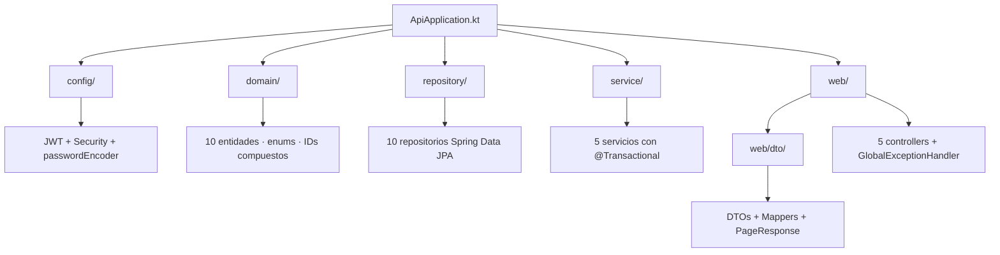
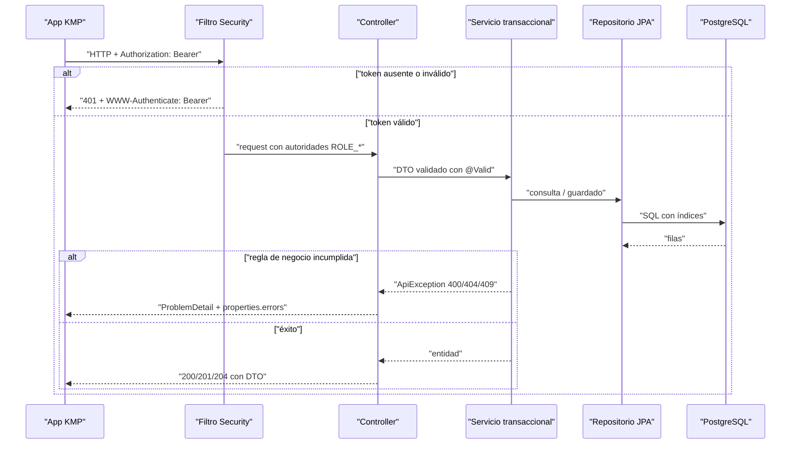

# Backend — EduvIA

> **Resumen.** API REST stateless en Spring Boot 4.2.0 (Kotlin, Java 21) sobre PostgreSQL 17, con Flyway como única fuente del esquema, JWT HS256 y errores RFC 9457. Expone 34 operaciones bajo `/api/v1`; **la tabla completa de endpoints está en [`docs/api.md`](api.md)** y no se repite aquí.

Fuentes ya escritas y reutilizadas: [`docs/backend/api-contract.md`](backend/api-contract.md), [`docs/backend/openapi.yaml`](backend/openapi.yaml), [`docs/backend/compat-report.md`](backend/compat-report.md), [`docs/backend/data-model.md`](backend/data-model.md), [`docs/backend/DECISIONS.md`](backend/DECISIONS.md), [`docs/backend/OPEN-QUESTIONS.md`](backend/OPEN-QUESTIONS.md), [`docs/backend/test-plan.md`](backend/test-plan.md), [`docs/backend/PROGRESS.md`](backend/PROGRESS.md) y [`docs/HALLAZGOS.md`](HALLAZGOS.md).

## 1. Paquetes y responsabilidades

Raíz: `backend/src/main/kotlin/com/example/librerias/api/`.



| Paquete | Responsabilidad | Archivos principales |
|---|---|---|
| (raíz) | Arranque y escaneo de componentes; sin lógica de negocio. | `ApiApplication.kt` |
| `config` | Clave HS256 compartida (`JwtEncoder`/`JwtDecoder`), cadena de filtros, autoridades `roles` → `ROLE_*`, codificador de contraseñas y errores de seguridad como `ProblemDetail`. | `JwtConfig.kt`, `SecurityConfig.kt` |
| `domain` | Entidades JPA, enums (`UserRole`, `Subject`, `CalendarEventType`, `MeetingResponse`) e IDs compuestos (`TaskDeliveryId`, `MeetingResponseId`). | `Entities.kt`, `CompositeIds.kt` |
| `repository` | 10 repositorios Spring Data: consultas derivadas, proyección de entregas, consultas de conflicto de juntas y borrados en bloque. | `Repositories.kt` |
| `service` | Reglas de negocio y transacciones: registro atómico, tokens, grupos, tareas, juntas y calendario. | `AuthService.kt`, `GroupService.kt`, `TaskService.kt`, `MeetingService.kt`, `CalendarService.kt` |
| `web` | Traducción HTTP ↔ servicio en 5 controllers y centralización de errores. | `AuthController.kt`, `GroupController.kt`, `TaskController.kt`, `MeetingController.kt`, `CalendarController.kt`, `GlobalExceptionHandler.kt` |
| `web/dto` | Request/response, `PageResponse<T>`, mappers entidad → DTO y campos derivados (`status`, `isNext`, `attendance`). | `Dtos.kt`, `Mappers.kt` |

## 2. Arranque y perfiles

- `backend/` es un build Gradle independiente del build KMP: Spring Boot 4.2.0, Kotlin 2.4.21, Java 21, springdoc 3.2.1, PostgreSQL, Flyway, Security/OAuth2 Resource Server, Validation, Actuator, JaCoCo y Testcontainers. Ver `backend/build.gradle.kts`.
- `application.yml` fija los valores base; `application-dev.yml` añade la semilla de demostración; `backend/src/test/resources/application-test.yml` usa Testcontainers con PostgreSQL real.
- Perfil **`dev`**: `spring.flyway.locations=classpath:db/migration,classpath:db/dev-data` → aplica `V1__init_schema.sql`, `V2__comments.sql` y `db/dev-data/V1000__seed.sql`. Perfil **`prod`**: solo migraciones versionadas, sin datos de prueba.
- Migraciones: `backend/src/main/resources/db/migration/V1__init_schema.sql` (10 tablas, constraints, 11 índices) y `V2__comments.sql`; el modelo y la justificación de cada índice están en [`docs/backend/data-model.md`](backend/data-model.md).
- Credenciales de la semilla: `laura@eduvia.mx` / `Maestra123` (`TEACHER`) y `maria@correo.com` / `Padre1234` (`PARENT`).
- `docker-compose.yml` (raíz, nombre `miapp`) levanta PostgreSQL 17 + API + Adminer opcional (`--profile tools`) con healthchecks y puertos configurables desde `.env`. Para `bootRun`, `backend/compose.yaml` levanta solo PostgreSQL y Spring Boot lo detecta gracias a `spring-boot-docker-compose` en `developmentOnly`.

Comandos reales del wrapper (No se ejecutan aquí):

```powershell
cd backend
.\gradlew.bat build
.\gradlew.bat bootRun
.\gradlew.bat check
```

`build` compila y empaqueta; `check` incluye `jacocoTestCoverageVerification` (umbral 80 % de líneas). `bootRun` usa el perfil activo que se le indique (por defecto, `dev` en el entorno local de Compose); la evidencia de arranques y pruebas está en [`docs/backend/PROGRESS.md`](backend/PROGRESS.md).

## 3. Propiedades de `application*.yml` y por qué

| Propiedad | Valor / origen | Razón |
|---|---|---|
| `spring.application.name` | `api` | Nombre en logs y Actuator; no altera el contrato. ⚠️ Ver nota H11/Q13 abajo. |
| `spring.datasource.url/username/password` | `${DB_URL}`, `${DB_USER}`, `${DB_PASSWORD}` (defaults locales `app`) | En despliegue se inyectan; los defaults son solo desarrollo. |
| `spring.jpa.hibernate.ddl-auto` | `validate` | Flyway es la única fuente del esquema; Hibernate comprueba entidades sin crear ni alterar tablas. |
| `spring.jpa.open-in-view` | `false` | La sesión no queda abierta al renderizar: evita cargas lazy implícitas y N+1 fuera de las transacciones de servicio. |
| `spring.jpa.properties.hibernate.jdbc.time_zone` | `UTC` | Backend y app interpretan igual fechas y vencimientos. |
| `spring.jackson.default-property-inclusion` | `always` | La app KMP necesita nulos explícitos (por ejemplo `attendance: null` para `PARENT`), no propiedades omitidas. |
| `spring.mvc.problemdetails.enabled` | `true` | Errores como `ProblemDetail` (RFC 9457), el formato que parsea el cliente Ktor. |
| `server.port` | `${PORT:8080}` | Compose y pruebas sobreescriben el puerto sin tocar código. |
| `server.error.include-stacktrace` | `never` | No exponer trazas al cliente; basta el `ProblemDetail`. |
| `management.endpoints.web.exposure.include` | `health,info` | Superficie de Actuator mínima. |
| `management.endpoint.health.probes.enabled` | `true` | Grupos `liveness`/`readiness` para los healthchecks de Compose. |
| `springdoc.swagger-ui.path` | `/swagger-ui.html` | UI pública de OpenAPI; coincide con la ruta permitida en `SecurityConfig`. |
| `jwt.secret` | `${JWT_SECRET}` (default local de desarrollo) | HS256; exige al menos 32 bytes. Compose falla rápido si no se define el secreto. |
| `jwt.access-token-seconds` | `900` | 15 minutos; la app refresca sola, así que se limita el impacto de un token robado. |
| `jwt.refresh-token-days` | `7` | Una semana; cada renovación rota el refresh token. |
| `spring.flyway.enabled` | `true` | Migraciones versionadas al arrancar. |
| `spring.flyway.locations` (`dev`) | `classpath:db/migration,classpath:db/dev-data` | Solo `dev` carga `V1000__seed.sql`; producción no. |
| `spring.jpa.properties.hibernate.generate_statistics` (`dev`) | `true` | Métricas para detectar N+1 en listados durante el desarrollo. |

⚠️ **Por confirmar · H11/Q13.** `backend/src/main/resources/application.properties` y `application.yml` definen por duplicado `spring.application.name=api`. Es inofensivo y se conserva sin unificar; ver [`docs/HALLAZGOS.md`](HALLAZGOS.md) y [`docs/backend/OPEN-QUESTIONS.md`](backend/OPEN-QUESTIONS.md).

## 4. Seguridad

- API **stateless**: CSRF desactivado (no hay cookies) y `SessionCreationPolicy.STATELESS`.
- Públicas: `/api/v1/auth/**`, `/actuator/health/**` (y `/actuator/health`), `/v3/api-docs/**`, `/swagger-ui/**`, `/swagger-ui.html` y `/error`. Cualquier otra ruta exige JWT Bearer.
- `JwtConfig` deriva una única clave `SecretKeySpec` de `jwt.secret` y expone encoder/decoder HS256 con el mismo secreto.
- `SecurityConfig.jwtAuthenticationConverter()` lee el claim `roles` y antepone `ROLE_` para `hasRole`/`@PreAuthorize`.
- `401` → `ProblemDetail` con cabecera `WWW-Authenticate: Bearer` (RFC 6750); `403` → `ProblemDetail` sin esa cabecera, porque el token es válido pero insuficiente.
- `PasswordEncoderFactories.createDelegatingPasswordEncoder()` admite hashes bcrypt antiguos y con prefijo `{bcrypt}`.
- No se implementa `ADMIN` (Q9): solo `PARENT` y `TEACHER`, con restricción por propiedad de recursos.

## 5. Errores, validación y paginación

**Errores.** `GlobalExceptionHandler` es un `@RestControllerAdvice` con `@Order(HIGHEST_PRECEDENCE)`: sin esa precedencia, los fallos de `@Valid`, cuerpos ilegibles y tipos inválidos caerían en el manejador genérico de Boot y se perdería `properties.errors`. Convierte:

| Situación | Resultado |
|---|---|
| `ApiException` de dominio | 400 / 401 / 404 / 409 con `detail`, `title` y `properties.errors`. |
| `@Valid` fallido | 400, `detail = "Validación incorrecta"`, errores por campo. |
| JSON ilegible | 400 con error en el campo `body` (causa registrada en logs, no expuesta). |
| Parámetro de query/path no convertible | 400 con el nombre y valor rechazados. |
| Excepción imprevista | 500 genérico, traza completa solo en logs. |

**Validación.** Los controllers anotan `@Valid` los bodies; `acceptedTerms` usa `@AssertTrue` (así `false` produce error y no se escapa como `null`). Reglas de negocio adicionales —unicidad de email/teléfono normalizados, códigos `XX-YYYY`,unicidad de juntas por `groupId + date + time + location`,entregas idempotentes y códigos de reset de 6 dígitos/10 min/5 intentos— están en la sección de reglas de [`docs/backend/api-contract.md`](backend/api-contract.md).

**Paginación.** `PageResponse<T> { items, page, size, totalElements, totalPages }`, con `page` empezando en 0 y tope de `size` 100; la convención acordada con la app es `page=0, size=20` ([Q2](backend/OPEN-QUESTIONS.md)). Los listados ordenan de forma estable desde el controlador (`id`, `dueDate,id`, `date,id`) y el cliente KMP consume solo `items` ([`compat-report.md`](backend/compat-report.md)).

## 6. Transacciones, índices y N+1

- `@Transactional` en los 5 servicios agrupa las operaciones que deben ser atómicas: registro de usuario con grupos/hijos, creación de tarea + evento `TASK`, creación/edición/borrado de junta + evento `1000+id`, entregas y respuestas. Si falla un código de clase en el registro, no queda usuario creado.
- `TaskDelivery` y `MeetingResponse` usan IDs compuestos como barrera de duplicados; las entregas se comprueban con `existsByTaskIdAndStudentId` antes de insertar.
- `MeetingRepository.findConflictingTimes(..., excludeId)` ignora la propia junta al editar (M9), base del 409 de duplicados.
- Once índices en `V1__init_schema.sql` cubren FKs y filtros frecuentes, más el índice único funcional `uk_meetings_unique (group_id, date, lower(time), lower(location))`. Detalle y justificación en [`docs/backend/data-model.md`](backend/data-model.md).
- Anti-N+1: `open-in-view: false`, consultas paginadas, proyección `findDeliveredStudentIds` (solo ids, sin cargar entidades) y borrados en bloque `@Modifying` para entregas y respuestas.

## 7. Flujo de una petición



## 8. Verificación y enlaces

- Contrato detallado: [`docs/backend/api-contract.md`](backend/api-contract.md) · OpenAPI: [`docs/backend/openapi.yaml`](backend/openapi.yaml) · Operaciones: [`docs/api.md`](api.md).
- Compatibilidad app ↔ API (26 paths, 34 operaciones, 36 schemas; `missing=[]`, `extra=[]`): [`docs/backend/compat-report.md`](backend/compat-report.md).
- Decisiones, dudas y ejecución: [`docs/backend/DECISIONS.md`](backend/DECISIONS.md), [`docs/backend/OPEN-QUESTIONS.md`](backend/OPEN-QUESTIONS.md), [`docs/backend/PROGRESS.md`](backend/PROGRESS.md), [`docs/backend/test-plan.md`](backend/test-plan.md).
- Hallazgos sin corregir: H11/Q13 (configuración duplicada) y H3/H4 (recuentos antiguos de schemas/operaciones) en [`docs/HALLAZGOS.md`](HALLAZGOS.md).
- Cliente de la API: [`docs/app-kmp.md`](app-kmp.md).
