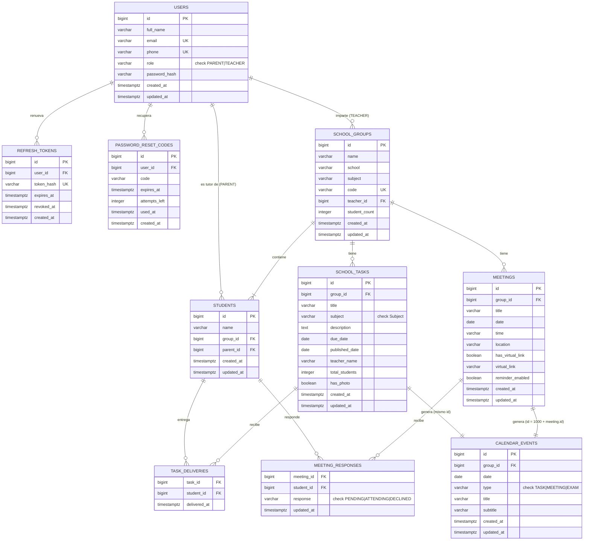

# Modelo de datos — EduvIA

> Derivado de `api-contract.md`. El esquema lo manda Flyway; Hibernate solo valida (`ddl-auto: validate`).
> IDs `bigint generated by default as identity` porque la app usa `Long`.

## Diagrama entidad-relación

## Tablas y columnas

### `users` — `model/User.kt` + cuenta de auth

| Columna | Tipo | Null | Default | Origen |
|---|---|---|---|---|
| `id` | `bigint generated by default as identity` | no | — | `User.id` |
| `full_name` | `varchar(200)` | no | — | `User.fullName` |
| `email` | `varchar(320)` | no | — | `User.email` (normalizado lower-case) |
| `phone` | `varchar(20)` | no | — | `User.phone` (solo dígitos) |
| `role` | `varchar(16)` | no | — | `User.role`, `ck_users_role` |
| `password_hash` | `varchar(100)` | no | — | bcrypt (no expuesto en DTO) |
| `created_at`, `updated_at` | `timestamptz` | no | `now()` | auditoría |

Restricciones: `pk_users`, `uk_users_email`, `uk_users_phone`, `ck_users_role in ('PARENT','TEACHER')`, `ck_users_email_format` (contiene `@`), `ck_users_phone_digits` (solo dígitos).

### `refresh_tokens` — Fase 3b

`id`, `user_id FK on delete cascade`, `token_hash` (SHA-256, `uk_refresh_tokens_hash`), `expires_at`, `revoked_at?`, `created_at`. Rotación = revocar + insertar.

### `password_reset_codes` — `AuthRepository.resetCodes`

`id`, `user_id FK cascade`, `code varchar(6)`, `expires_at` (10 min), `attempts_left integer default 5` (`ck >= 0`), `used_at?`. Un nuevo código invalida los anteriores del usuario (mediante `used_at`).

### `school_groups` — `model/SchoolGroup.kt`

`id`, `name`, `school`, `subject`, `code varchar(16)` (`uk_school_groups_code`, búsqueda case-insensitive con índice funcional `lower(code)`), `teacher_id FK users on delete restrict`, `student_count integer default 0` (`ck >= 0`), auditoría.

> `student_count` se guarda deliberadamente: es un contador consultado en cada listado de grupos y en `CreateTaskUseCase`; se mantiene actualizado en `linkStudent` para evitar `count(*)` repetidos. Documentado como derivado-but-cached.

### `students` — `model/Student.kt`

`id`, `name`, `group_id FK school_groups on delete cascade`, `parent_id FK users on delete restrict` (**nullable**: la app usa `parentId = 0` como "sin tutor asignado"; el mapper convierte `null ↔ 0`), auditoría. Un alumno pertenece a un grupo y, opcionalmente, a un tutor.

### `school_tasks` — `model/SchoolTask.kt`

`id`, `group_id FK cascade`, `title`, `subject varchar(16)` (`ck_subject`), `description text`, `due_date date`, `published_date date` (`ck_due_after_publish` no se impone: la demo tiene publicación anterior, pero se permite igualdad), `teacher_name`, `total_students integer`, `has_photo boolean default false`, auditoría.

`deliveredStudentIds` **no** es columna: vive en `task_deliveries`.

### `task_deliveries` — `SchoolTask.deliveredStudentIds: Set<Long>`

`task_id FK cascade`, `student_id FK students on delete cascade`, `delivered_at`. PK `(task_id, student_id)` → idempotencia. Índice en `student_id` ya cubierto por la PK compuesta (primer campo `task_id`); se añade índice inverso para consultas por alumno.

### `meetings` — `model/MeetingModels.kt`

`id`, `group_id FK cascade`, `title`, `date date`, `time varchar(20)`, `location varchar(200)`, `has_virtual_link boolean`, `virtual_link?`, `reminder_enabled boolean default true`, auditoría. `uk_meetings_unique (group_id, date, lower(time), lower(location))` → 409.

`isNext`, `relativeLabel`, `response` (para el alumno) son derivados; `response` se sirve desde `meeting_responses`.

### `meeting_responses` — `MeetingRepository.responses`

`meeting_id FK cascade`, `student_id FK cascade`, `response varchar(16)` (`ck_meeting_response`), `updated_at`. PK `(meeting_id, student_id)`.

### `calendar_events` — `model/CalendarModels.kt`

`id bigint primary key default nextval('calendar_events_id_seq')`. Los eventos generados por una tarea usan **el mismo id que la tarea** (regla de la app). Los generados por una junta usan `1000 + meeting.id`: en la app las juntas y las tareas vivían en dos listas separadas con ids que se solapaban, pero en una única tabla hace falta desambiguar (documentado en `OPEN-QUESTIONS.md`). Los eventos creados directamente (`C2`) usan el valor de la secuencia. FK `group_id cascade`, `date`, `type` (`ck_event_type`), `title`, `subtitle`, auditoría.

`attendance` es derivado de `meeting_responses`, nunca almacenado.

## Mapeo DTO ↔ tabla (resumen)

| DTO app | Tabla(s) | Campos calculados / no persistidos |
|---|---|---|
| `User` | `users` | `firstName` (derivado de `fullName`) |
| `SchoolGroup` | `school_groups` | `studentCount` cacheado |
| `Student` | `students` | — |
| `SchoolTask` | `school_tasks` + `task_deliveries` | `displayTitle`, `deliveredCount`, `missingCount`, `isComplete`, `deliveredFraction`, `status` |
| `Meeting` | `meetings` + `meeting_responses` | `isNext`, `relativeLabel`, `response` (por alumno) |
| `FamilyResponse` | `students` + `meeting_responses` | `familyName = "Familia de " + name` |
| `AttendanceSummary` | — | 100 % derivado |
| `CalendarEvent` | `calendar_events` | `attendance` derivado; `subtitle` se guarda tal cual lo envía la app |

## Índices y justificación

| Índice | Justificación |
|---|---|
| `idx_refresh_tokens_user (user_id)` | FK + limpieza por usuario |
| `idx_password_reset_codes_user (user_id)` | FK + invalidar códigos anteriores |
| `idx_school_groups_teacher (teacher_id)` | Filtro `GET /groups?teacherId=` |
| `idx_school_groups_code_lower (lower(code))` | Búsqueda case-insensitive `GET /groups/by-code` |
| `idx_students_group (group_id)` | FK + `GET /groups/{id}/students` + attendance |
| `idx_students_parent (parent_id)` | FK + `GET /students?parentId=` |
| `idx_school_tasks_group_due (group_id, due_date)` | `GET /tasks?groupId=` ordenado por fecha |
| `idx_task_deliveries_student (student_id)` | Consulta inversa de entregas por alumno |
| `idx_meetings_group_date (group_id, date)` | FK + orden de `GET /meetings` |
| `idx_meeting_responses_student (student_id)` | `GET /meetings/responses?studentId=` |
| `idx_calendar_events_group_date (group_id, date)` | `GET /calendar/events` por rol/grupo |

## Migraciones

- `V1__init_schema.sql`: extensión `pgcrypto`, las 10 tablas, constraints y todos los índices.
- `V1000__seed_dev.sql` (en `db/dev-data/`, solo perfil `dev`): 2 usuarios demo, 2 grupos, 30 alumnos, 6 tareas + entregas, 2 juntas + respuestas, eventos de calendario. Contraseñas bcrypt de `Maestra123` / `Padre1234`.
