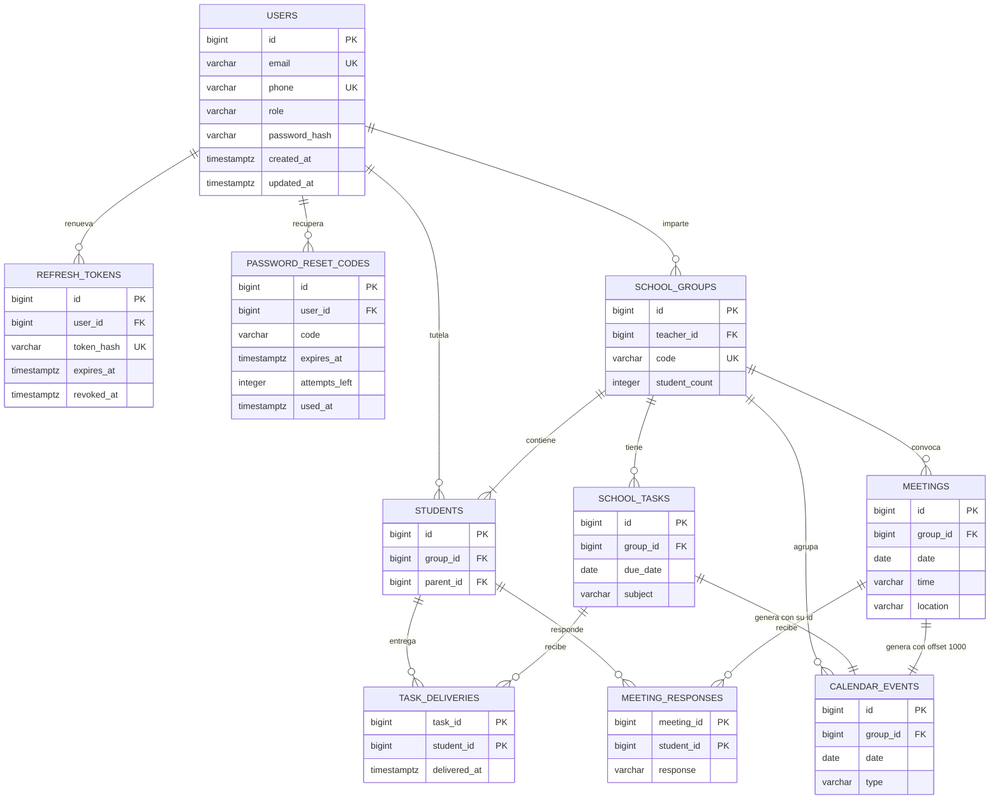

# Base de datos — EduvIA

> PostgreSQL 17 en Docker, 10 tablas. Flyway es la única fuente del esquema y Hibernate solo valida (`spring.jpa.hibernate.ddl-auto: validate`, en `backend/src/main/resources/application.yml`).
> El detalle columna por columna y el mapeo DTO ↔ tabla están en [`backend/data-model.md`](backend/data-model.md); aquí solo está el índice resumido y su operación.

## Modelo resumido



Las dos tablas de unión tienen **PK compuesta** (`task_deliveries`, `meeting_responses`); en el diagrama ambas columnas aparecen marcadas como `PK`.

## Tablas y propósito

| Tabla | Propósito | Índices principales |
|---|---|---|
| `users` | Cuentas `PARENT`/`TEACHER`, email y teléfono únicos, hash bcrypt | `uk_users_email`, `uk_users_phone` |
| `refresh_tokens` | Refresh tokens con rotación (hash SHA-256, revocación) | `uk_refresh_tokens_hash`, `idx_refresh_tokens_user` |
| `password_reset_codes` | Códigos de 6 dígitos, 10 min, 5 intentos, un solo uso | `idx_password_reset_codes_user` |
| `school_groups` | Grupos del docente con código de clase y contador cacheado | `uk_school_groups_code`, `idx_school_groups_code_lower`, `idx_school_groups_teacher` |
| `students` | Alumnos de un grupo, con tutor opcional | `idx_students_group`, `idx_students_parent` |
| `school_tasks` | Tareas con fecha de entrega y publicación | `idx_school_tasks_group_due` |
| `task_deliveries` | Entregas por alumno; idempotencia por PK compuesta | `idx_task_deliveries_student` (inverso de la PK) |
| `meetings` | Juntas; unicidad por grupo + fecha + hora + lugar | `uk_meetings_unique`, `idx_meetings_group_date` |
| `meeting_responses` | Respuesta de cada familia; se sobrescribe por PK compuesta | `idx_meeting_responses_student` |
| `calendar_events` | Calendario unificado de tareas, juntas y exámenes | `idx_calendar_events_group_date` |

## Índices y por qué existen

| Índice | Consulta o regla que lo justifica |
|---|---|
| `idx_refresh_tokens_user (user_id)` | FK y limpieza/rotación por usuario |
| `idx_password_reset_codes_user (user_id)` | Invalidar los códigos anteriores al generar uno nuevo |
| `idx_school_groups_teacher (teacher_id)` | Filtro `GET /groups?teacherId=` |
| `idx_school_groups_code_lower (lower(code))` | Búsqueda case-insensitive de `GET /groups/by-code` |
| `idx_students_group (group_id)` | `GET /groups/{id}/students` y cálculo de asistencia |
| `idx_students_parent (parent_id)` | `GET /students?parentId=` |
| `idx_school_tasks_group_due (group_id, due_date)` | `GET /tasks?groupId=` ordenado por vencimiento |
| `idx_task_deliveries_student (student_id)` | Consulta inversa de entregas por alumno |
| `idx_meetings_group_date (group_id, date)` | Ordenación de `GET /meetings` |
| `uk_meetings_unique (group_id, date, lower(time), lower(location))` | Junta duplicada → 409 (case-insensitive) |
| `idx_meeting_responses_student (student_id)` | `GET /meetings/responses?studentId=` |
| `idx_calendar_events_group_date (group_id, date)` | `GET /calendar/events` filtrado por grupo/fecha |

## Migraciones, en orden

1. `backend/src/main/resources/db/migration/V1__init_schema.sql` — extensión `pgcrypto`, las 10 tablas, restricciones con nombre y los índices. Tiene cabeceras `--` explicativas. **No se edita**: ya aplicada, cambiarla rompería el checksum de Flyway.
2. `backend/src/main/resources/db/migration/V2__comments.sql` — solo `COMMENT ON TABLE`, `COMMENT ON COLUMN` y `COMMENT ON INDEX`; no crea, altera ni borra objetos. Se creó en esta tarea de documentación como versión nueva precisamente para no tocar V1.
3. `backend/src/main/resources/db/dev-data/V1000__seed.sql` — datos demo, **solo perfil `dev`**. Vive en `db/dev-data/`, no en `db/migration/`: `backend/src/main/resources/application-dev.yml` añade `classpath:db/dev-data` a `spring.flyway.locations`; `backend/src/test/resources/application-test.yml` carga solo `classpath:db/migration`.

> Hallazgo [H1](HALLAZGOS.md): [`backend/data-model.md`](backend/data-model.md) menciona `V1000__seed_dev.sql`, pero el archivo real es `V1000__seed.sql`. En esta guía se usa siempre el nombre real; el hallazgo no se ha corregido en su documento original.

## Convenciones que conviene respetar

- Tablas en plural y `snake_case`; columnas `snake_case`; JSON de la API en `camelCase`.
- IDs `bigint generated by default as identity` porque la app usa `Long` (decisión Q3 en [`backend/OPEN-QUESTIONS.md`](backend/OPEN-QUESTIONS.md)).
- `timestamptz` para auditoría (`created_at`, `updated_at`, `now()`); `date` para fechas de tareas, juntas y eventos (`YYYY-MM-DD`).
- Enums como `varchar` con `check` con nombre (`ck_users_role`, `ck_subject`, `ck_event_type`, `ck_meeting_response`).
- Restricciones con prefijo `uk_`, `fk_`, `ck_`, `idx_`.
- `students.parent_id` es **nullable** en BD; en la app equivale a `parentId = 0`. El mapper hace la conversión `NULL ↔ 0`.
- `calendar_events.id` = id de la tarea para eventos `TASK`; = `MEETING_ID_OFFSET + meetings.id` (1000) para `MEETING` (constante en `Librerias_eduvia/shared/src/commonMain/kotlin/com/example/librerias/model/CalendarModels.kt`; decisión Q8 en [`backend/OPEN-QUESTIONS.md`](backend/OPEN-QUESTIONS.md)). Los eventos `EXAM` toman `nextval('calendar_events_id_seq')`.
- `school_groups.student_count` es un contador **cacheado**, actualizado al vincular alumnos; no se calcula con `count(*)` en cada listado.
- `task_deliveries` y `meeting_responses` usan PK compuesta para que repetir una entrega o una respuesta sea idempotente.
- `attendance`, `isNext`, `relativeLabel`, `displayTitle` y similares son derivados: **no se almacenan**.

## Datos demo y consultas

Perfil `dev` (el que usa por defecto `docker-compose.yml`): 2 usuarios, 3 grupos, 30 alumnos, 6 tareas, 116 entregas, 2 juntas, 56 respuestas y 23 eventos de calendario (evidencia de ejecución en [`backend/PROGRESS.md`](backend/PROGRESS.md), Fase 2).

| Usuario | Contraseña | Rol |
|---|---|---|
| `laura@eduvia.mx` | `Maestra123` | `TEACHER` |
| `maria@correo.com` | `Padre1234` | `PARENT` |

Las 6 tareas semilla vencen entre el 2 y el 15 de octubre de 2026. A fecha 25 de noviembre de 2026, la pantalla «Activas» está vacía y «Pasadas» muestra las 6: es comportamiento esperado de los datos, no un fallo de la API.

```powershell
# Consola psql dentro del contenedor (stack de desarrollo)
docker compose exec postgres psql -U app -d app
```

```sql
-- Comprobaciones rápidas dentro de psql
select count(*) from users;          -- 2
select count(*) from school_tasks;   -- 6
select id, title, due_date from school_tasks order by due_date;
select id, group_id, date, time, location from meetings;
select id, type from calendar_events where id >= 1000 order by id;
select tablename from pg_tables where schemaname = 'public' order by tablename;
```

Para volver al estado sembrado desde cero, borrar el volumen `pgdata` y levantar el stack con el perfil `dev`:

```powershell
docker compose down -v
docker compose up -d --build --wait
```

`docker compose down` **conserva** los datos; `down -v` los elimina. No edites V1 ni V1000 para «arreglar» datos de prueba: crea una migración nueva si el esquema debe cambiar. Más detalles de arranque en [`docker.md`](docker.md) y de verificación en [`pruebas.md`](pruebas.md).
