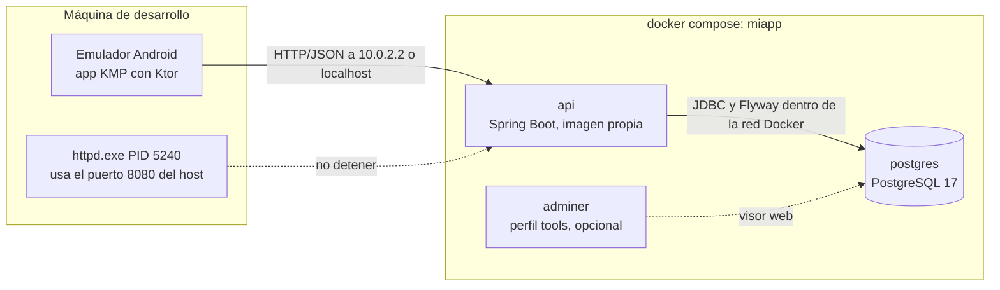

# Docker y Docker Compose — EduvIA

> Stack raíz definido en `docker-compose.yml` (`name: miapp`): PostgreSQL 17 + API Spring Boot + Adminer opcional.
> La app KMP **no** se conteneriza: se ejecuta en el emulador desde Android Studio. Vista general de la arquitectura en [`../GUIA-OPENCODE.md`](../GUIA-OPENCODE.md).

## Servicios



| Servicio | Imagen / build | Función | Estado |
|---|---|---|---|
| `postgres` | `postgres:17-alpine` | Base de datos; Flyway la aplica la API al arrancar, no el contenedor de BD | Siempre |
| `api` | `build: ./backend` (`backend/Dockerfile`) | API REST en `:8080`, Actuator y Swagger | Siempre; espera a `postgres` healthy |
| `adminer` | `image: adminer` | Visor web de PostgreSQL | Solo con `--profile tools` |

`backend/compose.yaml` es un compose **mínimo, solo PostgreSQL**, para `.\gradlew.bat bootRun` con la API en el host (Spring Boot lo detecta automáticamente). No es el stack de despliegue.

## Build multi-stage de la API

`backend/Dockerfile` compila con JDK 21 y ejecuta con JRE 21:

1. Etapa `build`: `eclipse-temurin:21-jdk`, `gradlew bootJar -x test`. Las pruebas no se ejecutan dentro de la imagen: Testcontainers necesita Docker, por eso corren en el host (`scripts/test-all.ps1`).
2. Etapa final: `eclipse-temurin:21-jre`, JAR copiado desde la etapa anterior, usuario no root `spring` (uid 1001), `curl` instalado únicamente para el healthcheck, puerto interno 8080.

`backend/.dockerignore` evita meter `build/`, `.gradle/` y artefactos locales en el contexto de build. `.gitattributes` mantiene los scripts con finales de línea LF (evita el error `/bin/sh^M` en Windows).

## Puertos y variables

| Variable | Valor por defecto | Uso |
|---|---|---|
| `DB_NAME` | `app` | Nombre de la BD de PostgreSQL |
| `DB_USER` | `app` | Usuario de BD (API y psql) |
| `DB_PASSWORD` | `app` | Contraseña de BD (solo local) |
| `DB_PORT` | `5432` | PostgreSQL publicado en el host |
| `API_PORT` | `8080` | API publicada en el host |
| `ADMINER_PORT` | `8081` | Adminer, solo con perfil `tools` |
| `SPRING_PROFILES_ACTIVE` | `dev` | `dev` carga la semilla; usar `prod` para no cargarla |
| `JWT_SECRET` | **obligatorio** | Compose falla si falta: `${JWT_SECRET:?Define JWT_SECRET en .env}`; al menos 32 caracteres |

La plantilla es `.env.example`; cópiala a `.env` (excluido por `.gitignore`) y ajusta los valores. La API recibe además `SPRING_DOCKER_COMPOSE_ENABLED=false`: así no se activa la detección automática de Compose de Spring Boot y la configuración explícita `DB_URL=jdbc:postgresql://postgres:5432/${DB_NAME:-app}` es la única fuente. Dentro de la red de Compose el host es `postgres`, no `localhost`.

## Healthchecks, volumen y perfiles

| Servicio | Healthcheck | Parámetros |
|---|---|---|
| `postgres` | `pg_isready -U <usuario> -d <bd>` | intervalo 5 s, timeout 3 s, 20 reintentos |
| `api` | `curl -fsS http://localhost:8080/actuator/health` | intervalo 10 s, timeout 3 s, `start_period` 40 s, 10 reintentos |

`api` usa `depends_on: postgres: condition: service_healthy`, y `--wait` espera a ambos healthchecks. El puerto del healthcheck de la API es el **interno** 8080.

El volumen con nombre `pgdata` guarda `/var/lib/postgresql/data`: `docker compose down` conserva los datos; `docker compose down -v` los borra (es lo que hace el stack de pruebas en su `finally`).

- Perfil **Spring `dev`**: `backend/src/main/resources/application-dev.yml` añade `classpath:db/dev-data` y carga `V1000__seed.sql` (nombre real; ver [H1](HALLAZGOS.md)).
- Perfil **Spring `test`**: `backend/src/test/resources/application-test.yml` carga solo `classpath:db/migration`; cada prueba crea sus datos.
- Perfil **Compose `tools`**: arranca Adminer con `docker compose --profile tools up -d`.

## Arranque, parada e inspección

```powershell
# Desde la raíz del repositorio
docker compose config -q
docker compose up -d --build --wait
docker compose ps
curl.exe -fsS http://localhost:8080/actuator/health
curl.exe -fsS http://localhost:8080/v3/api-docs
```

Swagger UI: `http://localhost:8080/swagger-ui.html`. Adminer: `http://localhost:8081` (servidor `postgres`, usuario/contraseña de `.env`) tras `docker compose --profile tools up -d`.

```powershell
docker compose logs -f api
docker compose logs postgres
docker compose restart api
docker compose up -d --build api
docker compose exec postgres psql -U app -d app
docker compose down
docker compose down -v --remove-orphans
```

## Desarrollo, stack aislado y pruebas manuales

| Situación | Proyecto Compose | Puertos publicados | Datos |
|---|---|---|---|
| Desarrollo habitual | `miapp` (nombre por defecto) | 8080 / 5432 / 8081 | `pgdata` propio con semilla `dev` |
| Suite automática (`scripts/test-all.ps1`) | `miapp-test`, impuesto con `-p` | 18080 / 15432 / 18081 | Volumen efímero; se destruye con `down -v` al terminar |
| Prueba manual en emulador (Fase 6) | `miapp-manual` | 18088 / 15435 / 18089 | Semilla `dev`; se destruyó al terminar |

Comandos reales de esos escenarios (detalle en [`pruebas.md`](pruebas.md) y [`backend/PROGRESS.md`](backend/PROGRESS.md)):

```powershell
docker compose -p miapp-test config -q
docker compose -p miapp-test up -d --build --wait
docker compose -p miapp-manual up -d --build --wait
docker compose -p miapp-manual logs api
docker compose -p miapp-test down -v --remove-orphans
```

**No detener `httpd.exe` (PID 5240)**: ocupa el puerto 8080 del host. Para no desplazarlo, las pruebas usan los puertos alternativos anteriores; en la prueba manual se usó además `adb reverse tcp:8080 tcp:18088` y una base URL Android temporal, revertida al terminar. La base URL definitiva de la app sigue siendo `http://10.0.2.2:8080/api/v1/` en Android y `http://localhost:8080/api/v1/` en iOS.

> ⚠️ Por confirmar: no hay una configuración de despliegue a producción documentada en las fuentes revisadas (secretos, perfil `prod`, TLS). Las decisiones provisionales están en [`backend/OPEN-QUESTIONS.md`](backend/OPEN-QUESTIONS.md).

Operación cotidiana y solución de problemas en [`operacion.md`](operacion.md); modelo de datos en [`base-de-datos.md`](base-de-datos.md).
