# Guía de desarrollo — EduvIA

> Receta para añadir un endpoint **de punta a punta**: contrato → base de datos → backend → app KMP → pruebas.
> El plan de trabajo original es [`../GUIA-OPENCODE.md`](../GUIA-OPENCODE.md); las decisiones ya acordadas están en [`backend/DECISIONS.md`](backend/DECISIONS.md). Los ejemplos concretos se basan en lo ya implementado (por ejemplo `PUT /meetings/{id}`, Fase 6 de [`backend/PROGRESS.md`](backend/PROGRESS.md)).

## Receta numerada

1. **Contrato primero.** Añade la operación en [`backend/api-contract.md`](backend/api-contract.md) y en [`backend/openapi.yaml`](backend/openapi.yaml), y una fila con su id en [`backend/test-plan.md`](backend/test-plan.md). Fijan ruta `/api/v1/...`, método, query, body, respuesta y errores. La app manda: si el modelo de dominio ya existe, se conserva la interfaz del repositorio y solo cambia la implementación remota.
2. **Migración Flyway.** Si hay columnas o tablas nuevas, crea un `Vn__nombre.sql` en `backend/src/main/resources/db/migration/`. Las migraciones existentes son `V1__init_schema.sql` (esquema e índices, con cabeceras `--`) y `V2__comments.sql` (solo `COMMENT ON`). **No edites una migración ya aplicada**: cambia su checksum. Para datos de ejemplo usa `backend/src/main/resources/db/dev-data/V1000__seed.sql` (nombre real; ver [H1](HALLAZGOS.md)), que solo se carga con el perfil `dev`. Hibernate valida (`ddl-auto: validate`), nunca crea el esquema.
3. **Entidad y repositorio en el backend.** Modela la tabla en `backend/src/main/kotlin/com/example/librerias/api/domain/Entities.kt` (claves compuestas en `CompositeIds.kt`) y añade el repositorio Spring Data en `backend/src/main/kotlin/com/example/librerias/api/repository/Repositories.kt`. ID `Long` ↔ `bigint generated by default as identity`; `parent_id` nullable ↔ `parentId = 0`; PK compuesta para idempotencia donde aplique.
4. **Servicio.** Implementa la regla de negocio y las transacciones en `backend/src/main/kotlin/com/example/librerias/api/service/<Recurso>Service.kt` (p. ej. `MeetingService.kt`). Los campos derivados se calculan aquí; los errores se traducen a `ProblemDetail` desde `backend/src/main/kotlin/com/example/librerias/api/web/GlobalExceptionHandler.kt`. Si el endpoint crea o borra un evento de calendario, hazlo en la misma transacción: tarea → mismo id; junta → `MEETING_ID_OFFSET + id` (1000).
5. **Controller y DTOs.** Añade el método en `backend/src/main/kotlin/com/example/librerias/api/web/<Recurso>Controller.kt`; request/response en `backend/src/main/kotlin/com/example/librerias/api/web/dto/Dtos.kt` y conversiones en `backend/src/main/kotlin/com/example/librerias/api/web/dto/Mappers.kt`. JSON en `camelCase`, fechas `YYYY-MM-DD`, nulos explícitos, paginación con `PageResponse<T>`; validación con anotaciones y errores RFC 9457. Las entidades nunca se exponen directamente.
6. **Pruebas del backend en rojo → verde.** Crea o amplía `backend/src/test/kotlin/com/example/librerias/api/<Recurso>IntegrationTest.kt` (son los archivos reales `AuthIntegrationTest.kt`, `GroupIntegrationTest.kt`, `TaskIntegrationTest.kt`, `MeetingIntegrationTest.kt`, `CalendarIntegrationTest.kt`). Usa `TestData.kt`, `IntegrationTestBase.kt` y Testcontainers con PostgreSQL real. Cubre caso feliz, validación 400, 404, 409 si aplica, paginación y N+1 en listados. Verifica con `.\gradlew.bat --no-daemon check` (incluye JaCoCo ≥ 80 %).
7. **DTOs, mapper y repositorio remoto en la app KMP.** Añade los DTOs `@Serializable` en `Librerias_eduvia/shared/src/commonMain/kotlin/com/example/librerias/data/remote/ApiDtos.kt`, las conversiones en `.../data/remote/Mappers.kt` y el método en `.../data/remote/Remote<Recurso>Repository.kt`, respetando la interfaz de `Librerias_eduvia/shared/src/commonMain/kotlin/com/example/librerias/domain/repository/`. Inyecta la implementación en `Librerias_eduvia/shared/src/commonMain/kotlin/com/example/librerias/di/AppContainer.kt`. Las bases URL por plataforma están en `.../androidMain/.../data/remote/PlatformHttpClient.kt` y `.../iosMain/.../data/remote/PlatformHttpClient.kt`. El refresh 401 y el parseo de `ProblemDetail` viven en `.../data/remote/ApiClient.kt`.
8. **Casos de uso.** Expón la operación en `Librerias_eduvia/shared/src/commonMain/kotlin/com/example/librerias/domain/usecase/<Recurso>UseCases.kt` (p. ej. `UpdateMeetingUseCase` en `MeetingUseCases.kt`) y añade su prueba en `Librerias_eduvia/shared/src/commonTest/kotlin/com/example/librerias/domain/usecase/`. No reescribas la lógica de la UI: el caso de uso devuelve el modelo de dominio que la pantalla ya entiende.
9. **ViewModel y navegación.** Conecta el caso de uso desde `Librerias_eduvia/shared/src/commonMain/kotlin/com/example/librerias/ui/<pantalla>/<Pantalla>ViewModel.kt` (p. ej. `ui/meetings/MeetingsViewModel.kt`, `ui/tasks/TasksViewModel.kt`) y, si el flujo lo exige, desde `Librerias_eduvia/shared/src/commonMain/kotlin/com/example/librerias/navigation/AppNavHost.kt`. Prueba estados de carga/error con el repositorio *fake* y `MockEngine`.
10. **Fixtures y contrato en la app.** Regenera los JSON con `cd backend` y `.\gradlew.bat --no-daemon test -PupdateContract=true`, y comprueba que `Librerias_eduvia/shared/src/androidHostTest/kotlin/com/example/librerias/contract/ContractFixturesFileTest.kt` los deserialice con `ignoreUnknownKeys = false`. Añade el fixture nuevo si la respuesta es nueva; actualiza DTOs y mappers en el mismo cambio. Detalle en [`pruebas.md`](pruebas.md).
11. **Verificación final.** Ejecuta desde la raíz `powershell -NoProfile -ExecutionPolicy Bypass -File scripts\test-all.ps1`. Registra el resultado en `backend/PROGRESS.md`, actualiza casillas de `backend/test-plan.md` y revisa `backend/compat-report.md`. El stack aislado usa `miapp-test` (18080/15432/18081); **no detengas `httpd.exe` (PID 5240)** que ocupa 8080. Detalles de contenedores en [`docker.md`](docker.md).

## Checklist

```mermaid
flowchart LR
    A["1. Contrato y fila en el plan"] --> B["2. Migración Flyway"]
    B --> C["3. Entidad y repositorio JPA"]
    C --> D["4. Servicio y transacción"]
    D --> E["5. Controller, DTOs y mapper"]
    E --> F["6. Test backend en verde"]
    F --> G["7. DTOs, mapper y repo remoto KMP"]
    G --> H["8. Casos de uso"]
    H --> I["9. ViewModel y navegación"]
    I --> J["10. Fixtures estrictos"]
    J --> K["11. test-all en verde"]
```

## Convenciones de equipo

- **Nombres:** tablas y columnas `snake_case` en plural; clases Kotlin en `PascalCase`; funciones y propiedades en `camelCase`; ids de escenario de pruebas `A1`, `G7`, `T3`, `M9`, `C2`.
- **Idioma:** KDoc y comentarios en español, al igual que los nombres de los tests entre comillas invertidas (p. ej. `junta duplicada devuelve 409`). Mensajes de error de usuario en español.
- **Diagramas:** solo Mermaid (`erDiagram` para tablas, `flowchart` para contenedores y flujos); etiquetas con caracteres especiales entre comillas. Bloques SQL, JSON o PowerShell van como código, nunca como arte ASCII.
- **Enlaces:** relativos entre documentos; las rutas de código se escriben completas desde la raíz del repositorio.
- **Regla central:** ningún cambio se da por terminado sin su prueba en verde; no se borran ni desactivan pruebas para que el build pase. Si una prueba falla, se corrige el código o se explica y corrige la prueba.
- **Documentar no es cambiar comportamiento:** en una tarea de documentación solo se escriben `.md`; los defectos se registran en [`HALLAZGOS.md`](HALLAZGOS.md) sin arreglarlos. Ejemplos: [H1](HALLAZGOS.md) (nombre real del seed), [H7](HALLAZGOS.md) (nombres reales frente a la plantilla), [H8](HALLAZGOS.md), [H9](HALLAZGOS.md), [H10](HALLAZGOS.md) y [H11](HALLAZGOS.md) (código confuso o duplicado que sigue igual).
- Las dudas que requieren decisión se anotan como `⚠️ Por confirmar` en [`backend/OPEN-QUESTIONS.md`](backend/OPEN-QUESTIONS.md), no se resuelven en silencio.

> ⚠️ Por confirmar: Q10 (botones «copiar»/«compartir»), Q11 (grupo `1` fijo en `HomeViewModel`), Q12 (repositorios *fake* convivientes) y Q13 (`spring.application.name` duplicado) siguen abiertos; ver [`backend/OPEN-QUESTIONS.md`](backend/OPEN-QUESTIONS.md). No se han modificado al escribir esta guía.
