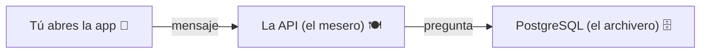

# Guías de EduvIA — explicado para estudiantes de secundaria 🎒

Estas guías no son para memorizar. Son para **entender de dónde sale cada botón de la app y qué pasa cuando lo presionas**.

Imagina que EduvIA es un restaurante escolar:

- La **app** es lo que ves y tocas.
- La **API** escucha los mensajes y decide qué hacer.
- La **base de datos** guarda los cuadernos, tareas y juntas para que no se pierdan al cerrar la app.

## Elige tu guía

| Si te preguntas… | Abre |
|---|---|
| ¿Cómo está hecha la app? ¿Qué es Kotlin Multiplatform? ¿Qué pasa cuando toco “Publicar junta”? | [La app Kotlin](./app-kotlin.md) |
| ¿Qué es una API? ¿Por qué hay un token? ¿Qué significan GET, POST, PUT y DELETE? | [La API REST](./api-rest.md) |
| ¿Dónde se guardan los datos? ¿Qué son tablas, claves y migraciones? | [La base de datos](./base-de-datos.md) |

## Consejo antes de empezar

Cuando veas una palabra rara, no te detengas: busca el apartado **“Palabras que suenan difíciles”** al final de cada guía. Casi siempre es un nombre técnico para algo que ya conoces.

Si quieres ver la versión “de adultos” con todos los detalles: está en [`docs/backend/`](../backend/).
