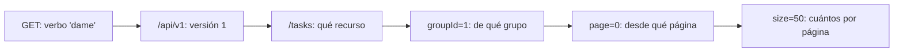
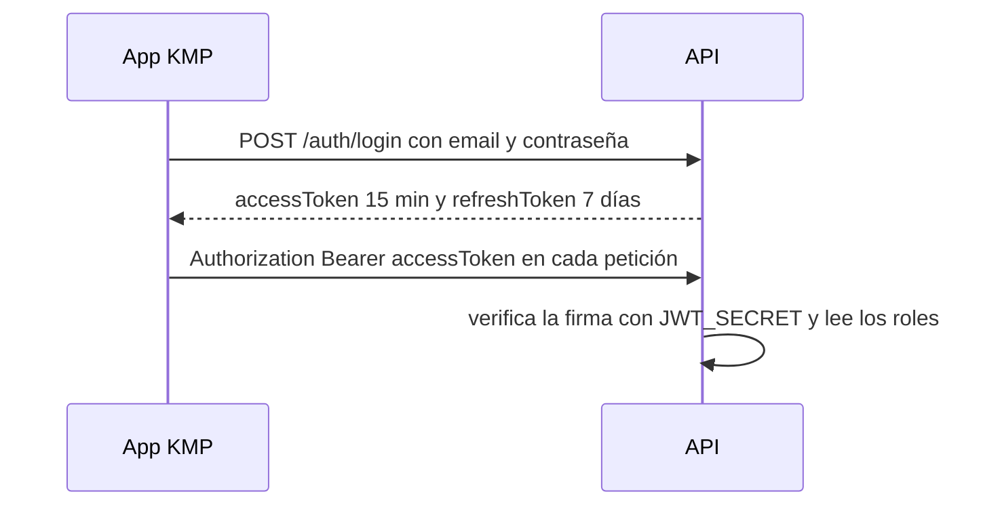

# Guía 2: La API REST de EduvIA 🍽️

## ¿Qué es una API?

Imagina que la app es un cliente en un restaurante y la API es el **mesero**.

- El cliente no entra a la cocina (no toca la base de datos directamente).
- El cliente le dice al mesero qué quiere: “trae las tareas del grupo 1”.
- El mesero va a la cocina, busca el plato y se lo lleva en bandeja.

Esa bandeja es una respuesta **JSON**: texto con forma de datos que los programas entienden.

En EduvIA la API vive en `backend/` y escucha en:

```text
http://localhost:8080/api/v1/...
```

`api/v1` significa “versión 1 de la API”. Si algún día cambiamos las reglas, podremos crear `v2` sin romper la app vieja.

## El mapa del código

Entrando a `backend/src/main/kotlin/com/example/librerias/api/`:

| Carpeta | Analogía | Qué hace |
|---|---|---|
| `web/` | El mesero que recibe pedidos | Controllers: `AuthController`, `GroupController`, `TaskController`, `MeetingController`, `CalendarController` |
| `web/dto/` | Las bandejas | `Dtos.kt` define lo que se envía y se recibe; `Mappers.kt` pasa entidades a bandeja |
| `service/` | La cocina | `AuthService`, `TaskService`, `MeetingService`… aplican las reglas y abren transacciones |
| `domain/` | Los ingredientes | Entidades JPA como `Meeting`, `SchoolTask`, enums como `Subject` |
| `repository/` | La despensa | Interfaces Spring Data JPA para buscar y guardar en PostgreSQL |
| `config/` | La seguridad de la entrada | `SecurityConfig` y `JwtConfig` deciden quién entra |

También está `GlobalExceptionHandler.kt`: cuando algo sale mal, convierte el error en una respuesta amable y con formato único.

## Cómo leer una dirección (URL)



Ojo con un detalle real: `GET /tasks` **siempre pide** `groupId`. Si lo olvidas, la petición falla (en la prueba manual vimos un 500) porque el parámetro es obligatorio. Ya quedó documentado en el contrato.

## Los cuatro verbos principales

| Verbo | Qué hace | Ejemplo de EduvIA |
|---|---|---|
| `GET` | Leer / mirar | `GET /meetings` → lista de juntas |
| `POST` | Crear algo nuevo | `POST /tasks` → publica una tarea |
| `PUT` | Reemplazar / editar algo | `PUT /meetings/3` → edita la junta 3 |
| `DELETE` | Borrar | `DELETE /tasks/7` → borra la tarea 7 |

Grupos de endpoints que existen de verdad:

- **Cuentas**: `POST /auth/register`, `/auth/login`, `/auth/refresh`, `/auth/logout`; `GET /me`; recuperación de contraseña con `/auth/reset-code` y `/auth/reset-password`.
- **Grupos y alumnos**: `GET /groups?teacherId=`, `/groups/by-code?code=`, `/groups/{id}/students`, `/students?parentId=`; `POST /groups`, `/students:link`.
- **Tareas**: `GET /tasks?groupId=`, `/tasks/{id}`; `POST /tasks`, `PUT /tasks/{id}`, `DELETE /tasks/{id}`, `POST /tasks/{id}/deliveries`.
- **Juntas**: `GET /meetings`, `/meetings/{id}`, `/meetings/{id}/attendance`, `/meetings/responses?studentId=`; `POST /meetings`, `PUT /meetings/{id}`, `DELETE /meetings/{id}`, respuestas y recordatorios.
- **Calendario**: `GET /calendar/events?role=TEACHER|PARENT`, `POST /calendar/events`, `DELETE /calendar/events/{id}`.

La lista completa y oficial está en [`openapi.yaml`](../backend/openapi.yaml). En la API en vivo puedes verla en `/swagger-ui.html` y `/v3/api-docs`.

## La pulsera del restaurante: JWT 🔑

Para entrar a las zonas privadas, la app muestra una “pulsera”: un **token JWT**.



- Los tokens `accessToken` son como un pase de corta duración.
- El `refreshToken` sirve para pedir otro pase sin volver a escribir la contraseña. Se guarda en la base de datos como hash (no en texto plano) y se puede revocar.
- Sin token → **401** con la cabecera `WWW-Authenticate: Bearer`.
- Con token pero sin permiso → **403**.

Pueden entrar sin token: `/auth/**`, `/actuator/health` y Swagger. Lo demás está protegido.

## Cuando algo sale mal: ProblemDetail ⚠️

La API no responde con texto suelto. Usa un formato llamado **ProblemDetail** (RFC 9457):

```json
{
  "type": "about:blank",
  "title": "Bad Request",
  "status": 400,
  "detail": "Datos no válidos",
  "errors": [
    { "field": "title", "message": "Requerido" }
  ]
}
```

Códigos que verás mucho:

| Código | Significado en EduvIA |
|---|---|
| 400 | Un dato está mal (fecha, título vacío, correo raro) |
| 401 | Falta el token o ya venció |
| 403 | El token sirve, pero ese usuario no puede hacer eso |
| 404 | No existe esa tarea, junta o grupo |
| 409 | Conflicto: correo repetido o junta duplicada en fecha+hora+lugar |

## Reglas de oro de esta API

1. **Paginación**: las listas devuelven `PageResponse`: `{ items, page, size, totalElements, totalPages }`. La página empieza en 0 y el `size` máximo es 100.
2. **Fechas**: `dateText` viaja como `YYYY-MM-DD` (`2026-12-05`). Los formularios de la app muestran `DD/MM/AAAA` y convierten antes de enviar.
3. **Nombres en inglés, contenido en español**: los campos van en camelCase (`dueDate`, `groupId`) y los mensajes de error en español.
4. **Una tarea crea su evento**: `POST /tasks` también crea un `calendar_events` con el **mismo id** que la tarea.
5. **Una junta crea su evento con id `1000 + meetings.id`**: junta 3 → evento 1003. Editar la junta actualiza ese mismo evento; borrarla lo borra.
6. **No hay dos juntas iguales** en el mismo grupo, fecha, hora y lugar (comparando sin importar mayúsculas). Por eso se añadió `PUT /meetings/{id}`: al editar, la propia junta no cuenta como duplicado.
7. **Entregas idempotentes**: marcar la misma tarea como entregada dos veces no crea dos filas.
8. **Registro atómico**: crear usuario + grupos ocurre en una sola transacción. Si falla el código de clase, no queda usuario a medias.

## Cómo probarla con tus propias manos 🧑‍💻

Desde la raíz del proyecto, con Docker corriendo:

```powershell
docker compose -p miapp up -d --build --wait
curl.exe -fsS http://localhost:8080/actuator/health
```

Devuelve algo como:

```json
{"groups":["liveness","readiness"],"status":"UP"}
```

Para entrar con la cuenta de ejemplo:

```powershell
$body = @{ email='laura@eduvia.mx'; password='Maestra123' } | ConvertTo-Json -Compress
$r = Invoke-RestMethod -Method Post -Uri 'http://localhost:8080/api/v1/auth/login' -ContentType 'application/json' -Body $body
"Mi token: $($r.accessToken.Substring(0,20))..."
```

Y para pedir tareas con ese token:

```powershell
$tareas = Invoke-RestMethod -Uri 'http://localhost:8080/api/v1/tasks?groupId=1' -Headers @{ Authorization = "Bearer $($r.accessToken)" }
$tareas.items | Select-Object id, title, dueDate
```

Datos semilla que puedes usar:

| Usuario | Contraseña | Rol |
|---|---|---|
| `laura@eduvia.mx` | `Maestra123` | TEACHER |
| `maria@correo.com` | `Padre1234` | PARENT |

Cuando termines:

```powershell
docker compose -p miapp down -v --remove-orphans
```

## Cómo se prueba automáticamente

Desde `backend/`:

```powershell
.\gradlew.bat --no-daemon check
```

Eso corre pruebas con PostgreSQL real (Testcontainers), valida el contrato y exige al menos 80 % de cobertura. Actualmente: **38 pruebas, 0 fallos**.

Con el stack levantado, además:

```powershell
$env:E2E_BASE_URL = 'http://localhost:8080'
.\gradlew.bat --no-daemon e2eTest
```

## Palabras que suenan difíciles

| Palabra | En pocas palabras |
|---|---|
| **REST** | Una forma de organizar mensajes por Internet usando URLs y verbos. |
| **Controller** | El mesero que recibe la petición y llama al cocinero. |
| **Service** | El cocinero: aplica reglas y maneja transacciones. |
| **DTO** | La bandeja con los datos que se envían o se devuelven. |
| **JWT** | Un pase firmado que dice quién eres y qué rol tienes. |
| **Transacción** | Un “todo o nada”: o se guarda todo, o no se guarda nada. |
| **Idempotente** | Hacerlo dos veces deja el mismo resultado que hacerlo una. |
| **Cobertura** | Qué tanto del código fue ejecutado por las pruebas. |

## Mini retos para practicar

1. Entra a `/swagger-ui.html` y prueba `GET /meetings`. Luego cambia `size` a 1 y observa la paginación.
2. Pide `GET /tasks` sin `groupId` y lee el error. Ahora entiende por qué ese parámetro es obligatorio.
3. Busca en `MeetingService.kt` la función `update` y explica por qué usa `excludeId = id`.

Si quieres ver cómo el mensaje viaja hasta la app, sigue con [la guía de la app Kotlin](./app-kotlin.md). Si quieres ver dónde se guarda todo, abre [la guía de la base de datos](./base-de-datos.md).
