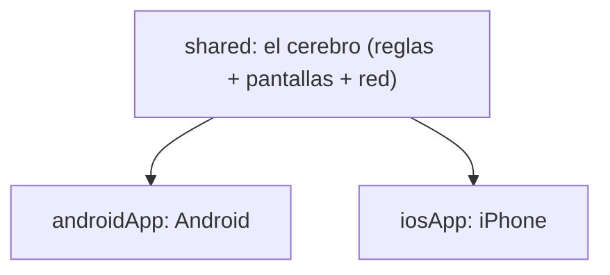

# Guía 1: La app de Kotlin de EduvIA 📱

## ¿Qué es esta app?

EduvIA es una app para que un **maestro** publique tareas y juntas, y para que un **padre o tutor** vea las tareas de sus hijos y responda si irá a una junta.

Todo lo que ves (botones, listas, calendario, formularios) está escrito en **Kotlin** usando **Compose** para dibujar la pantalla.

## La idea magia: “un cerebro, dos cuerpos” 🧠

La app se llama *Kotlin Multiplatform* (KMP). En corto:



El cerebro vive en `shared/`. Las partes de cada teléfono solo ponen el motor de internet y la ventana donde se muestra la app.

En el proyecto real:

| Parte | Qué es |
|---|---|
| `Librerias_eduvia/shared/` | El cerebro compartido. Lo usa Android y iOS. |
| `Librerias_eduvia/androidApp/` | La “casa” de Android. |
| `Librerias_eduvia/iosApp/` | La “casa” de iOS (Xcode). |

Dentro de `shared/src/` hay carpetas con nombres especiales:

| Carpeta | Para qué sirve |
|---|---|
| `commonMain` | Código que vale para **los dos** teléfonos. Aquí está casi todo. |
| `androidMain` | Lo que solo Android necesita (motor OkHttp y la dirección del servidor). |
| `iosMain` | Lo que solo iPhone necesita (motor Darwin). |
| `commonTest` | Pruebas que se ejecutan en ambos. |
| `androidHostTest` | Pruebas que leen respuestas reales guardadas del backend. |

## El mapa del cerebro (`commonMain`)

Entra a `shared/src/commonMain/kotlin/com/example/librerias/`. Verás estas carpetas:

| Carpeta | Analogía | Qué contiene |
|---|---|---|
| `model/` | Los **nombres de las cosas** | `User`, `SchoolTask`, `Meeting`, `CalendarEvent`, `AppResult` |
| `domain/usecase/` | Las **reglas del juego** | `CreateMeetingUseCase`, `UpdateMeetingUseCase`, `LoginUseCase`… |
| `domain/repository/` | Un **contrato** | Dice “quiero guardar una junta”, sin decir cómo |
| `data/remote/` | El **mensajero** | `ApiClient`, DTOs, `SessionStore`, repositorios que hablan con Ktor |
| `data/repository/` | Versiones antiguas con datos de ejemplo | Ya no son las que usa la app principal |
| `di/AppContainer.kt` | El **taller de armado** | Crea y conecta todas las piezas |
| `ui/` | Los **carteles y botones** | Pantallas Compose y ViewModels |
| `navigation/AppNavHost.kt` | El **guardia de tránsito** | Decide qué pantalla se ve según la pestaña y la sesión |

## ¿Qué es un ViewModel? 🧾

Imagina que la pantalla es una pizarra y el ViewModel es el ayudante que recuerda qué está escrito.

- La pantalla **dice**: “El usuario tocó Guardar”.
- El ViewModel **piensa**: “Voy a llamar al caso de uso correcto”.
- El ViewModel **avisa**: “Ya cambió la lista, vuelve a dibujarte”.

Ese “aviso” se llama `StateFlow`. Es como un cartel que se actualiza solo: cuando cambia la lista de juntas, la pantalla se redibuja sin que nadie le diga “actualízate”.

Ejemplos reales: `MeetingsViewModel`, `TasksViewModel`, `HomeViewModel`, `LoginViewModel`.

## Un viaje completo: publicar una junta 🚀

Vamos a seguir un dedo tocando **“Publicar junta”**:

1. **Pantalla** (`ui/meetings/CreateMeetingScreen.kt`): el usuario escribe título, fecha, hora y lugar.
2. **ViewModel** (`MeetingsViewModel.createMeeting`): recibe los datos en `NewMeetingInput`.
3. **Caso de uso** (`CreateMeetingUseCase`): revisa las reglas:
   - ¿El título está vacío?
   - ¿La fecha es anterior a hoy?
   - ¿La hora es válida, tipo `8:00 am`?
   - ¿Ya existe otra junta igual en ese grupo?
4. **Repositorio** (`RemoteMeetingRepository.addMeeting`): convierte la junta en JSON y llama a `api.post("meetings", ...)`.
5. **`ApiClient`**: pone el token `Bearer` en la cabecera, envía el mensaje por Ktor y, si la respuesta es 401, intenta refreshear el token y repetir.
6. **API** (la otra guía): guarda la junta y su evento en el calendario.
7. **De vuelta**: el repositorio actualiza la caché (`RemoteListStore`) y el `StateFlow` hace que la pantalla muestre la junta nueva.

Si estás editando, el paso 3 usa `UpdateMeetingUseCase` y el paso 4 llama a `PUT /meetings/{id}` en vez de `POST`. Por eso se conserva el id y no aparece el error de “junta duplicada”.

## Las reglas viven en `domain/usecase`

La app no deja que la pantalla decida todo. Las reglas están separadas para que se puedan probar sin teléfono.

Ejemplo de regla real:

> Si editas una junta y cambias solo el título, no se debe tratar como una junta nueva.

Por eso `UpdateMeetingUseCase` excluye la propia junta (`existing.id != original.id`) al buscar duplicados.

Otra regla real: los eventos de junta en el calendario usan el número `1000 + meetings.id`. Está en `MEETING_ID_OFFSET`. Así una junta con id 3 aparece como evento 1003 y no choca con una tarea con id 3.

## ¿Cómo habla con internet? 🌐

Usa **Ktor 3.2.1** (una librería para hacer peticiones HTTP).

| Plataforma | Motor | Dirección del servidor |
|---|---|---|
| Android | OkHttp | `http://10.0.2.2:8080/api/v1/` |
| iOS | Darwin | `http://localhost:8080/api/v1/` |

`10.0.2.2` es la forma que tiene el emulador Android de decir “mi computadora”.

El token de sesión se guarda en memoria (`SessionStore`): si cierras la app, hay que entrar de nuevo. Eso es una decisión consciente, no un olvido.

Las fechas viajan al servidor en formato `YYYY-MM-DD` (por ejemplo `2026-12-05`), aunque los formularios muestren `DD/MM/AAAA` (`05/12/2026`).

## Pruebas sin necesidad de servidor 🧪

En `commonTest` hay un “servidor falso” con `MockEngine`. Es como ensayar una obra de teatro: la app cree que habla con internet, pero las respuestas son JSON guardado.

Archivos que vale la pena mirar:

- `data/remote/ApiClientTest.kt` — comprueba token, refresh y errores.
- `data/remote/RemoteRepositoriesTest.kt` — comprueba que el `PUT` de juntas se envía bien.
- `domain/usecase/UpdateMeetingUseCaseTest.kt` — comprueba la regla del título sin duplicados.
- `androidHostTest/contract/ContractFixturesFileTest.kt` — lee respuestas reales del backend con `ignoreUnknownKeys=false` (si el backend cambia un campo, la prueba avisa).

Comandos que se usan en Windows (desde `Librerias_eduvia`):

```powershell
.\gradlew.bat --no-daemon :shared:testAndroid
.\gradlew.bat --no-daemon :androidApp:installDebug
```

Resultado actual: **19 pruebas, 0 fallos**.

## Palabras que suenan difíciles

| Palabra | Dicho fácil |
|---|---|
| **Compose** | La herramienta para dibujar botones y textos con Kotlin. |
| **DTO** | Un “sobre” con los datos exactos que se envían al servidor. |
| **Flow / StateFlow** | Una pizarra que avisa cuando cambia. |
| **Caso de uso** | Una regla de negocio con nombre propio. |
| **Repositorio** | El que sabe buscar y guardar, sin importar si es internet o memoria. |
| **Ktor** | El mensajero que lleva y trae los mensajes HTTP. |
| **DI / AppContainer** | El taller que arma las piezas y las entrega ya conectadas. |

## Mini retos para practicar

1. Cambia el texto del botón “Guardar cambios” en `CreateMeetingScreen.kt` y vuelve a instalar la app.
2. Añade una regla nueva en `UpdateMeetingUseCase`: que el lugar no pueda tener menos de 3 letras. Escribe primero una prueba en `UpdateMeetingUseCaseTest.kt`.
3. Busca `MEETING_ID_OFFSET` y explica con tus palabras por qué existe.

## Si algo falla

- ¿La app no conecta? Mira la base URL en `androidMain/.../PlatformHttpClient.kt` y que el servidor esté levantado.
- ¿Ktor da error al compilar el APK? La versión correcta es **3.2.1** (la 3.2.0 rompía D8).
- ¿Una lista no se actualiza? Revisa si el repositorio llamó a `refreshEvents()` o actualizó la caché.

Para más detalle técnico, lee el [contrato de API](../backend/api-contract.md) y el [informe de compatibilidad](../backend/compat-report.md).
