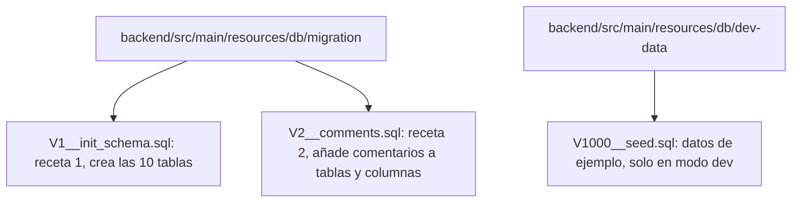
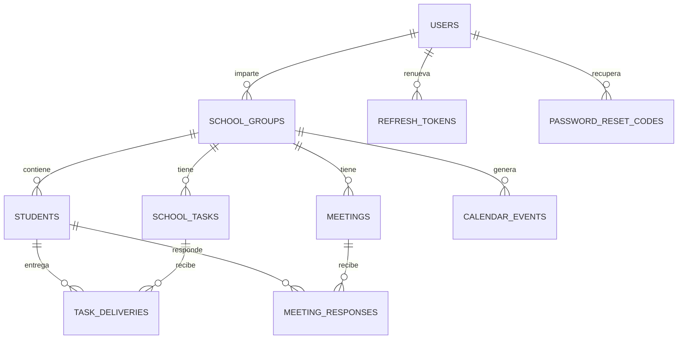

# Guía 3: La base de datos de EduvIA 🗄️

## ¿Qué es una base de datos?

Imagina una biblioteca enorme.

- Cada **tabla** es un cajón con fichas de un mismo tipo.
- Cada **fila** es una ficha (una persona, una tarea, una junta).
- Cada **columna** es un dato de la ficha (nombre, correo, fecha).
- El **id** es el número de ficha, para no confundir dos que se llaman igual.

EduvIA usa **PostgreSQL 17**. Es como un archivero muy ordenado que nunca olvida nada cuando cerramos la app.

## ¿Quién manda a construir los cajones? Flyway 📐

Los cajones no se crean a mano. Se crean con recetas numeradas:



Flyway es el constructor que lee las recetas en orden y las aplica una sola vez. Por eso **no se edita una receta que ya se aplicó**: si quieres cambiar algo, se escribe una receta nueva (`V2__...`).

El archivo `V1000__seed.sql` mete datos de prueba: Laura, María, 3 grupos, 30 alumnos, 6 tareas y 2 juntas. Solo se carga con el perfil `dev`, no en producción.

La app usa `ddl-auto: validate`: Spring revisa que el código coincida con la base; si no coincide, arranca con error. Es como decir “no inventes tablas nuevas, yo ya tengo las recetas”.

## El mapa de los 10 cajones

| Tabla | Qué guarda | Columnas y relaciones importantes |
|---|---|---|
| `users` | Maestros y padres | `id`, `full_name`, `email` y `phone` únicos, `role` (`TEACHER` o `PARENT`), `password_hash` |
| `refresh_tokens` | Pases para renovar sesión | `user_id` → `users.id`, `token_hash`, `expires_at`, `revoked_at` |
| `password_reset_codes` | Códigos de 6 dígitos para recuperar contraseña | `user_id` → `users.id`, `code`, `expires_at`, `attempts_left` (empieza en 5) |
| `school_groups` | Grupos escolares | `teacher_id` → `users.id`, `code` tipo `3B-7K2P` (único), `student_count` |
| `students` | Alumnos | `group_id` → `school_groups.id`, `parent_id` → `users.id` (puede ser nulo) |
| `school_tasks` | Tareas | `group_id`, `title`, `subject`, `due_date`, `published_date`, `teacher_name` |
| `task_deliveries` | Quién entregó cada tarea | PK doble (`task_id`, `student_id`); ambas son foreign keys |
| `meetings` | Juntas de padres | `group_id`, `date`, `time`, `location`, `virtual_link`, `reminder_enabled` |
| `meeting_responses` | Si cada familia va a la junta | PK doble (`meeting_id`, `student_id`); `response` es `PENDING`, `ATTENDING` o `DECLINED` |
| `calendar_events` | Lo que se ve en el calendario | `id`, `group_id`, `date`, `type` (`TASK`, `MEETING` o `EXAM`), `title`, `subtitle` |

El número exacto de tablas y columnas está en [`V1__init_schema.sql`](../../backend/src/main/resources/db/migration/V1__init_schema.sql).

## Cómo se conectan las fichas 🔗



El símbolo `o{` se lee “muchos”. Un maestro tiene **muchos** grupos; un grupo tiene **muchos** alumnos.

Tres detalles importantes:

1. **`on delete cascade`**: si borras un grupo, también se borran sus alumnos, tareas y juntas. Es como tirar una carpeta: se va todo lo que había dentro.
2. **`on delete restrict`**: si un maestro tiene grupos, no puedes borrar al maestro así nada más. Primero hay que arreglar sus grupos.
3. **Clave primaria doble**: en `task_deliveries` y `meeting_responses` se usa la pareja de ids. Así un alumno no puede entregar dos veces la misma tarea ni responder dos veces la misma junta. Eso es lo *idempotente* de la guía de la API.

## Reglas que la base de datos hace cumplir ✅

La base no solo guarda: también dice “eso no se puede”.

| Regla | Cómo se llama en SQL | Dónde está |
|---|---|---|
| El correo no se repite | `unique (email)` | `users` |
| El teléfono no se repite | `unique (phone)` | `users` |
| El rol solo es `PARENT` o `TEACHER` | `check (role in (...))` | `users` |
| El código de grupo es `XX-YYYY` | `check (code ~ '^[A-Z0-9]{2}-[A-Z0-9]{4}$')` | `school_groups` |
| El código de recuperación tiene 6 dígitos | `check (code ~ '^[0-9]{6}$')` | `password_reset_codes` |
| No hay dos juntas iguales (sin importar mayúsculas) | `unique index ... (group_id, date, lower(time), lower(location))` | `meetings` |
| Un evento solo puede ser TASK, MEETING o EXAM | `check (type in (...))` | `calendar_events` |

## El truco del id de calendario 🎩

Cuando creas una tarea, se guarda una fila en `school_tasks` y otra en `calendar_events` con **el mismo id**.

Cuando creas una junta, se guarda en `meetings` y su evento usa:

```text
id_del_evento = 1000 + id_de_la_junta
```

Ejemplo real de la fase manual:

```text
meetings.id = 4   →   calendar_events.id = 1004
```

¿Por qué? Porque en la app antigua los ids de tareas y juntas se solapaban (había una tarea 3 y una junta 3). Sumando 1000, el calendario puede distinguirlos sin confusión. Al editar la junta se actualiza ese mismo evento; al borrarla, se borra el evento.

## Vamos a verlo con nuestros ojos 👀

Con el stack levantado:

```powershell
docker compose -p miapp up -d --build --wait
```

Entra a la base con `psql` (el lector de texto de PostgreSQL):

```powershell
docker compose -p miapp exec postgres psql -U app -d app -c "\dt"
```

Eso lista las 10 tablas. Ahora mira fichas reales:

```powershell
docker compose -p miapp exec postgres psql -U app -d app -c "select id, full_name, email, role from users;"
docker compose -p miapp exec postgres psql -U app -d app -c "select id, title, due_date from school_tasks order by due_date;"
docker compose -p miapp exec postgres psql -U app -d app -c "select id, title, date from meetings;"
```

También puedes usar **Adminer**, una página para ver la base con botones:

```powershell
docker compose -p miapp --profile tools up -d adminer
```

Abre `http://localhost:8081`, servidor `postgres`, usuario y contraseña los de `.env` (por defecto `app` / `app`), base `app`.

Cuando termines:

```powershell
docker compose -p miapp down -v --remove-orphans
```

> Ojo: `down -v` borra el volumen de la base. En desarrollo está bien; en la vida real no se hace sin copia de seguridad.

## Mini reto para practicar 🧪

1. Levanta el stack y cuenta los alumnos: `select count(*) from students;`.
2. Busca el grupo de Laura con `select id, name, code from school_groups where teacher_id = 1;`.
3. Crea una tarea desde la app o la API y vuelve a correr el `select` de `school_tasks`. Verás una fila nueva.
4. Mira `calendar_events`: aparecerá un evento con el mismo id de la tarea.

Si te sale un error de “relation does not exist”, revisa el nombre: es `school_tasks`, no `tasks`. Es de los fallos más comunes.

## Palabras que suenan difíciles

| Palabra | En pocas palabras |
|---|---|
| **Tabla** | Un cajón de fichas del mismo tipo. |
| **Fila** | Una ficha. |
| **Columna** | Un dato de la ficha. |
| **PK (clave primaria)** | El número único de la ficha. |
| **FK (clave foránea)** | Un número que apunta a otra ficha. |
| **CHECK / UNIQUE** | Reglas que la base hace cumplir. |
| **Migración** | Una receta numerada para crear o cambiar tablas. |
| **Seed** | Datos de ejemplo para practicar. |
| **Transacción** | Varios cambios que se guardan juntos o no se guardan. |
| **Volumen** | El disco donde se guarda la base dentro de Docker. |

Para ver el diseño completo, abre [`data-model.md`](../backend/data-model.md) y [`DECISIONS.md`](../backend/DECISIONS.md). Para volver al camino de los mensajes, lee [la guía de la API](./api-rest.md).
