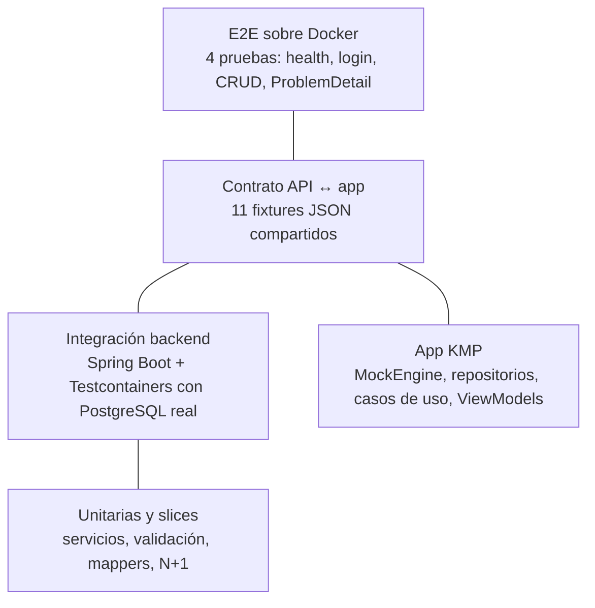
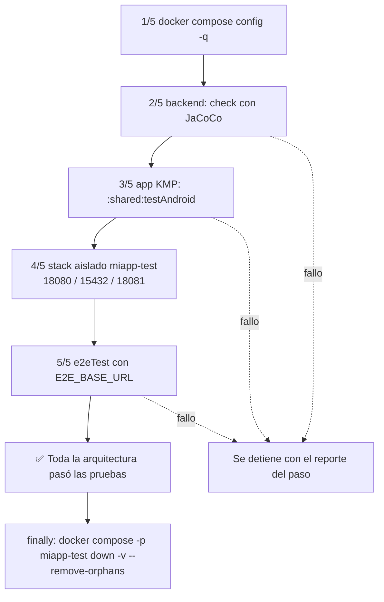

# Pruebas — EduvIA

> Pirámide verificada: 38 tests del backend, 19 de la app KMP, 4 E2E, JaCoCo 86,2 % de instrucciones y `/actuator/health` UP (evidencia final en [`backend/PROGRESS.md`](backend/PROGRESS.md), Fase 7).
> Plan original, con un id por escenario: [`backend/test-plan.md`](backend/test-plan.md). Contratos: [`backend/api-contract.md`](backend/api-contract.md) y [`backend/openapi.yaml`](backend/openapi.yaml).

## Pirámide



No se usa H2: Testcontainers levanta **PostgreSQL real** para que Flyway, el SQL y las restricciones se ejecuten de verdad; es la razón de esta capa, no una costumbre. `IntegrationTestBase.kt` reinicia la base entre pruebas, así que cada test parte de un estado conocido y `TestData.kt` aporta los datos mínimos necesarios.

## Suites y qué cubren

| Capa | Archivo | Cobertura principal |
|---|---|---|
| Arranque | `backend/src/test/kotlin/com/example/librerias/api/ApiApplicationTests.kt` | Contexto Spring con `ddl-auto: validate` (entidades ↔ Flyway) |
| Auth | `backend/src/test/kotlin/com/example/librerias/api/AuthIntegrationTest.kt` | Registro, login, refresh con rotación, logout, `/me`, exists, recuperación |
| Grupos | `backend/src/test/kotlin/com/example/librerias/api/GroupIntegrationTest.kt` | Listado paginado, búsqueda por código, alta de grupos y alumnos, `studentCount` |
| Tareas | `backend/src/test/kotlin/com/example/librerias/api/TaskIntegrationTest.kt` | CRUD, entregas idempotentes, evento de calendario con el mismo id, validación |
| Juntas | `backend/src/test/kotlin/com/example/librerias/api/MeetingIntegrationTest.kt` | CRUD, duplicados 409, asistencia, respuestas, recordatorios, `PUT /meetings/{id}` con evento `1000 + id` |
| Calendario | `backend/src/test/kotlin/com/example/librerias/api/CalendarIntegrationTest.kt` | Eventos por rol, creación y borrado, `attendance` derivado |
| Soporte backend | `backend/src/test/kotlin/com/example/librerias/api/IntegrationTestBase.kt`, `TestcontainersConfiguration.kt`, `TestData.kt` | BD efímero, limpieza entre pruebas, datos únicos por test |
| Contrato en la app | `Librerias_eduvia/shared/src/androidHostTest/kotlin/com/example/librerias/contract/ContractFixturesFileTest.kt` | Deserializa los 11 fixtures con `ignoreUnknownKeys = false` |
| Cliente Ktor | `Librerias_eduvia/shared/src/commonTest/kotlin/com/example/librerias/data/remote/ApiClientTest.kt` | Ruta/query/token, refresco en 401, `ProblemDetail`, respuestas 204 |
| Repositorios KMP | `Librerias_eduvia/shared/src/commonTest/kotlin/com/example/librerias/data/remote/RemoteRepositoriesTest.kt` | Mapeo DTO → dominio y bodies exactos del contrato |
| Casos de uso | `Librerias_eduvia/shared/src/commonTest/kotlin/com/example/librerias/domain/usecase/UpdateMeetingUseCaseTest.kt` | Creación/edición de juntas y evento con `MEETING_ID_OFFSET` |
| Lógica compartida | `Librerias_eduvia/shared/src/commonTest/kotlin/com/example/librerias/SharedCommonTest.kt`, `Librerias_eduvia/shared/src/androidHostTest/kotlin/com/example/librerias/SharedLogicAndroidHostTest.kt` | Modelos y reglas de dominio de la app |
| E2E (aislada) | `backend/src/test/kotlin/com/example/librerias/api/E2eIntegrationTest.kt` | `@Tag("e2e")`: health, login + `/me`, CRUD de grupo/tarea persistente, 404 `ProblemDetail` |

Los fixtures se generan/comparan desde las pruebas del backend usando `contract.fixtures.dir` y `contract.update`, propiedades declaradas en `backend/build.gradle.kts`.

## Contrato compartido: fixtures

Los 11 archivos de `contract/fixtures/` son respuestas reales de la API, versionadas y consumidas por ambas capas:

| Fixture | Respuesta que fija |
|---|---|
| `login-response.json`, `register-response.json` | Tokens, usuario, grupos creados |
| `groups-page.json`, `students-page.json` | `PageResponse<T>` con `items`, `page`, `size`, `totalElements`, `totalPages` |
| `tasks-page.json`, `task-detail.json` | Fechas `YYYY-MM-DD`, `deliveredStudentIds`, campos derivados |
| `meetings-page.json`, `meeting-detail.json`, `attendance-page.json` | `isNext`, `relativeLabel`, nulos explícitos, familias |
| `calendar-page.json` | Eventos `TASK`/`MEETING` (id `1000 + meeting.id`) y `attendance` |
| `problem-validation.json` | `application/problem+json` con `status`, `detail`, `instance`, `errors` |

`ContractFixturesFileTest.kt` usa `Json { ignoreUnknownKeys = false }`: si el backend añade o renombra un campo, la prueba **falla** en lugar de descartarlo silenciosamente. Así se detecta un cambio de forma del contrato antes de que llegue al emulador. Cambiar la forma a propósito exige regenerar los fixtures y adaptar los DTOs de la app en el mismo cambio:

```powershell
cd backend
.\gradlew.bat --no-daemon test -PupdateContract=true
```

## Comandos reales en Windows

```powershell
# Todo en una sola orden, desde la raíz del repositorio
powershell -NoProfile -ExecutionPolicy Bypass -File scripts\test-all.ps1

# Backend: pruebas + verificación de contrato + JaCoCo
cd backend
.\gradlew.bat --no-daemon check

# App KMP (no necesita emulador) y comprobación del APK
cd ..\Librerias_eduvia
.\gradlew.bat --no-daemon :shared:testAndroid
.\gradlew.bat --no-daemon :androidApp:assembleDebug
```

`scripts/test-all.ps1` ejecuta 5 pasos y limpia siempre en `finally`:



La tarea `test` del backend **excluye** la etiqueta `e2e`; `e2eTest` la incluye y usa `e2e.baseUrl` desde `E2E_BASE_URL`. Para ejecutar E2E a mano contra un stack propio:

```powershell
cd backend
$env:E2E_BASE_URL = 'http://localhost:18080'
.\gradlew.bat --no-daemon e2eTest
```

## Resultados reales registrados

| Verificación | Resultado |
|---|---|
| `scripts\test-all.ps1` desde cero | `✅ Toda la arquitectura pasó las pruebas`; limpieza `down -v` ejecutada |
| Backend (`check`) | 38 tests, 0 failures, 0 skipped |
| App KMP (`:shared:testAndroid`) | 19 tests, 0 failures, 0 skipped |
| E2E (`e2eTest`) | 4 pruebas, 0 failures |
| JaCoCo | 86,2 % instrucciones (5595/6488); umbral ≥ 80 % superado |
| Salud del stack | `{"groups":["liveness","readiness"],"status":"UP"}` |
| Contrato runtime vs. diseño | `missing=[]`, `extra=[]`; ver [`backend/compat-report.md`](backend/compat-report.md) |

> Hallazgo [H5](HALLAZGOS.md): [`backend/test-plan.md`](backend/test-plan.md) conserva casillas `[ ]` en escenarios como A1-dup, G7-dup o T-n1 aunque la suite está en verde. No se han marcado ni desmarcado en esta tarea de documentación: la distinción entre «no automatizado» y «casilla no actualizada» sigue pendiente.

## Cómo añadir una prueba

1. Escribe primero la prueba **roja** que reproduce el comportamiento deseado; no desactives pruebas ni bajes umbrales para pasar.
2. Si es backend, añade el caso al `*IntegrationTest.kt` correspondiente y crea sus datos con `TestData.kt`. La BD se reinicia entre pruebas.
3. Si cambia la forma de una respuesta, regenera el fixture con `-PupdateContract=true` y comprueba `ContractFixturesFileTest.kt` en la app; actualiza DTOs/mappers si hace falta.
4. Si es E2E, usa `@Tag("e2e")` en `E2eIntegrationTest.kt` y verifica que pase contra `miapp-test`, no contra el stack de desarrollo.
5. Ejecuta el paso correspondiente y, antes de darlo por terminado, `scripts\test-all.ps1` completo; anota el resultado en `backend/PROGRESS.md` y las casillas que procedan en `backend/test-plan.md`.

La receta completa de punta a punta está en [`guia-de-desarrollo.md`](guia-de-desarrollo.md); los comandos de contenedores en [`docker.md`](docker.md).
